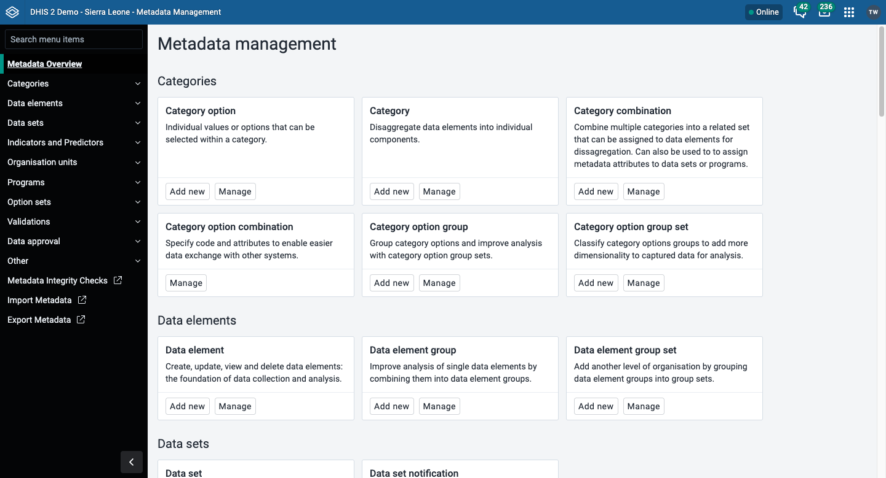
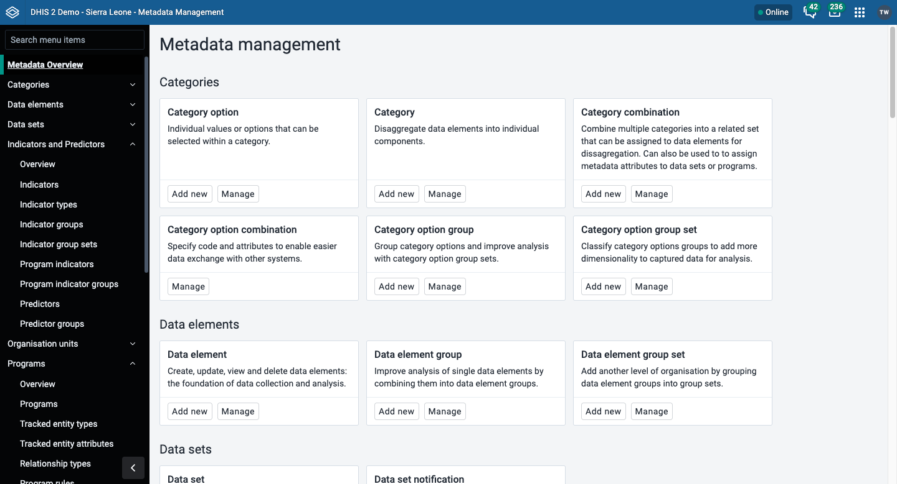
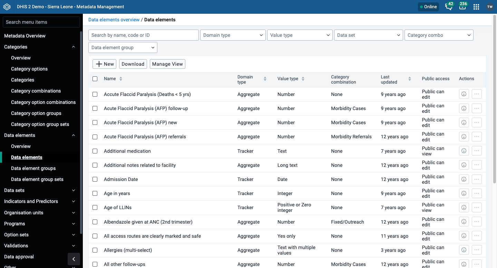
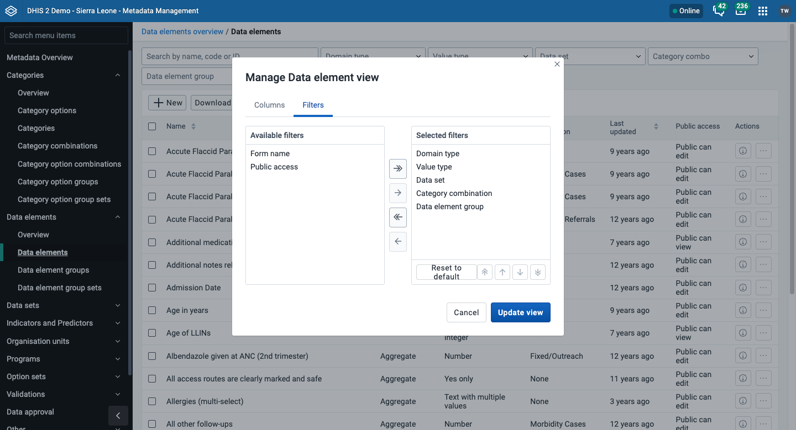
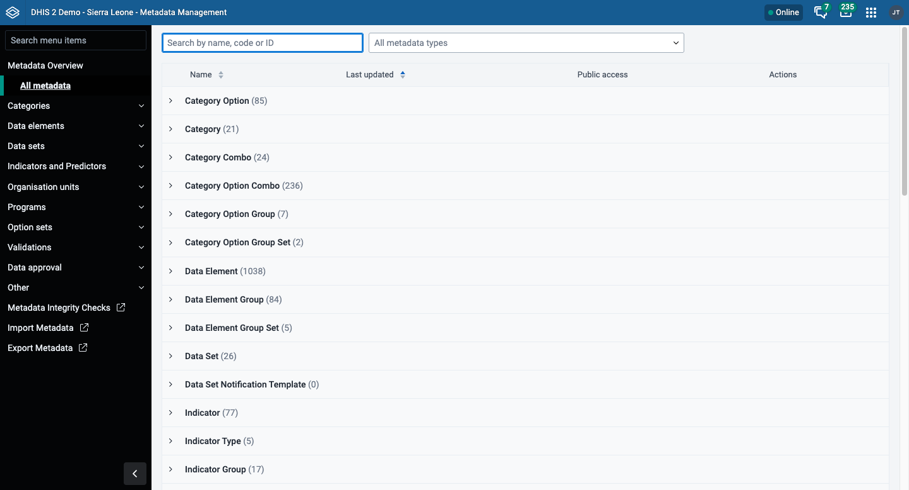
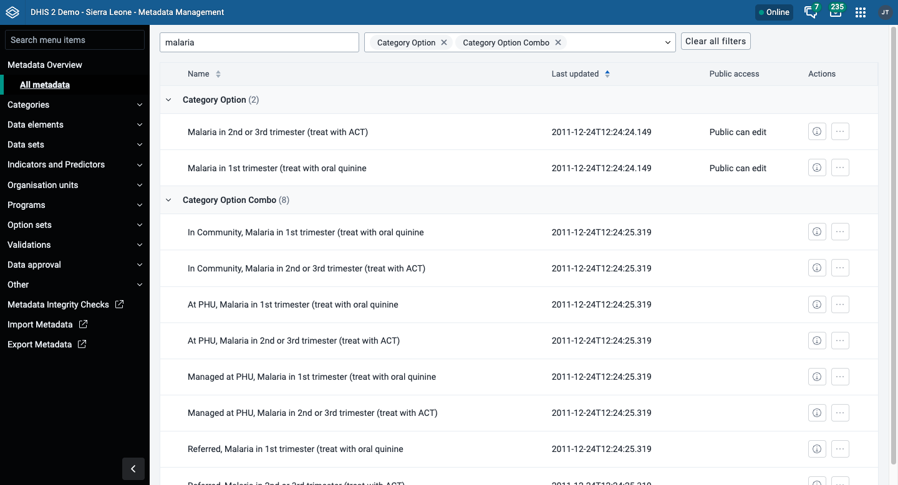
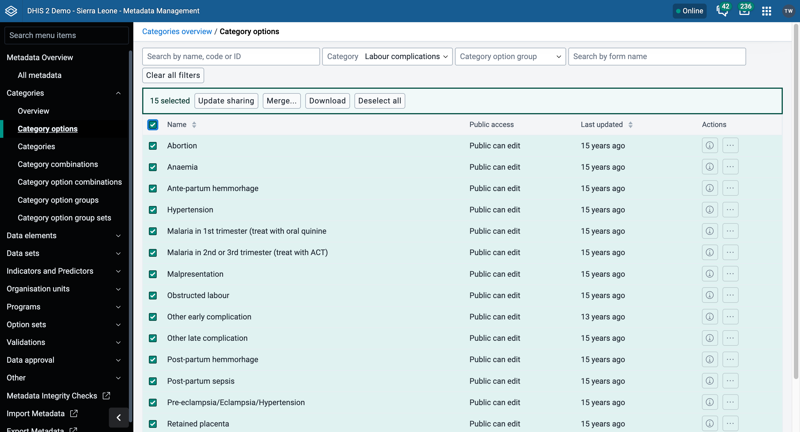
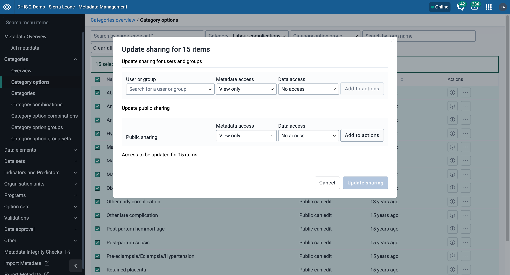
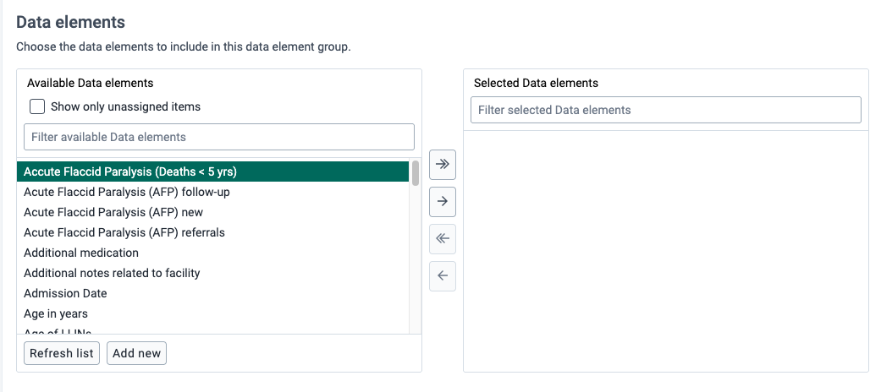

# Metadata Management app { #metadata_management_app }

This chapter explains how to use the **Metadata Management** app to configure the metadata objects that you need to collect and analyze data. It covers how to find objects, the actions that work on most objects, and how to merge duplicate objects.

> **Note**
>
> The **Metadata Management** app replaces the functionality of the Maintenance app.
> The app is available from the [DHIS2 App Hub](https://apps.dhis2.org/app/3c6d0723-904c-4c7a-bbd6-35f3c3aa356b) and works with DHIS2 v41 and later.
> If your instance does not have the **Metadata Management** app installed, use the Maintenance app instead. See [Configure metadata](#maintenance_app).

## About the Metadata Management app { #mm_about_metadata_management_app }

In the **Metadata Management** app you configure these metadata objects:

- Categories
- Data elements
- Data sets and data entry forms
- Indicators and predictors
- Organisation units
- Option sets
- Validations
- Attributes
- Constants
- Legends
- SQL views
- Locales
- Analytics table hooks

> **Note**
>
> The functions that you can use depend on the access permissions of your user role.

The sidebar of the app also has **Programs** and **Data approval** sections. This chapter does not cover them. For programs, see [Configure programs (Metadata Management app)](#mmp_configure_programs). If your instance does not have the **Metadata Management** app, see [Configure programs in the Maintenance app](#configure_programs_in_maintenance_app). For data approval, see [Manage data approval](#mm_manage_data_approval).

> **Note**
>
> The **Metadata Management** app is released continuously, so new sections and features are added regularly. If a section in the list is not in your installed version of the app, the section is not available yet. To get the latest features, update the app from the App Hub.

The **Metadata Management** app replaces the Maintenance app with a new design. The main improvements are:

- **Merging duplicate metadata.** You can merge duplicate metadata objects from the list view, for the object types in [Merge](#mm_common_actions_merge). This helps you keep your metadata clean.
- **Advanced filtering and search.** Each object list has filters to help you find objects by name, code, or other attributes.
- **Bulk sharing.** You can update the sharing settings of several objects at once.

### Navigate metadata objects { #mm_navigating_metadata }

The sidebar lists all available metadata sections. Click a section to expand it and see its object types, as shown in the following image.

Click an object type to open its list.

The list shows a set of columns that are relevant to the object type. You can change which columns the list shows. Your changes apply only to your user and do not change any metadata.

#### Manage visible columns

1. Above the list of objects, click **Manage View**.
2. In the dialog, click the **Columns** tab. The default columns are in the **Selected columns** list on the right.
3. Click a column in the **Available columns** list on the left to move it to the **Selected columns** list.
4. Use the arrow buttons to move columns between the two lists.
5. Use the up and down arrow buttons to change the order of the selected columns.
6. Click **Update view**.

To restore the default columns, click **Reset to default**.

#### Filter and search { #mm_filtering_searching }

Each list has a search bar and a row of filters at the top. The filters depend on the object type. For example, you can filter data elements by domain type, value type, data set, category combination, and data element group.

To change which filters the list shows:

1. Above the list, click **Manage View**.
2. Click the **Filters** tab.
3. Move filters between the **Available filters** list and the **Selected filters** list.
4. Click **Update view**.

#### Download metadata { #mm_download_metadata }

You can download the metadata of the object type that you are viewing. The download can include all objects, only the objects that you chose in the list, or only the objects that match the filters that you applied.

1. Above the list, click **Download**.
2. Under **Compression**, choose **Zip**, **Gzip**, or **Uncompressed**.
3. Under the option that ends with **to include**, for example **Data elements to include**, choose **All**, **Only selected**, or **Only items that match selected filters**.
4. (Optional) Choose **Include user sharing settings** to add the sharing settings of each object to the download.
5. Click **Download**.

### All metadata view { #mm_all_metadata_view }

The **All metadata** view lets you search for a keyword across several metadata types. The results update as you type. Use the **All metadata types** menu to choose which types to search. Each type shows five results at first. You can load more.

### Update sharing for several objects { #mm_bulk_sharing }

You can change the sharing settings of several objects at once.

1. In the list, choose the checkbox of each object that you want to update. In the following example, the list shows only the category options in the category **Labour complications**, and all of them are chosen.

    

2. In the toolbar above the list, click **Update sharing**.
3. In the dialog, choose the sharing settings to add to the chosen objects.

    

More options to change existing sharing settings are in development.

## Background and reference { #mm_background_and_reference }

These pages explain how the metadata objects work and list the expression syntax. They are in the Implement section of the documentation.

- [Understanding categories and category combinations](#understanding_categories_and_category_combinations)
- [Understanding data elements and data sets](#understanding_data_elements_and_data_sets)
- [Understanding indicators, predictors, and expressions](#understanding_indicators_predictors_and_expressions)
- [Understanding organisation units](#understanding_organisation_units)
- [Understanding data approval](#understanding_data_approval)
- [Understanding validation rules](#understanding_validation_rules)
- [Understanding option sets, attributes, constants, legends, and merging](#understanding_shared_metadata_concepts)
- [Understanding programs, tracker configuration, and program disaggregation](#understanding_programs_and_tracker)
- [Reference: indicator functions and aggregation types](#reference_indicator_expressions)
- [Reference: predictor generator expression functions and operators](#reference_predictor_generator_expressions)
- [Reference: program rule operators, functions, and variables](#reference_program_rule_expressions)
- [Reference: program indicator expressions, functions, variables, and operators](#reference_program_indicator_expressions)

## Common metadata object fields { #mm_common_metadata_fields }

Many metadata objects share the same fields. The following table explains each field, so that the procedures do not repeat it. A procedure explains a field only when the field is specific to that object type.

Table: Common metadata object fields

| Field                               | Used on                                                                                                                          | Purpose and best practice                                                                                                                                                                                                                                                                                               |
| ----------------------------------- | -------------------------------------------------------------------------------------------------------------------------------- | ----------------------------------------------------------------------------------------------------------------------------------------------------------------------------------------------------------------------------------------------------------------------------------------------------------------------- |
| Name                                | All objects                                                                                                                      | The full name that the app shows in lists and in most reports. The name must usually be unique within the object type.                                                                                                                                                                                                  |
| Short name                          | Most objects                                                                                                                     | A shorter version of **Name**. It often has a character limit, commonly 50 and sometimes less. The form tells you if you exceed the limit. Apps use the short name where space is limited, for example in Pivot Table column headers and in mobile apps.                                                                |
| Code                                | All objects                                                                                                                      | An optional identifier made of letters, numbers, dots, dashes, and underscores. A code cannot contain spaces. External systems and data exchanges use codes to refer to DHIS2 objects. If you change a code that is in use, you can break an integration. Agree on a coding convention before you create many objects.  |
| Form name                           | Data elements, category options, and similar objects                                                                             | An alternative name that data entry forms show as a column header instead of **Name**. Use it when **Name** is too long, or when the form needs different wording.                                                                                                                                                      |
| Description                         | All objects                                                                                                                      | Fill in the description even when it is optional. Explain what the object measures or represents and why. Write enough detail for someone who does not know the project to understand it.                                                                                                                               |
| Start date, End date                | Category options and other objects that depend on time                                                                           | Limits the time when the object is available. For example, a category option can apply only during one project phase.                                                                                                                                                                                                   |
| Color, Icon                         | Data elements, indicators, and options                                                                                           | Optional styling that data capture apps (Capture, DHIS2 Android Capture) show, so that users can tell objects apart.                                                                                                                                                                                                    |
| Data dimension, Data dimension type | Categories, category combinations, category option groups, category option group sets, and data element and indicator group sets | Controls whether the object is available as a dimension in analytics apps, such as Pivot Table and Data Visualizer, next to Period and Organisation unit. For some objects you also choose between **Disaggregation** and **Attribute**. That choice depends on how you use the object. See the section for the object. |

## Common actions { #mm_common_actions }

The actions **Show details**, **Sharing settings**, **Translate**, **Delete**, and **Clone** work the same way for almost all object types in this app. This section describes each action once. The section for an object type describes an action only when the object type does something different, for example when it does not support the action.

### Show details { #mm_common_actions_details }

1. Open the list of the object type that you want to view.
2. Click the options menu of the object and choose **Show details**.

### Change sharing settings { #mm_common_actions_sharing }

Sharing settings control which users and user groups can view or edit an object, for example an organisation unit or a tracked entity attribute.

Some objects also have data sharing settings. They control who can view or enter data in form fields that use the object.

> **Note**
>
> By default, everyone (**Public access**) can find, view, and edit metadata objects.

1. Open the list of the object type that you want to change.
2. Click the options menu of the object and choose **Sharing settings**.
3. (Optional) To add a user or user group, search for it and choose it.
4. For each access group, choose a metadata sharing setting:
    - **Can edit and view**: The access group can view and edit the object.
    - **Can view only**: The access group can view the object.
    - **No access**: The access group cannot access the object. You can choose this only for **Public access**.
5. Where data sharing settings are available, choose a setting for each access group:
    - **Can capture data**: The access group can view and capture data for the object.
    - **Can view data**: The access group can view data for the object.
    - **No access**: The access group cannot access data for the object.
6. Click **Close**.

### Translate { #mm_common_actions_translate }

DHIS2 can translate database content. You can translate an object into any number of locales. A locale is a language for a geographical, political, or cultural region.

> **Tip**
>
> To see translations yourself, open the **System Settings** app, click **Appearance**, and choose a language.

1. Open the list of the object type that you want to translate.
2. Click the options menu of the object and choose **Translate**.

    > **Tip**
    >
    > Organisation unit levels do not have an options menu. Click the **Translate** icon next to the list item instead.

3. Choose a locale.
4. Enter a **Name** in the locale. Optionally, enter a **Short name** and a **Description**.
5. Click **Save**.

### Delete { #mm_common_actions_delete }

> **Note**
>
> You can delete an object only if no data is associated with it.

> **Warning**
>
> Deleting objects is not recommended, because a deletion cannot be undone. In almost all cases, it is better to deactivate or close an object.

If you cannot delete an object, or if you want to keep its history, use [Sharing settings](#mm_common_actions_sharing) to restrict access instead. The object and its data remain, but users without access cannot see them. Some object types have a better option. For example, you can close an organisation unit instead of deleting it.

1. Open the list of the object type that you want to delete from.
2. Click the options menu of the object and choose **Delete**.
3. Click **Confirm deletion**.

To delete several objects at once, choose their checkboxes in the list and click **Delete** in the toolbar above the list. Not every object type supports this.

One object type has an extra risk. When you delete a data set, DHIS2 also deletes the data entry forms and section forms of the data set, and you cannot restore them. Make a backup of your database before you delete a data set.

### Clone { #mm_common_actions_clone }

Cloning an object saves time when you need many similar objects.

1. Open the list of the object type that you want to clone from.
2. Click the options menu of the object and choose **Clone**. The form shows all values of the original object.
3. Change the values that must be unique, such as **Name** and **Code**. Change any other values that you want.
4. Click **Save**.

Most object types support **Clone**. These object types do not support it: category option combination, data set, section, section form, custom form, and organisation unit level.

### Merge { #mm_common_actions_merge }

For background on merging, see [About merging](#mm_about_merge). Only some object types support merging.

> **Warning**
>
> A merge cannot be undone.

The app has a merge screen for eight object types. Each type needs its own authority. If you do not have the authority, the **Merge...** button does not show.

Table: Object types that support merging

| Object type                 | Authority                       | Core version  | Procedure for the object type                                                |
| --------------------------- | ------------------------------- | ------------- | ---------------------------------------------------------------------------- |
| Organisation unit           | `F_ORGANISATION_UNIT_MERGE`     | v37 and later | [Merge organisation units](#mm_merge_organisation_units)                     |
| Indicator                   | `F_INDICATOR_MERGE`             | v41 and later | [Merge indicators](#mm_merge_indicators)                                     |
| Indicator type              | `F_INDICATOR_TYPE_MERGE`        | v41 and later | [Merge indicator types](#mm_merge_indicator_types)                           |
| Category option             | `F_CATEGORY_OPTION_MERGE`       | v42 and later | [Merge category options](#mm_merge_category_options)                         |
| Category option combination | `F_CATEGORY_OPTION_COMBO_MERGE` | v42 and later | [Merge category option combinations](#mm_merge_category_option_combinations) |
| Data element                | `F_DATA_ELEMENT_MERGE`          | v42 and later | [Merge data elements](#mm_merge_data_elements)                               |
| Category                    | `F_CATEGORY_MERGE`              | v43 and later | [Merge categories](#mm_merge_categories)                                     |
| Category combination        | `F_CATEGORY_COMBO_MERGE`        | v43 and later | [Merge category combinations](#mm_merge_category_combinations)               |

The version that matters is the DHIS2 core version of your instance, not the version of the app. Core added merge support for one object type at a time.

All merge screens work in the same way:

1. Open the list of the object type that you want to merge.
2. Choose the checkbox of each object that you want to merge. Choose the objects that DHIS2 removes (the sources) and the object that DHIS2 keeps (the target). The merge screen offers only the objects that you chose here.
3. In the toolbar above the list, click **Merge...**.
4. In the field with **(source)** in its name, choose the objects that DHIS2 merges into the target.
5. In the field with **(target)** in its name, choose the object to keep.
6. Under **Merge settings**, choose what happens to the sources and to the data that is linked to them. The settings depend on the object type. See the following table.
7. Under **Merging cannot be undone**, enter the confirmation code that the app shows.
8. Click **Merge**. The app shows **Merge complete**.
9. (Optional) Click **Back to list**.

Table: Merge settings for each object type

| Object type                                                                | Source objects | Data values                   | Data approvals                |
| -------------------------------------------------------------------------- | -------------- | ----------------------------- | ----------------------------- |
| Organisation unit                                                          | Keep or delete | Move to the target, or delete | Move to the target, or delete |
| Data element                                                               | Keep or delete | Move to the target, or delete | Not applicable                |
| Category option combination                                                | No setting     | Move to the target, or delete | Not applicable                |
| Indicator, indicator type, category option, category, category combination | Keep or delete | Not applicable                | Not applicable                |

When you move data values to the target, DHIS2 keeps the value that was updated most recently if the source and the target both have a value.

## Use a transfer list { #mm_transfer_list_component }

Many procedures ask you to assign one type of object to another, for example category options to a category, or data elements to a data element group. You do this with the two-panel transfer list.

The **Available** panel on the left lists every object that you can assign, whether or not it is assigned somewhere else. Some object types add the **Show only unassigned items** checkbox above this list. It limits the list to objects that do not belong to another object of the same type. This is most useful when you assign members to groups. Each panel has its own filter box, so you can search the **Available** list and the **Selected** list separately.

To move objects to the **Selected** list:

- Double-click an object in the **Available** list.
- Click an object to choose it. To choose a range or several objects, hold **Shift** or **Ctrl** while you click. Then click the right arrow.
- To move every object in the **Available** list, click the double right arrow.

To move objects back to the **Available** list:

- Double-click an object in the **Selected** list.
- Click an object to choose it. To choose a range or several objects, hold **Shift** or **Ctrl** while you click. Then click the left arrow.
- To move every object in the **Selected** list, click the double left arrow.

Some transfer lists have an **Add new** button. It opens a drawer with an empty form where you can create a new object without leaving the object that you are editing. Fill in the form and click **Save and close**. The new object appears in the **Available** list.
