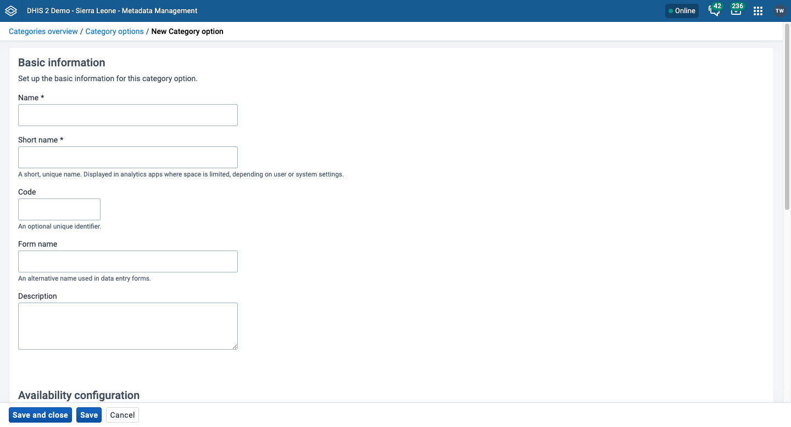
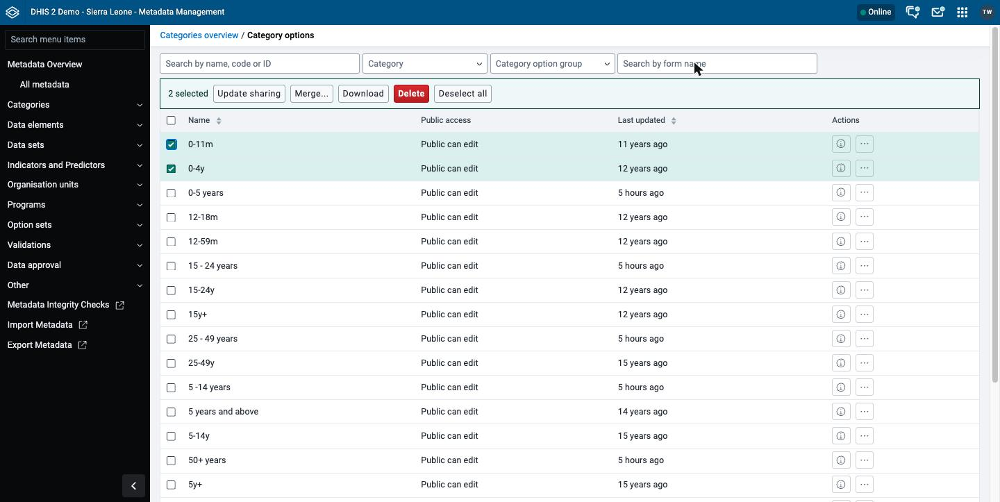
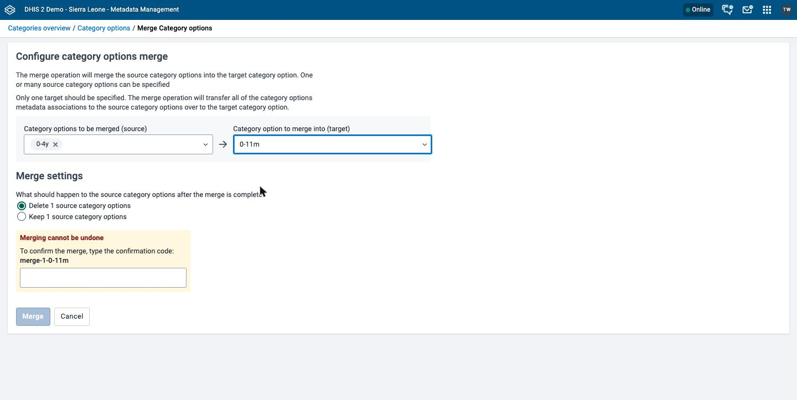
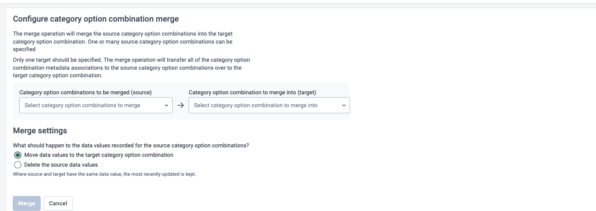

# Manage categories { #mm_manage_category }

This chapter explains how categories, category options, category combinations, and category option groups work, and how to configure them in the **Metadata Management** app.

For background on categories, see [About categories](#mm_about_category).

> **Background and reference**
>
> For background and concepts, see [Understanding categories and category combinations](#understanding_categories_and_category_combinations) and [Understanding option sets, attributes, constants, legends, and merging](#understanding_shared_metadata_concepts).

## Workflow { #mm_workflow_category }

1. Create all category options.
2. Create categories that contain the category options.
3. Create category combinations that contain one or more categories.
4. Create data elements and assign each one to a category combination.

## Create or edit a category option { #mm_create_category_option }

Reuse category options when you can. For example, two categories can share the category option "Under 1 year". Reuse is important when you need to analyze category options, or category option combinations, together.

1. Open the **Metadata Management** app and click **Categories** > **Category options**.
2. To create a category option, click **New**. To edit one, click the options menu of the category option and choose **Edit**.
3. Fill in **Name**, **Short name**, **Code**, **Form name**, **Description**, **Start date**, and **End date**. Only **Name** is required. See [Common metadata object fields](#mm_common_metadata_fields).
4. Choose the organisation units where the category option is available.

    > **Tip**
    >
    > To choose all organisation units of an organisation unit level or an organisation unit group, such as "Chiefdom" or "Urban", choose the **Organisation unit level** or the **Organisation unit group** and click **Select**.

5. Click **Save**.

## Create or edit a category { #mm_create_category }

Create a category after you create all of its category options.

1. Open the **Metadata Management** app and click **Categories** > **Categories**.
2. Click **New**.
3. Fill in **Name**, **Short name**, **Code**, and **Description**. See [Common metadata object fields](#mm_common_metadata_fields).
4. Choose a **Data dimension type**:
    - **Disaggregation**: Use the category to split data elements into components.
    - **Attribute**: Use the category to add attributes to data recorded through a data set.
5. (Optional) Choose **Data dimension** to make the category available as a dimension in analytics apps.
6. Assign the category options to the category.
7. Click **Save**.

## Create or edit a category combination { #mm_create_category_combination }

For background on category combinations and the category option combinations that they create, see [How category combinations work](#understanding_category_combinations).

1. Open the **Metadata Management** app and click **Categories** > **Category combinations**.
2. Click **New**.
3. Fill in **Name** and **Code**. See [Common metadata object fields](#mm_common_metadata_fields).
4. Choose a **Data dimension type**: **Disaggregation** or **Attribute**.
5. (Optional) Choose **Skip category total in reports**.
6. Assign categories to the category combination.
7. Click **Save**.

## Create or edit a category option group { #mm_create_category_option_group }

Category option groups classify category options. Together with category option group sets, they add more dimensions to your data for analysis, for example in the **Pivot Table** and **Data Visualizer** apps.

For example, a system collects data by project, and each project is a category option. You must analyze the data by the donor that supports each project. Create a category option group set called "Donor". Create each donor as a category option group, and put each project in the group of its donor. In the analytics apps, the group set "Donor" is a data dimension, and each donor is an item that you can use in reports.

1. Open the **Metadata Management** app and click **Categories** > **Category option groups**.
2. Click **New**.
3. Fill in **Name**, **Short name**, **Code**, and **Description**. See [Common metadata object fields](#mm_common_metadata_fields).
4. Choose a **Category option group usage**: **Disaggregation** or **Attribute**. It works like the **Data dimension type**. See [Common metadata object fields](#mm_common_metadata_fields).
5. Assign category options to the group.
6. Click **Save**.

## Create or edit a category option group set { #mm_create_category_option_group_set }

A category option group set contains category option groups. It adds dimensions to your data for analysis, for example in the **Pivot Table** and **Data Visualizer** apps.

1. Open the **Metadata Management** app and click **Categories** > **Category option group sets**.
2. Click **New**.
3. Fill in **Name** and **Description**. See [Common metadata object fields](#mm_common_metadata_fields).
4. Choose a **Data dimension type**.
5. Assign category option groups to the group set.
6. Click **Save**.

## Use a category combination for a data set { #mm_use_category_combo_for_data_set }

For background on attribute category combinations, see [Attribute category combinations for data sets](#understanding_attribute_category_combinations). The categories and the category combination must have the data dimension type **Attribute**.

The following steps use the example from that section.

1. Create two categories with the data dimension type **Attribute**: "Implementing partner" and "Project".
2. Create a category combination with the data dimension type **Attribute**: "Implementing partners and projects".
3. Assign the two categories to the category combination.
4. Create a data set called "ART monthly summary" and choose the category combination "Implementing partners and projects".

For more about assigning a category combination to a data set, see [Manage data sets](#mm_manage_data_set).

## Assign a code to a category option combination { #mm_assign_code_category_option_combo }

DHIS2 creates category option combinations automatically. You do not create them, but you can assign a code to each one. A code makes data exchange with external systems easier.

1. Open the **Metadata Management** app and click **Categories** > **Category option combinations**.
2. Click the options menu of the category option combination and choose **Edit**.
3. In the **Code** field, enter a code.
4. Click **Save**.

## Merge category options { #mm_merge_category_options }

Merging category options combines duplicate category options into one. You need the `F_CATEGORY_OPTION_MERGE` authority.

1. Open the **Metadata Management** app and click **Categories** > **Category options**.
2. Choose the checkbox of each category option that you want to merge, including the category option that you want to keep.
3. In the toolbar above the list, click **Merge...**.
4. In **Category options to be merged (source)**, choose the category options that DHIS2 removes.
5. In **Category option to merge into (target)**, choose the category option to keep.
6. Under **Merge settings**, choose whether DHIS2 deletes the source category options or keeps them.
7. Under **Merging cannot be undone**, enter the confirmation code.
8. Click **Merge**.

For more information on the effect of this merge on your metadata, see the [API documentation](https://docs.dhis2.org/en/develop/using-the-api/dhis-core-version-master/metadata.html?h=category+merge+option#category_option_merge).

## Merge category option combinations { #mm_merge_category_option_combinations }

DHIS2 creates category option combinations automatically, so duplicates can occur. For example, two category combinations can end up with the same set of category options. A category option combination can have data values recorded against it, so this merge screen has a **Merge settings** step for data values. You need the `F_CATEGORY_OPTION_COMBO_MERGE` authority.

1. Open the **Metadata Management** app and click **Categories** > **Category option combinations**.
2. Choose the checkbox of each category option combination that you want to merge, including the one that you want to keep.
3. In the toolbar above the list, click **Merge...**.
4. In **Category option combinations to be merged (source)**, choose the category option combinations that DHIS2 removes.
5. In **Category option combination to merge into (target)**, choose the one to keep.
6. Under **Merge settings**, choose **Move data values to the target category option combination** or **Delete the source data values**. If the source and the target both have a data value, DHIS2 keeps the value that was updated most recently.
7. Under **Merging cannot be undone**, enter the confirmation code.
8. Click **Merge**.

This screen has no option to keep the source category option combinations.

## Merge categories { #mm_merge_categories }

Merging categories combines duplicate categories into one. You need the `F_CATEGORY_MERGE` authority.

1. Open the **Metadata Management** app and click **Categories** > **Categories**.
2. Choose the checkbox of each category that you want to merge, including the category that you want to keep.
3. In the toolbar above the list, click **Merge...**.
4. In **Categories to be merged (source)**, choose the categories that DHIS2 removes.
5. In **Category to merge into (target)**, choose the category to keep.
6. Under **Merge settings**, choose whether DHIS2 deletes the source categories or keeps them.
7. Under **Merging cannot be undone**, enter the confirmation code.
8. Click **Merge**.

## Merge category combinations { #mm_merge_category_combinations }

Merging category combinations combines duplicate category combinations into one. The source and the target must contain the same categories. If they do not, the **Merge** button is disabled and the app shows the message **Categories of source and target category combinations do not match**. You need the `F_CATEGORY_COMBO_MERGE` authority.

1. Open the **Metadata Management** app and click **Categories** > **Category combinations**.
2. Choose the checkbox of each category combination that you want to merge, including the one that you want to keep.
3. In the toolbar above the list, click **Merge...**.
4. In **Category combinations to be merged (source)**, choose the category combinations that DHIS2 removes.
5. In **Category combination to merge into (target)**, choose the one to keep.
6. Under **Merge settings**, choose whether DHIS2 deletes the source category combinations or keeps them.
7. Under **Merging cannot be undone**, enter the confirmation code.
8. Click **Merge**.

For the steps that all merge screens share, see [Merge](#mm_common_actions_merge).
