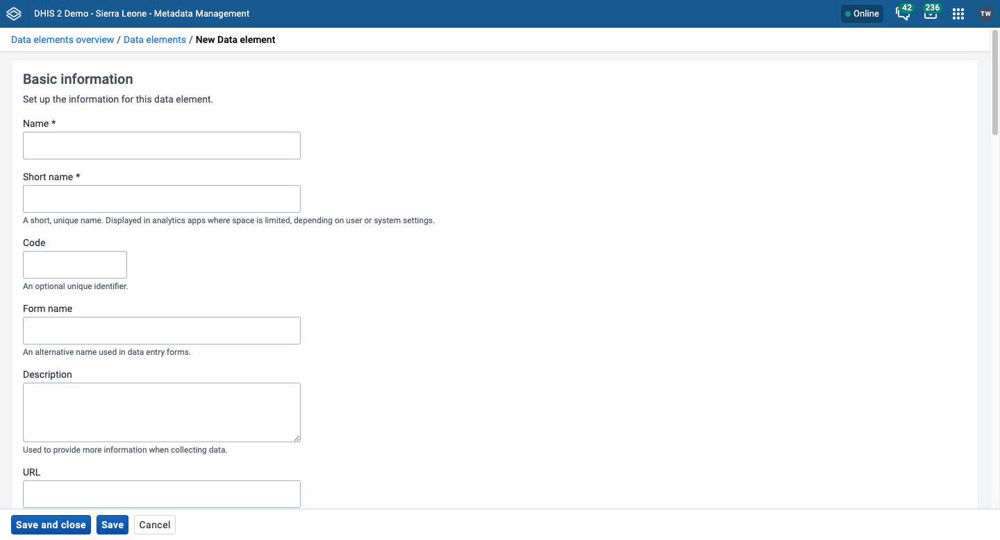
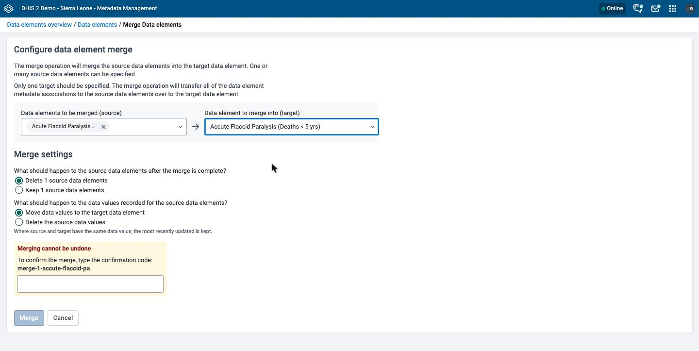

# Manage data elements { #mm_manage_data_element }

This chapter explains how data elements, data element groups, and data element group sets work, and how to configure and merge them in the **Metadata Management** app.

For background on data elements, see [About data elements](#mm_about_data_element).

> **Note**
>
> If your instance does not have the **Metadata Management** app installed, use the Maintenance app instead. See [Configure metadata](#maintenance_app).

> **Background and reference**
>
> For background and concepts, see [Understanding data elements and data sets](#understanding_data_elements_and_data_sets) and [Understanding option sets, attributes, constants, legends, and merging](#understanding_shared_metadata_concepts).

## Workflow { #mm_workflow_data_element }

1. Create all category options.
2. Create categories that contain the category options.
3. Create category combinations that contain one or more categories.
4. Create data elements and assign each one to a category combination.

## Create or edit a data element { #mm_create_data_element }

1. Open the **Metadata Management** app and click **Data elements** > **Data elements**.
2. To create a data element, click **New**. To edit one, click the options menu of the data element and choose **Edit**.
3. Enter a **Name**. Each data element must have a unique name. See [Common metadata object fields](#mm_common_metadata_fields).
4. Enter a **Short name**. Typically, the short name is an abbreviation of the name. Apps use it in reports and other places where space is limited.
5. (Optional) Enter a **Code**.
6. (Optional) Enter a **Form name**. Data entry forms can show this alternative name instead of the **Name**.
7. Enter a **Description**. Be as precise as possible. Include complete information about how the data element is measured and what its purpose is.
8. (Optional) Enter a **URL**. Data capture apps show it with the description.
9. (Optional) Under **Visual configuration**, choose a **Color** and an **Icon**. Data capture apps use them for this data element.
10. In the **Data collection** section, choose a **Domain**: **Aggregate** or **Tracker**.
11. Choose a **Value type**. This is the type of data that the data element records.

    If you choose an option set in step 16, the app sets the **Value type** to match the option set and you cannot change it here. If you change the value type of a data element that already has data, the app asks you to confirm the change. Existing values can become incompatible and can affect analytics tables.

    Table: Value types

    | Value type                | Description                                                                                                                                                                  |
    | ------------------------- | ---------------------------------------------------------------------------------------------------------------------------------------------------------------------------- |
    | Text                      | Textual value. The maximum number of allowed characters per value is 50,000.                                                                                                 |
    | Long text                 | Textual value. Renders as a text area with no length constraint in forms.                                                                                                    |
    | Text with multiple values | Textual value with more than one value. The app shows this value type only for an option set that uses it.                                                                   |
    | Letter                    | A single letter.                                                                                                                                                             |
    | Phone number              | Phone number.                                                                                                                                                                |
    | Email                     | Email address.                                                                                                                                                               |
    | Yes/No                    | Boolean values rendered as menus in data entry.                                                                                                                              |
    | Yes only                  | Boolean values rendered as checkboxes in data entry.                                                                                                                         |
    | Date                      | Dates rendered as calendar widget in data entry.                                                                                                                             |
    | Date and time             | Combination of the **Date** and **Time** value types.                                                                                                                        |
    | Time                      | Time rendered as hours and minutes in HH:MM format.                                                                                                                          |
    | Number                    | Any real numeric value with a single decimal point.                                                                                                                          |
    | Unit interval             | Any real number greater than or equal to 0 and less than or equal to 1.                                                                                                      |
    | Percentage                | Any real number greater than or equal to 0 and less than or equal to 100.                                                                                                    |
    | Integer                   | Any whole number (positive and negative), including zero.                                                                                                                    |
    | Positive integer          | Any whole number greater than (but not including) zero.                                                                                                                      |
    | Negative integer          | Any whole number less than (but not including) zero.                                                                                                                         |
    | Positive or Zero integer  | Any whole number greater than or equal to zero.                                                                                                                              |
    | Username                  | DHIS2 user. Renders as a dialog for searching for and choosing a user.                                                                                                       |
    | Coordinate                | A point coordinate specified as longitude and latitude in decimal degrees. Specify all coordinates in the format `[-19.23, 56.42]`.                                          |
    | Organisation unit         | Organisation units rendered as a hierarchy tree widget. If the user has search organisation units assigned, the tree shows these instead of the assigned organisation units. |
    | Reference                 | Stores a reference (UID) to another DHIS2 object, allowing a data value to link to a specific record elsewhere in the system.                                                |
    | Age                       | Dates rendered as calendar widget or by entering number of years, months and days, which calculates the date value based on the current date.                                |
    | URL                       | Enables manual entry of a URL.                                                                                                                                               |
    | File                      | A file resource where you can store external files, for example documents and photos.                                                                                        |
    | Image                     | A file resource where you can store photos. Unlike **File**, the **Image** type can show the uploaded image directly in forms.                                               |
    | GeoJSON                   | Stores geographic geometry data in GeoJSON format, for example boundary polygons or catchment areas for organisation units.                                                  |

12. Choose an **Aggregation type**. This is the default aggregation operation for the data element.

    The app disables **Aggregation type** and sets it to **None** for these value types: **Text**, **Long text**, **Text with multiple values**, **Letter**, **Phone number**, **Email**, **Username**, **File**, **Coordinate**, **Date**, **Date and time**, **Time**, **Organisation unit**, **Reference**, **Age**, **URL**, **Image**, and **GeoJSON**.

    Your DHIS2 instance supplies the list of operators, so an older version might not show every operator in the following table.

    Every aggregation type answers two separate questions. The first is how the shorter periods inside the reporting period combine. The second is how child organisation units combine into their parent. The table shows both rules for each operator.

    Table: Aggregation operators

    | Aggregation operator                                 | Over periods                                                               | Over the organisation unit hierarchy |
    | ---------------------------------------------------- | -------------------------------------------------------------------------- | ------------------------------------ |
    | Sum                                                  | Sum                                                                        | Sum                                  |
    | Average                                              | Average                                                                    | Average                              |
    | Average (sum in org unit)                            | Average                                                                    | Sum                                  |
    | Count                                                | Count of values                                                            | Count of values                      |
    | Min                                                  | Minimum                                                                    | Minimum                              |
    | Max                                                  | Maximum                                                                    | Maximum                              |
    | Min (sum in org unit)                                | Minimum                                                                    | Sum                                  |
    | Max (sum in org unit)                                | Maximum                                                                    | Sum                                  |
    | First value (sum in org unit hierarchy)              | Earliest value within the 10 years up to the end of the period             | Sum                                  |
    | First value (average in org unit hierarchy)          | Earliest value within the 10 years up to the end of the period             | Average                              |
    | First value (first in org unit hierarchy)            | Earliest value within the 10 years up to the end of the period             | Earliest value                       |
    | Last value (sum in org unit hierarchy)               | Most recent value up to the end of the period, looking back up to 10 years | Sum                                  |
    | Last value (average in org unit)                     | Most recent value up to the end of the period, looking back up to 10 years | Average                              |
    | Last value (last in org unit hierarchy)              | Most recent value up to the end of the period, looking back up to 10 years | Most recent value                    |
    | Last value in period (sum in org unit hierarchy)     | Most recent value, counting only periods inside the requested period       | Sum                                  |
    | Last value in period (average in org unit hierarchy) | Most recent value, counting only periods inside the requested period       | Average                              |
    | Standard deviation                                   | Standard deviation (population-based)                                      | Standard deviation                   |
    | Variance                                             | Variance (population-based)                                                | Variance                             |
    | None                                                 | No aggregation                                                             | No aggregation                       |

    Two more entries are not aggregation behaviors:

    - **Default**: DHIS2 uses the aggregation type that follows from the value type of the data element.
    - **Custom**: The aggregation comes from somewhere other than the operators in the table.

    For background on aggregation operators, with a worked example, see [How aggregation operators work](#understanding_aggregation_operators).

13. (Optional) Choose **Store zero data values** to save zero values. By default, DHIS2 does not store zero values. Choose this option if a zero value is meaningful, for example if you track the number of vaccine doses administered and zero is a valid entry.
14. (Optional) Enter a **Field mask**. This is a regular expression that limits what users can enter. The DHIS2 Android Capture app accepts a value only if the whole value matches the expression.

    > **Note**
    >
    > Field masks work in the DHIS2 Android Capture app. They do not work in the Capture web app.

    For example, the pattern `\d\d\d-\d\d\d-\d\d\d` accepts only values such as 123-456-789.

15. In the **Disaggregation and Option sets** section, choose a **Category combination**. This is the disaggregation that DHIS2 applies to the data element. The field is required, and the default option is **None**. If the **Domain** is **Tracker**, the app sets the field to **None** and you cannot change it.
16. (Optional) Choose an **Option set** to limit data entry to a predefined list of options. If you choose one, the app sets the **Value type** to match the option set.
17. (Optional) Choose an **Option set comment** to give data entry a set of predefined comments.
18. (Optional) In the **Legend set** section, assign one or more legend sets. Analytics apps use them to visualize the values of this data element. See [Use a transfer list](#mm_transfer_list_component).
19. (Optional) In the **Aggregation levels** section, choose one or more **Aggregation level(s)**. By default, aggregation starts at the lowest assigned organisation unit. If you choose a higher level, data from lower levels is not included in the aggregation.
20. (Optional) In the **Groups** section, assign the data element to one or more data element groups. See [Use a transfer list](#mm_transfer_list_component).
21. Click **Save**.

## Create or edit a data element group { #mm_create_data_element_group }

Data element groups let you group related data elements for reporting and analysis.

1. Open the **Metadata Management** app and click **Data elements** > **Data element groups**.
2. Click **New**.
3. Fill in **Name**, **Short name**, **Code**, and **Description**. **Name** and **Short name** are required. See [Common metadata object fields](#mm_common_metadata_fields).
4. In the **Data elements** section, assign data elements to the group. See [Use a transfer list](#mm_transfer_list_component).
5. Click **Save**.

## Create or edit a data element group set { #mm_create_data_element_group_set }

Data element group sets let you classify several data element groups.

1. Open the **Metadata Management** app and click **Data elements** > **Data element group sets**.
2. Click **New**.
3. Fill in **Name**, **Short name**, **Code**, and **Description**. **Name** and **Short name** are required. See [Common metadata object fields](#mm_common_metadata_fields).
4. (Optional) Choose **Compulsory: all data elements must belong to at least one group in this group set.** to require that every data element belongs to at least one group in this group set.
5. (Optional) Choose **Show as data dimension in analytics apps** to use the data element group set in analytics.
6. In the **Data element groups** section, assign data element groups to the group set. See [Use a transfer list](#mm_transfer_list_component).
7. Click **Save**.

## Merge data elements { #mm_merge_data_elements }

Merging data elements combines duplicate data elements into one. DHIS2 reassigns all metadata associations of the source data elements to the target data element. DHIS2 then handles the data values of the sources as you choose. Data elements carry recorded data values, so this merge screen has a **Merge settings** step for data values. You need the `F_DATA_ELEMENT_MERGE` authority.

All source data elements must have the same value type and the same domain type (aggregate or tracker) as the target. DHIS2 rejects the merge if they do not.

1. Open the **Metadata Management** app and click **Data elements** > **Data elements**.
2. Choose the checkbox of each data element that you want to merge, including the data element that you want to keep.
3. In the toolbar above the list, click **Merge...**.
4. In **Data elements to be merged (source)**, choose the data elements that DHIS2 removes.
5. In **Data element to merge into (target)**, choose the data element to keep.
6. Under **Merge settings**, make two choices:
    - Choose whether DHIS2 deletes the source data elements or keeps them. The default is to delete them.
    - Choose **Move data values to the target data element** or **Delete the source data values**. The default is to move them. If the source and the target both have a data value, DHIS2 keeps the value that was updated most recently.
7. Under **Merging cannot be undone**, enter the confirmation code that the app shows.
8. Click **Merge**. The app shows **Merge complete**.

> **Warning**
>
> A merge cannot be undone, whichever settings you choose.

For the steps that all merge screens share, see [Merge](#mm_common_actions_merge).
