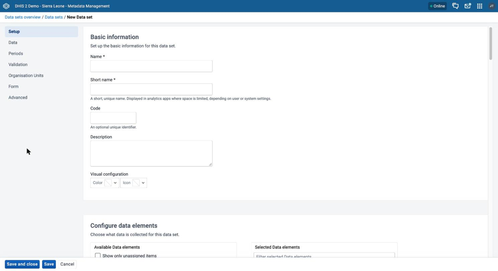
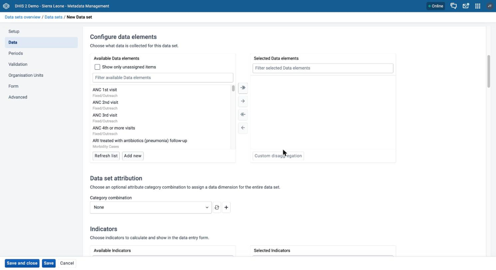
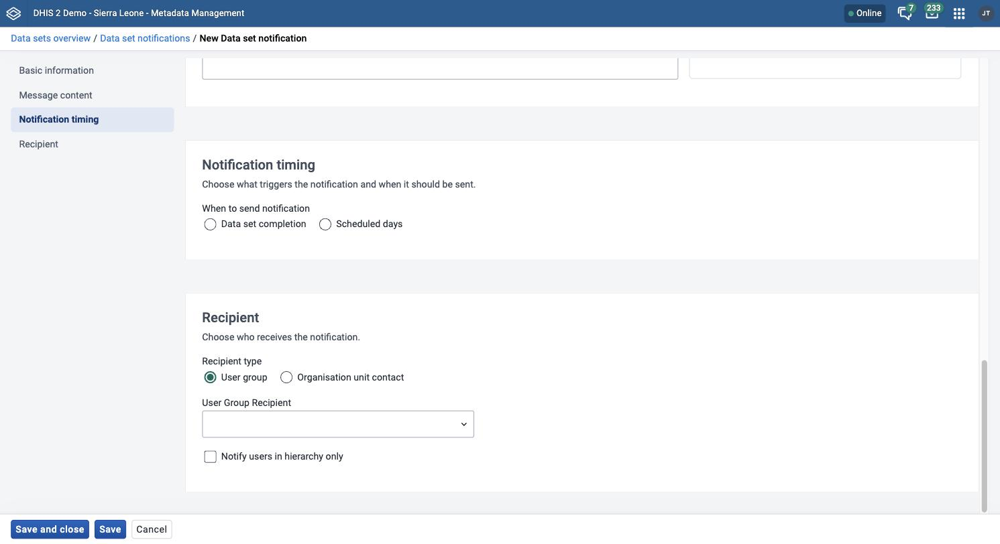
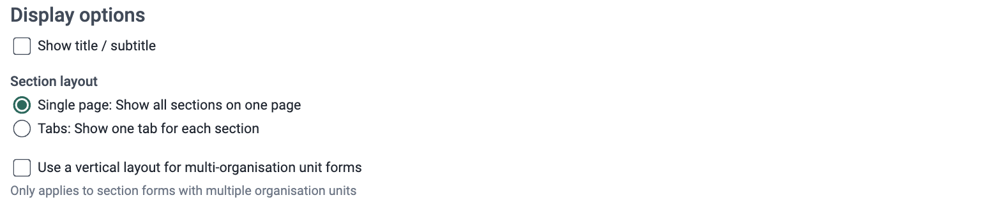
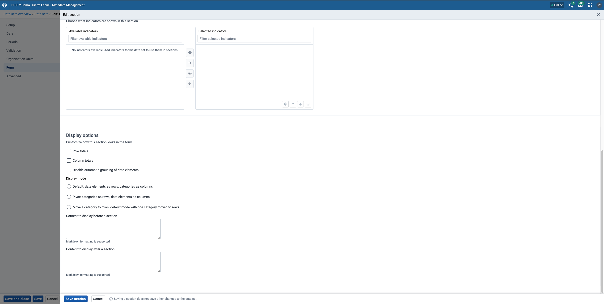

# Manage data sets and data entry forms { #mm_manage_data_set }

This chapter explains how data sets and data entry forms work, and how to configure data sets, data set notifications, section forms, and custom forms in the **Metadata Management** app.

For background on data sets and data entry forms, see [About data sets and data entry forms](#mm_about_dataset_dataform).

> **Note**
>
> The **Metadata Management** app replaces the functionality of the Maintenance app. If your instance does not have the **Metadata Management** app installed, use the Maintenance app instead. See [Configure metadata](#maintenance_app).

> **Background and reference**
>
> For background and concepts, see [Understanding data elements and data sets](#understanding_data_elements_and_data_sets).

## Workflow { #mm_workflow_data_set }

Create data elements and categories before you create data sets and data entry forms.

1. Create a data set and choose its data elements.
2. Assign the data set to organisation units.
3. Save the data set.
4. (Optional) Create a section form or a custom form. The **Section form** and **Custom form** tabs are available only after you save the data set. After you add data elements to a data set, save the data set before you edit its sections or its custom form.

After you save the data set and assign organisation units, you can enter data in the **Data Entry** app.

## Create or edit a data set { #mm_create_data_set }

The data set form has seven tabs in the sidebar of the form: **Setup**, **Data**, **Periods**, **Validation**, **Organisation Units**, **Form**, and **Advanced**. The form fields are in these tabs. Fields that have an asterisk are required.

1. Open the **Metadata Management** app and click **Data sets** > **Data sets**.
2. To create a data set, click **New**. To edit one, click the options menu of the data set and choose **Edit**.
3. On the **Setup** tab, fill in **Name** and **Short name**. Optionally, fill in **Code**, **Description**, and **Visual configuration**. See [Common metadata object fields](#mm_common_metadata_fields).
4. On the **Data** tab, choose the data elements of the data set. Optionally, choose a **Category combination** and indicators.
5. On the **Periods** tab, choose a **Period type** and, optionally, set the rules for data entry periods.
6. On the **Validation** tab, choose the rules for completing the data set.
7. On the **Organisation Units** tab, choose the organisation units that can collect data with the data set.
8. (Optional) On the **Form** and **Advanced** tabs, choose the form type and the advanced options.
9. Click **Save and close**.

The **Save** button saves the data set and keeps the form open.

The following table lists the fields of each tab.

Table: Data set fields

| Tab | Field | Purpose |
| --- | --- | --- |
| Setup | **Name**, **Short name** | The name of the data set, and a shorter name for places with little space. Both are required. The short name must be unique. |
| Setup | **Code** | An optional unique identifier. |
| Setup | **Description** | A description of the data set. The maximum length is 2000 characters. |
| Setup | **Visual configuration** | The **Color** and **Icon** of the data set. |
| Data | **Configure data elements** | The data elements of the data set. The list offers only data elements with the domain type aggregate. To change the category combination of a data element for this data set, see [Override the category combination of a data element](#mm_override_dataelement_catcombo_in_dataset). |
| Data | **Category combination** | An optional category combination for the whole data set, under the heading **Data set attribution**. The menu lists category combinations with the data dimension type **Attribute**. For more information, see [Use a category combination for a data set](#mm_use_category_combo_for_data_set). |
| Data | **Indicators** | Indicators that DHIS2 calculates and shows in the data entry form. The sections of a section form can use only the indicators that you choose here. |
| Periods | **Period type** | How often users collect data. The default is **Monthly**. If you change the period type of a data set that has data, the app asks you to confirm. Data that users entered before the change does not show in the **Data Entry** app, and this can lead to duplicate data entry. |
| Periods | **Allow data entry in future periods** | Choose the checkbox, then enter the **Number of future periods** that users can enter data for. |
| Periods | **Close data entry a certain number of days after period end (expiry days)** | Choose the checkbox, then enter the **Number of days** after the end of a period. After this number of days, users cannot enter or edit data. If the checkbox is clear, the value is 0 and users can always edit. |
| Periods | **Close data entry after "category combination" category option end date** | Shows only when the data set has a category combination that is not the default. Choose the checkbox to close data entry after the end date of the category options. |
| Periods | **Add a period entry rule** | Under the heading **Limit data entry by period**. Opens the **Add period entry rule** dialog, where you choose a **Year** and a **Period**, and enter an **Opening date** and a **Closing date**. The closing date must be after the opening date. Click **Edit** or **Remove** next to a rule to change or remove it. |
| Validation | **Approval workflow** | An optional data approval workflow. The menu lists the workflows that use the category combination of the data set, and the workflows that have no category combination. See [Assign a workflow to a data set](#mm_assign_approval_workflow). |
| Validation | **Completing requires passing validation** | Users cannot complete the data entry form if validation rule violations exist. |
| Validation | **Completing requires all empty values to have a comment** | Users cannot complete the data entry form until each empty value has a comment. |
| Validation | **Completing requires compulsory fields to have a value** | Users cannot complete the data entry form until every compulsory data element has a value. See [Edit compulsory data elements in a data set](#mm_edit_compulsory_dataelement_in_dataset). |
| Validation | **If one category combination field has a value, require all for that category combination to have a value** | Users must fill in all fields of a category combination if they fill in one of them. |
| Validation | **Number of days after period to qualify for on time submission** | The number of days after the end of a period in which a report counts as on time in reporting rates. Enter 0 to ignore. The default is 15. |
| Validation | **Compulsory data elements** | The data elements that are compulsory. See [Edit compulsory data elements in a data set](#mm_edit_compulsory_dataelement_in_dataset). |
| Organisation Units | Organisation unit tree | The organisation units that can collect data with the data set. |
| Form | **Basic form**, **Section form**, **Custom form** | The form type. See [Manage section forms](#mm_manage_section_form) and [Manage custom forms](#mm_manage_customform). |
| Form | **Display options** | See [Display options](#mm_data_set_display_options). The panel is available in DHIS2 v42 and later. |
| Advanced | **Do not save this data set to offline storage** | Makes the data set available only when the user is connected to the internet. |
| Advanced | **Include data element descriptions in offline storage** | Saves the descriptions of the data elements with the data set in offline storage. |
| Advanced | **Use this data set with the Java mobile client** | Has no effect. DHIS2 no longer includes the Java mobile service. |
| Advanced | **Send complete notifications** | Sends a notification when users complete the data set. Choose a **Recipient user group**, and optionally choose **Send notification to completing user**. For notifications with more options, see [Create or edit a data set notification](#mm_create_data_set_notification). |
| Advanced | **Legends** | Legends that color the values in the **Data Entry** and analytics apps. |

> **Note**
>
> You can also assign data sets to an organisation unit from the organisation unit form, in the **Reference assignment** section. The app source shows no function to add a data set to several organisation units in one action.

## Create or edit a data set notification { #mm_create_data_set_notification }

A data set notification sends a message about a data set. You configure a template that determines what the notification contains, when DHIS2 sends it, and who receives it.

1. Open the **Metadata Management** app and click **Data sets** > **Data set notifications**.
2. Click **New**.
3. On the **Basic information** tab, fill in **Name** and, optionally, **Code**. Choose the **Data sets** that the notification applies to.
4. On the **Message content** tab, fill in **Message subject** and **Message body**. **Message body** is required. To add a variable, click it under **Insert a variable:**.
5. On the **Notification timing** tab, under **When to send notification**, choose **Data set completion** or **Scheduled days**.
6. If you chose **Scheduled days**, choose **Before** or **After**. Enter the number of days. Under **Send notification as**, choose **Collective summary** or **Single notification**.
7. On the **Recipient** tab, under **Recipient type**, choose **User group** or **Organisation unit contact**.
8. If you chose **User group**, choose a **User Group Recipient**. Optionally, choose **Notify users in hierarchy only**.
9. If you chose **Organisation unit contact**, choose **Send as SMS**, **Send as Email**, or both.
10. Click **Save and close**.

The **Message subject** and **Message body** accept these variables. Each button inserts the variable at the cursor, in the form `V{variable_name}`.

Table: Variables for data set notifications

| Button | Inserted text |
| --- | --- |
| **Data set name** | `V{data_set_name}` |
| **Current date** | `V{current_date}` |
| **Data set description** | `V{data_description}` |
| **Complete registration organisation unit** | `V{registration_ou}` |
| **Complete registration period** | `V{registration_period}` |
| **Complete registration user** | `V{registration_user}` |
| **Complete registration time** | `V{registration_time}` |
| **Complete registration att opt combo** | `V{att_opt_combo}` |

## Override the category combination of a data element { #mm_override_dataelement_catcombo_in_dataset }

You can override the category combination of a data element for one data set. This lets you use a different disaggregation for the same data element in different data sets. The category combination that you choose must have the data dimension type **Disaggregation**.

1. Open the **Metadata Management** app and click **Data sets** > **Data sets**.
2. Click the options menu of the data set and choose **Edit**.
3. On the **Data** tab, choose the data elements of the data set.
4. Under the list of selected data elements, click **Custom disaggregation**.
5. In the **Override data element category combination** dialog, choose a replacement category combination for each data element that you want to change.
6. Click **Close**.
7. Click **Save and close**.

In the list of selected data elements, an asterisk (\*) follows the category combination of each data element that you overrode.

## Edit compulsory data elements in a data set { #mm_edit_compulsory_dataelement_in_dataset }

You can mark data elements of a data set as compulsory. The list of compulsory data elements contains one entry for each combination of a data element and a category option combination. A data element that you remove from the data set is also removed from the compulsory list.

To make the compulsory data elements required, choose **Completing requires compulsory fields to have a value** on the **Validation** tab. Users then cannot complete the data entry form until each compulsory data element has a value.

1. Open the **Metadata Management** app and click **Data sets** > **Data sets**.
2. Click the options menu of the data set and choose **Edit**.
3. Click the **Validation** tab.
4. Under **Compulsory data elements**, move the data elements from **Available data elements** to **Compulsory data elements**. See [Use a transfer list](#mm_transfer_list_component).
5. Click **Save and close**.

## Manage section forms { #mm_manage_section_form }

A section form divides the data elements of a data set into sections. Each section is a table in the data entry form. To open the sections of a data set, click the options menu of the data set and choose **Edit**. Click the **Form** tab, and then click the **Section form** tab.

> **Note**
>
> The **Section form** tab is available only after you save the data set. Save the data set after you add data elements, and before you edit sections.

### Display options { #mm_data_set_display_options }

The **Display options** panel is on the **Form** tab, under the form type tabs. It is available when your instance runs DHIS2 v42 or later. It applies to the form as a whole and has these options:

* **Show title / subtitle**: Shows a title and a subtitle above the form during data entry. Enter the text in **Title** and **Subtitle**. Each field has a maximum of 500 characters. Under **Position**, choose **Line start**, **Center**, or **Line end**. This option applies to all form types.
* **Section layout**: Applies to section forms only. Choose **Single page: Show all sections on one page** or **Tabs: Show one tab for each section**. If you choose tabs, also choose **Horizontal tabs** or **Vertical tabs**.
* **Use a vertical layout for multi-organisation unit forms**: Applies to section forms only. The option applies only to section forms with multiple organisation units.

Each section also has display settings. They are in the **Display options** panel of the section, with the description **Customize how this section looks in the form.**

* **Row totals**: Adds a total column at the end of each row.
* **Column totals**: Adds a total row at the end of the section.
* **Disable automatic grouping of data elements**: Keeps the data elements in the order that you assigned them, instead of grouping them by category combination.
* **Display mode**: Controls how the table of the section arranges data elements and categories. Choose one option:
  * **Default: data elements as rows, categories as columns**
  * **Pivot: categories as rows, data elements as columns**
  * **Move a category to rows: default mode with one category moved to rows**. With this option, choose the category in **Category to move to rows**. The field shows only when the data elements of the section have more than one category.
* **Content to display before a section** and **Content to display after a section**: Text that the form shows before or after the section. The fields support Markdown formatting.

### Create a section form

1. Open the **Metadata Management** app and click **Data sets** > **Data sets**.
2. Click the options menu of the data set and choose **Edit**.
3. Click the **Form** tab, and then click the **Section form** tab.
4. Click **Add section**. The **New section** panel opens.
5. Under **Section setup**, enter a **Name**. Optionally, enter a **Code** and a **Description**. The name must be unique within the data set.
6. Under **Section data elements**, move the data elements of this section from **Available data elements** to **Selected data elements**.
7. Click **Save section**.

Repeat these steps for each section of the form.

Each data element can belong to one section only. The **Available data elements** list does not offer data elements that belong to another section. To show only the data elements of one category combination, use **Filter by category combination**. Under **Section indicators**, you can also choose indicators for the section. The list offers the indicators that you chose on the **Data** tab of the data set.

Saving a section does not save other changes to the data set.

### Edit a section form

1. Open the **Metadata Management** app and click **Data sets** > **Data sets**.
2. Click the options menu of the data set and choose **Edit**.
3. Click the **Form** tab, and then click the **Section form** tab.
4. Click the options menu of the section and choose **Edit**.
5. Change the section, including its [display options](#mm_data_set_display_options).
6. Click **Save section**.

### Manage gray fields in a section form

You can disable (gray out) cells of a section form to prevent data entry for some combinations of a data element and a category option.

1. Open the **Metadata Management** app and click **Data sets** > **Data sets**.
2. Click the options menu of the data set and choose **Edit**.
3. Click the **Form** tab, and then click the **Section form** tab.
4. Click the options menu of the section and choose **Edit**.
5. Under **Section data elements**, click **Manage enabled/disabled fields**.
6. (Optional) Choose a category combination in **Filter by category combination**.
7. Clear the checkbox of each cell that you want to disable. A cleared cell shows **Disabled**. A chosen cell shows **Enabled**.
8. Click **Update**, and then click **Save section**.

### Change section display order in a section form

1. Open the **Metadata Management** app and click **Data sets** > **Data sets**.
2. Click the options menu of the data set and choose **Edit**.
3. Click the **Form** tab, and then click the **Section form** tab.
4. Click **Reorder sections**. The **Reorder form sections** dialog opens. The button is not available when the data set has fewer than two sections.
5. Click the up arrow or the down arrow next to a section to move it.
6. Click **Save section ordering**.

### Delete a section in a section form

1. Open the **Metadata Management** app and click **Data sets** > **Data sets**.
2. Click the options menu of the data set and choose **Edit**.
3. Click the **Form** tab, and then click the **Section form** tab.
4. Click the options menu of the section and choose **Delete**. The section shows the message **Section {name} will be removed on save**.
5. Click **Save and close** to delete the section. To keep the section, click **Restore section** before you save.

### Translate a section in a section form

1. Open the **Metadata Management** app and click **Data sets** > **Data sets**.
2. Click the options menu of the data set and choose **Edit**.
3. Click the **Form** tab, and then click the **Section form** tab.
4. Click the options menu of the section and choose **Translate**.
5. Choose a locale and enter the translated name. See [Translate](#mm_common_actions_translate).
6. Click **Save**.

## Manage custom forms { #mm_manage_customform }

> **Note**
>
> Custom forms use an HTML editor. A custom form takes more time to create and maintain than a section form.

### Create a custom form

1. Open the **Metadata Management** app and click **Data sets** > **Data sets**.
2. Click the options menu of the data set and choose **Edit**.
3. Click the **Form** tab, and then click the **Custom form** tab.
4. Click **Create custom form**. To change an existing custom form, click **Edit custom form**.
5. In the HTML editor, design the form. To add an element, put the cursor in the editor and choose the element under **Select elements**. The element types are **Data elements**, **Totals**, **Indicators**, and **Flags**.
6. (Optional) Click **Preview** to see the form. Click **Edit** to return to the editor.
7. Click **Save custom form**.

Choose **Insert grey (disabled) fields** before you choose elements to insert them as disabled fields. Use **Filter elements** to search the list.

Saving a custom form does not save other changes to the data set. To delete a custom form, click **Delete custom form**. The form shows the message **Custom form will be removed on save**. Click **Save and close** to delete the form, or click **Restore custom form** to keep it.

The **Custom form** tab is available only after you save the data set.

### Scripting in custom forms

Custom forms support JavaScript for advanced interactions and validation. Add scripts directly to the HTML of the custom form. The preview does not run scripts.

#### Events

| Event | Description |
| --- | --- |
| `dhis2.de.event.formLoaded` | Fired after the form loads. |
| `dhis2.de.event.dataValuesLoaded` | Fired after the data values load into the form. |
| `dhis2.de.event.formReady` | Fired when the form is ready for data entry. |
| `dhis2.de.event.dataValueSaved` | Fired after a data value has been saved successfully. |

#### Functions

| Function | Description |
| --- | --- |
| `dhis2.de.on( event, fn )` | Registers `fn` as the handler for an event. It first removes the existing handler for that event. |
| `dhis2.de.getCurrentOrganisationUnit()` | Returns the ID of the current organisation unit. |

For **Show details**, **Sharing settings**, **Translate**, **Delete**, and **Clone**, see [Common actions](#mm_common_actions). Note the extra risk for deleting a data set: DHIS2 also deletes the data entry forms and section forms of the data set. For more information, see [Delete](#mm_common_actions_delete).
