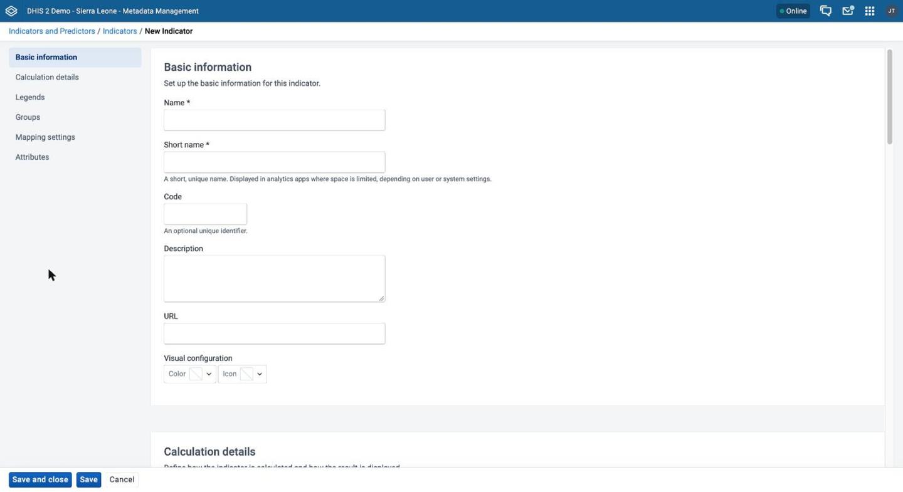
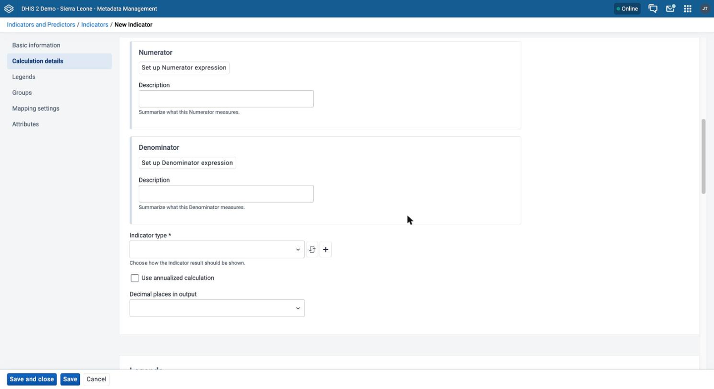
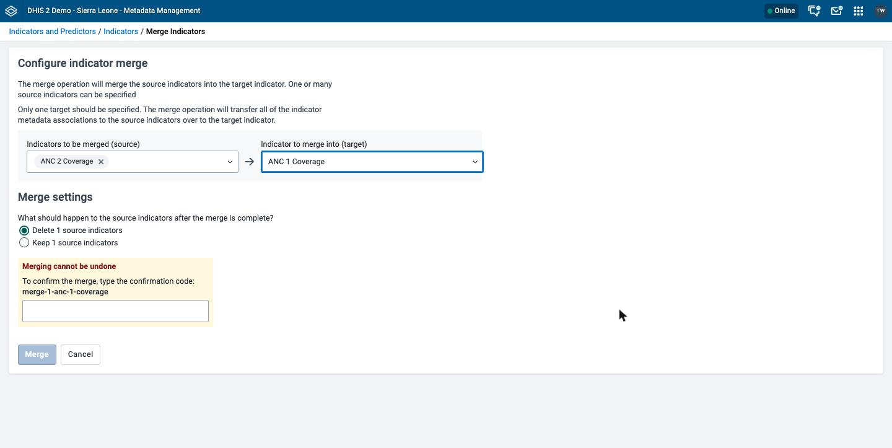
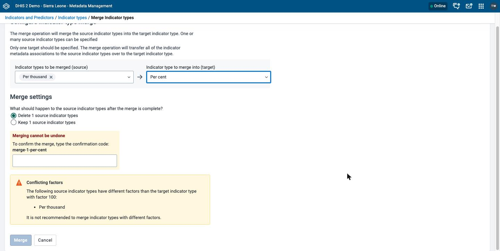

# Manage indicators { #mm_manage_indicator }

This chapter describes how to configure and merge indicators, indicator types, indicator groups, and indicator group sets in the **Metadata Management** app.

> **Note**
>
> The **Metadata Management** app replaces the functionality of the Maintenance app.
> If your instance does not have the **Metadata Management** app installed, use the Maintenance app instead. See [Configure metadata](#maintenance_app).

For background on indicators, expression syntax, and the functions that you can use, see [About indicators](#mm_about_indicator).
For background on evaluating part of an expression before aggregation, see [Indicator subexpressions](#mm_indicator_subexpressions).
For background on year-to-date calculations, see [Indicator year-to-date](#mm_indicator_yeartodate).

> **Background and reference**
>
> For background and concepts, see [Understanding indicators, predictors, and expressions](#understanding_indicators_predictors_and_expressions). For the functions you can use, see [Reference: indicator functions and aggregation types](#reference_indicator_expressions).

## Workflow { #mm_workflow_indicator }

1. Create indicator types (unless you use the default types).
2. Create indicators.
3. (Optional) Create indicator groups.
4. (Optional) Create indicator group sets.

## Create or edit an indicator type { #mm_create_indicator_type }

Indicator types define the factor by which DHIS2 multiplies indicator values when it shows them in reports or exports them to analytics. For example, a "Per cent" indicator type multiplies values by 100.

1. Open the **Metadata Management** app and click **Indicators and Predictors** > **Indicator types**.
2. To create an indicator type, click **New**. To edit one, click the options menu of the indicator type and choose **Edit**.
3. In the **Name** field, enter the name of the indicator type, for example "Per cent".
4. In the **Factor** field, enter the factor as a whole number. For a percentage indicator, enter 100.
5. Click **Save**.

If another indicator type already has the factor that you enter, the app shows the warning **An indicator type with this factor already exists**. The warning does not stop you from saving.

## Create or edit an indicator { #mm_create_indicator }

The form has these sections: **Basic information**, **Calculation details**, **Legends**, **Groups**, **Aggregate data export mapping**, and **Attributes**. Create the indicator type of the indicator before you start. See [Create or edit an indicator type](#mm_create_indicator_type).

1. Open the **Metadata Management** app and click **Indicators and Predictors** > **Indicators**.
2. To create an indicator, click **New**. To edit one, click the options menu of the indicator and choose **Edit**.
3. Under **Basic information**, fill in **Name**, **Short name**, **Code**, **Description**, and **URL**. **Name** and **Short name** are required. See [Common metadata object fields](#mm_common_metadata_fields). Use these entries:
    - **Name**: the full name of the indicator, for example "Incidence of confirmed malaria cases per 1000 population".
    - **Short name**: an abbreviated name, for example "Inc conf. malaria per 1000 pop". The short name must be unique and 50 characters or fewer.
    - **Description**: a brief, informative description of the indicator and how DHIS2 calculates it.
    - **URL**: a link to a place where a full metadata description of the indicator is available, for example an indicator registry.
4. (Optional) Under **Visual configuration**, choose a color and an icon for the indicator.
5. Under **Calculation details**, set up the numerator:
    1. Click **Set up Numerator expression**. If the indicator already has a numerator, the button is **Edit Numerator expression**.
    2. In the dialog, enter the expression in the text area. To add an item, click a type in the sidebar on the right: **Operators**, **Data elements**, **Program data**, **Org unit counts**, **Constants**, **Reporting rates**, or **Indicators**. Then click an item in the list. The app inserts the item at the position of the cursor.
    3. Check the message under the text area. **Valid expression** shows a description of the expression. **Invalid expression** means that you must correct the expression. If the message is **Expression not yet validated**, click **Validate**.
    4. Click **Apply**.
    5. In the **Description** field under **Numerator**, enter a short summary of what the numerator measures. The description is required.
6. Set up the denominator in the same way. Click **Set up Denominator expression**, or **Edit Denominator expression** if the indicator already has a denominator. Enter a **Description** under **Denominator**. The denominator and its description are required.
7. Under **Calculation details**, set the calculation options:
    - **Indicator type**: choose an indicator type. The indicator type is required. It sets a factor that DHIS2 applies automatically during the calculation.
    - **Use annualized calculation**: (Optional) choose this checkbox to apply an annualization factor. This scales the numerator up to a yearly equivalent, so that you can compare it with a denominator that is already annual, such as a population figure. Typically DHIS2 multiplies the numerator by 365 divided by the number of days in the reporting period.
    - **Decimal places in output**: (Optional) choose a number from 0 to 5.
8. (Optional) Fill in the other sections:
    - Under **Legends**, assign legend sets with the transfer list. You can also change the order of the chosen legend sets. See [Use a transfer list](#mm_transfer_list_component).
    - Under **Groups**, move the indicator groups that the indicator belongs to from **Available groups** to **Selected groups**. If an indicator group set is compulsory, add the indicator to a group in that group set.
    - Under **Aggregate data export mapping**, enter the ID of a category option combination in **Category option combination for aggregate data export** and the ID of an attribute option combination in **Attribute option combination for aggregate data export**. DHIS2 uses these settings to map aggregated data that you export to another server.
    - Under **Attributes**, enter values for any custom attributes.
9. Click **Save**.

## Create or edit an indicator group { #mm_create_indicator_group }

Indicator groups classify indicators. Use them to find indicators and to add them to indicator group sets.

1. Open the **Metadata Management** app and click **Indicators and Predictors** > **Indicator groups**.
2. To create an indicator group, click **New**. To edit one, click the options menu of the indicator group and choose **Edit**.
3. Fill in **Name**, **Code**, and **Description**. Only **Name** is required. See [Common metadata object fields](#mm_common_metadata_fields).
4. Under **Indicators**, assign the indicators to the group with the transfer list. You must assign at least one indicator. See [Use a transfer list](#mm_transfer_list_component).
5. (Optional) Under **Attributes**, enter values for any custom attributes.
6. Click **Save**.

## Create or edit an indicator group set { #mm_create_indicator_group_set }

An indicator group set contains indicator groups. Use a group set when you need to organize indicator groups in a structure, for example by topic.

1. Open the **Metadata Management** app and click **Indicators and Predictors** > **Indicator group sets**.
2. To create an indicator group set, click **New**. To edit one, click the options menu of the indicator group set and choose **Edit**.
3. Fill in **Name**, **Short name**, **Code**, and **Description**. **Name** and **Short name** are required. See [Common metadata object fields](#mm_common_metadata_fields).
4. (Optional) Choose **Compulsory: all indicators must belong to at least one group in this group set.** to require every indicator to belong to a group in this group set.
5. Under **Indicator groups**, assign the indicator groups to the group set with the transfer list. You must assign at least one indicator group. You can also change the order of the chosen groups. See [Use a transfer list](#mm_transfer_list_component).
6. Click **Save**.

## Merge indicators { #mm_merge_indicators }

Merging indicators combines duplicate indicators into one. You need the `F_INDICATOR_MERGE` authority.

1. Open the **Metadata Management** app and click **Indicators and Predictors** > **Indicators**.
2. Choose the checkbox of each indicator that you want to merge, including the indicator that you want to keep.
3. In the toolbar above the list, click **Merge...**.
4. In **Indicators to be merged (source)**, choose the indicators that DHIS2 removes.
5. In **Indicator to merge into (target)**, choose the indicator to keep.
6. Under **Merge settings**, choose whether DHIS2 deletes the source indicators or keeps them.
7. Under **Merging cannot be undone**, enter the confirmation code.
8. Click **Merge**.

For the steps that all merge screens share, see [Merge](#mm_common_actions_merge). For more information on the effect of this merge on your metadata, see the [API documentation](https://docs.dhis2.org/en/develop/using-the-api/dhis-core-version-master/metadata.html#webapi_indicator_merge).

## Merge indicator types { #mm_merge_indicator_types }

Merging indicator types combines duplicate indicator types into one. You need the `F_INDICATOR_TYPE_MERGE` authority.

1. Open the **Metadata Management** app and click **Indicators and Predictors** > **Indicator types**.
2. Choose the checkbox of each indicator type that you want to merge, including the indicator type that you want to keep.
3. In the toolbar above the list, click **Merge...**.
4. In **Indicator types to be merged (source)**, choose the indicator types that DHIS2 removes.
5. In **Indicator type to merge into (target)**, choose the indicator type to keep.
6. Under **Merge settings**, choose whether DHIS2 deletes the source indicator types or keeps them.
7. Under **Merging cannot be undone**, enter the confirmation code.
8. Click **Merge**.

If the factor of a source indicator type differs from the factor of the target, the app shows the warning **Conflicting factors**. The warning lists the source indicator types with a different factor and says: **It is not recommended to merge indicator types with different factors.** The warning does not stop you from merging.

For the steps that all merge screens share, see [Merge](#mm_common_actions_merge). For more information on the effect of this merge on your metadata, see the [API documentation](https://docs.dhis2.org/en/develop/using-the-api/dhis-core-version-master/metadata.html#webapi_indicator_type_merge).
