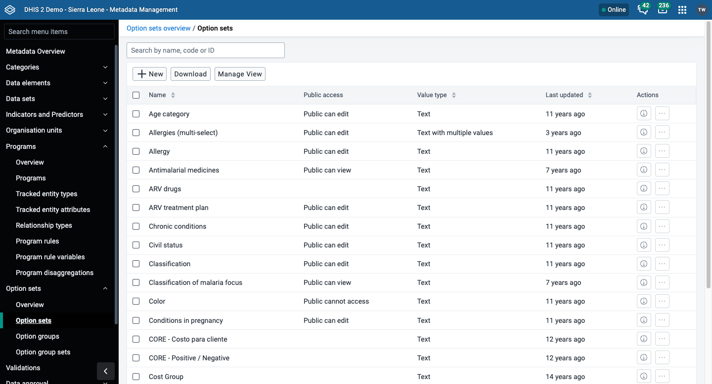
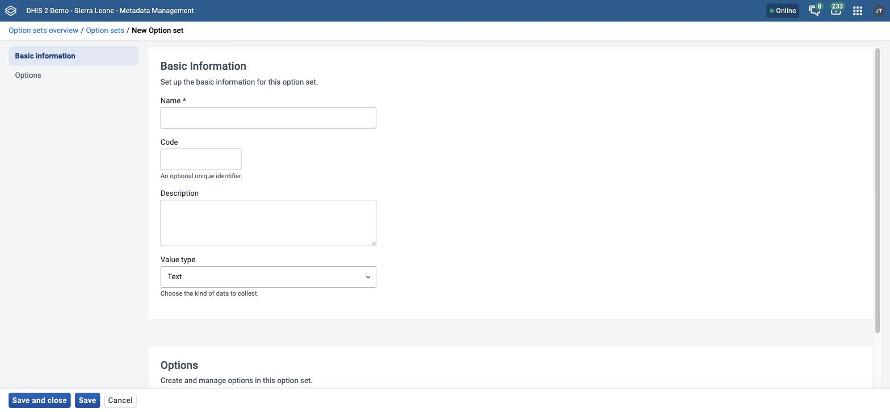

# Manage option sets { #mm_manage_option_set }

This chapter explains how option sets, option groups, and option group sets work, and how to configure them in the **Metadata Management** app.

> **Note**
>
> If your instance does not have the **Metadata Management** app installed, use the Maintenance app instead. See [Configure metadata](#maintenance_app).

For background on option sets, see [About option sets](#mm_about_option_set).

In the **Metadata Management** app, you manage these option set objects:

Table: Option set objects in the Metadata Management app

| Object type      | Available functions                                             |
| ---------------- | --------------------------------------------------------------- |
| Option set       | Create, edit, share, delete, show details, and translate        |
| Option group     | Create, edit, clone, share, delete, show details, and translate |
| Option group set | Create, edit, clone, share, delete, show details, and translate |

For **Show details**, **Sharing settings**, **Translate**, **Delete**, and **Clone**, see [Common actions](#mm_common_actions). Option sets do not support **Clone**. None of the object types on this page support **Merge**.

> **Background and reference**
>
> For background and concepts, see [Understanding option sets, attributes, constants, legends, and merging](#understanding_shared_metadata_concepts).

## Create or edit an option set { #mm_create_option_set }

> **Note**
>
> Each option needs a **Name** and a **Code**. After you create an option, you cannot change its code. The name and the code of an option must be unique within the option set.

1. Open the **Metadata Management** app and click **Option sets** > **Option sets**.
2. To create an option set, click **New**. To edit one, click the options menu of the option set and choose **Edit**.
3. Under **Basic information**, fill in **Name**, **Code**, and **Description**. Only **Name** is required. See [Common metadata object fields](#mm_common_metadata_fields).
4. Choose a **Value type**. You cannot change the value type after you create the option set.
5. Click **Save**. The form stays open so that you can add options. You cannot add options before you save the option set.
6. Under **Options**, add each option that you need:
    1. Click **Add option**. The **New option** panel opens.
    2. Enter a **Name** and a **Code**. Both are required.
    3. (Optional) Enter a **Description**. Under **Visual configuration**, choose a **Color** and an **Icon**. Data capture apps use them for this option.
    4. Click **Save option**. The option appears in the list.
7. (Optional) Put the options in order:
    - Click **Sort by name (A-Z)**, **Sort by name (Z-A)**, **Sort by code (asc)**, or **Sort by code (desc)**.
    - To move one option, use the up arrow and down arrow buttons in its row.
8. Click **Save**.

DHIS2 creates and updates each option when you click **Save option**. Saving an option does not save other changes to the option set. The order of the options, and the removal of options, apply when you click **Save** in the option set form.

To change or remove an option, click the options menu of the option in the list:

- Choose **Edit** to change the option. You cannot change its **Code**.
- Choose **Translate** to translate the option.
- Choose **Delete** to remove the option. The row shows **Will be removed on save** until you click **Save**. Click **Restore option** to keep the option.

To find an option in a long list, enter text in **Search by name or code**. The sort buttons are disabled while a filter is active.

## Create or edit an option group { #mm_create_option_group }

Option groups classify the options in an option set. An option group is a subset of the options in an option set. You can use option groups to filter a large option set into smaller, related parts.

Program rules can hide or show the options of an option group together in the **Capture** app.

> **Note**
>
> After you create an option group, you cannot change its **Option set**.

1. Open the **Metadata Management** app and click **Option sets** > **Option groups**.
2. Click **New**.
3. Fill in **Name**, **Short name**, **Code**, and **Description**. **Name** and **Short name** are required. See [Common metadata object fields](#mm_common_metadata_fields).
4. Choose the **Option set** that the group belongs to.
5. Assign the options that you want to group. The app shows the options of the chosen option set only. See [Use a transfer list](#mm_transfer_list_component).
6. Click **Save**.

## Create or edit an option group set { #mm_create_option_group_set }

Option group sets collect several option groups into one set. An option group set adds more dimensions to your captured data for analysis.

> **Note**
>
> After you create an option group set, you cannot change its **Option set**.

1. Open the **Metadata Management** app and click **Option sets** > **Option group sets**.
2. Click **New**.
3. Fill in **Name**, **Code**, and **Description**. See [Common metadata object fields](#mm_common_metadata_fields).
4. (Optional) Choose **Show as data dimension in analytics apps** to make the group set available as a dimension in analytics apps, next to the standard dimensions Period and Organisation unit.
5. Choose the **Option set** that the group set belongs to. If you change it before you save, the app clears the option groups that you chose.
6. Assign option groups to the group set. The **Available option groups** list is on the left. The **Selected option groups** list, with the option groups that are members of the group set, is on the right. See [Use a transfer list](#mm_transfer_list_component).
7. Click **Save**.
