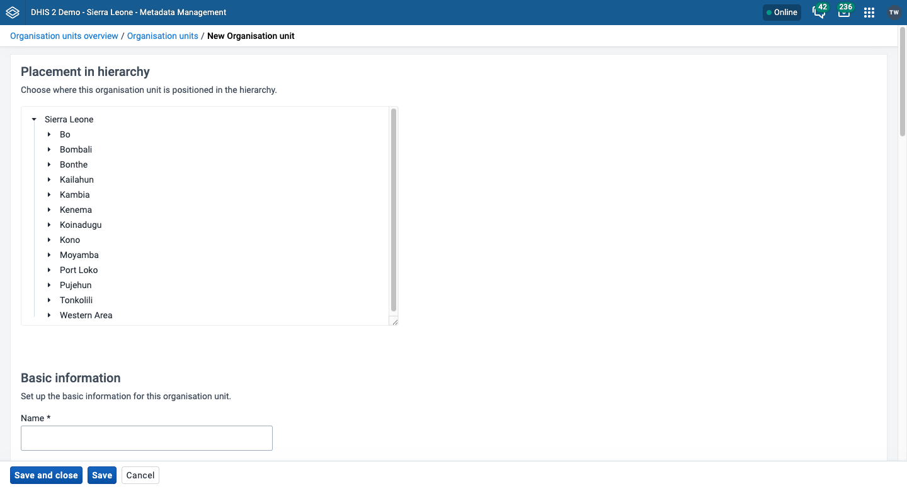
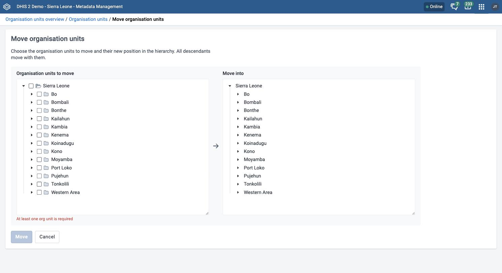
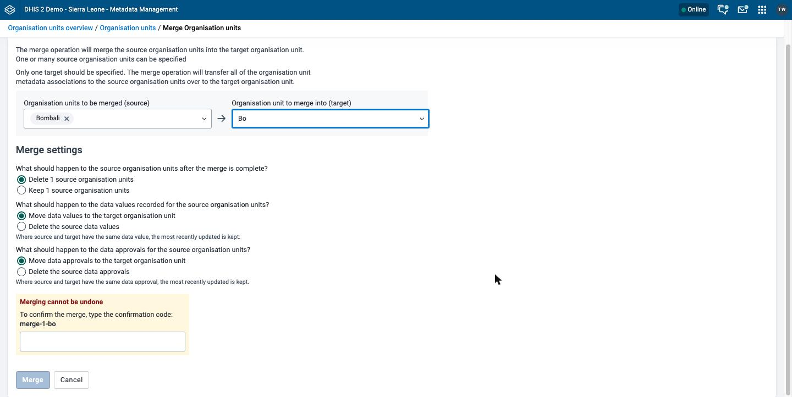

# Manage organisation units { #mm_manage_organisation_unit }

This chapter explains how organisation units, organisation unit levels, organisation unit groups, and organisation unit group sets work, and how to configure, move, close, and merge them in the **Metadata Management** app.

For background on organisation units, see [About organisation units](#mm_about_organisation_unit).

> **Note**
>
> If your instance does not have the **Metadata Management** app installed, use the Maintenance app instead. See [Configure metadata](#maintenance_app).

> **Background and reference**
>
> For background and concepts, see [Understanding organisation units](#understanding_organisation_units).

## Workflow { #mm_workflow_organisation_unit }

1. Create organisation units. Start at the top of the hierarchy and work down.
2. Create organisation unit groups.
3. Create organisation unit group sets.
4. Assign organisation units to groups.
5. Assign organisation unit groups to group sets.

## Create or edit an organisation unit { #mm_create_organisation_unit }

The **Organisation units** list shows the hierarchy as a tree. Click the arrow next to an organisation unit to show its children.

1. Open the **Metadata Management** app and click **Organisation units** > **Organisation units**.
2. To create an organisation unit, click **New**. To create it inside an existing organisation unit, click the options menu of the parent and choose **Add a unit inside**. To edit an organisation unit, click its options menu and choose **Edit**.
3. Under **Placement in hierarchy**, choose the parent organisation unit. If you chose **Add a unit inside**, the app chooses the parent for you. The app shows **Organisation unit will be positioned inside** and the name of the parent.
4. Fill in **Name**, **Short name**, **Code**, **Description**, **Comment**, and the contact details (**Contact person**, **Address**, **Email**, **Phone number**, and **URL**). See [Common metadata object fields](#mm_common_metadata_fields). **Name**, **Short name**, and **Opening date** are required.
5. Set an **Opening date**, which is the date from which the organisation unit is active. Optionally, set a **Closed date**. See [Close an organisation unit](#mm_close_organisation_unit).
6. (Optional) Under **Location**, enter the coordinates of the organisation unit.
7. Click **Save**.

If your instance is empty, the form shows the message **Creating first organisation unit**. The first organisation unit becomes the root of the hierarchy.

The form has these fields that the steps do not cover:

- **Image**: Click **Upload an image** to add a picture. The app accepts JPG, PNG, or GIF files of up to 10 MB.
- **Reference assignment**: Assign the organisation unit to data sets and programs. This section shows only when the system setting **Allow assigning object to related objects during add or update** is on. You find it under **Access** in the **System Settings** app.

In the **Location** section, you can enter the coordinates of a point in two fields. The app labels both fields **Longitude**. Enter the longitude in the first field and the latitude in the second field. If the organisation unit already has another geometry type, such as a polygon, the app shows the message that the coordinates are not editable. You cannot edit polygons in this app.

## Create or edit an organisation unit group { #mm_create_organisation_unit_group }

For background on organisation unit groups, see [Organisation unit groups and group sets](#understanding_organisation_unit_groups_and_group_sets).

1. Open the **Metadata Management** app and click **Organisation units** > **Organisation unit groups**.
2. Click **New**.
3. Fill in **Name**, **Short name**, **Code**, and **Description**. See [Common metadata object fields](#mm_common_metadata_fields). **Name** and **Short name** are required.
4. (Optional) Under **Visual configuration**, choose a **Color** and a **Symbol**. To set a symbol, choose it in the **Choose a symbol** dialog and click **Choose symbol**.
5. Under **Organisation units**, choose the organisation units to include in the group.
6. Click **Save**.

## Create or edit an organisation unit group set { #mm_create_organisation_unit_group_set }

For background on organisation unit group sets, see [Organisation unit groups and group sets](#understanding_organisation_unit_groups_and_group_sets).

1. Open the **Metadata Management** app and click **Organisation units** > **Organisation unit group sets**.
2. Click **New**.
3. Fill in **Name**, **Short name**, **Code**, and **Description**. See [Common metadata object fields](#mm_common_metadata_fields). **Name** and **Short name** are required.
4. (Optional) Choose any of these checkboxes:
    - **Compulsory: all organisation units must belong to at least one group in this group set.** Every organisation unit must be a member of a group in this group set.
    - **Show as data dimension in analytics apps**: The group set is available as a dimension in analytics apps.
    - **Inherit parent organisation unit groups**: When an organisation unit has no group assigned, the app uses the group of the closest parent.
5. Under **Organisation unit groups**, choose the groups to include in the group set.
6. Click **Save**.

DHIS2 does not stop you from putting one organisation unit in two groups of the same group set, and the app shows no warning. Keep each organisation unit in one group of a group set. The data integrity check **Organisation units which belong to multiple groups in a group set** lists the organisation units that break this rule.

## Assign names to organisation unit levels { #mm_name_organisation_unit_level }

After you create the organisation unit hierarchy, you can name each level. For example, in a national hierarchy, level 1 is "National", level 2 is "Province", level 3 is "District", and level 4 is "Facility".

1. Open the **Metadata Management** app and click **Organisation units** > **Organisation unit levels**.
2. In the row of the level, click **Edit** (pencil icon).
3. Enter a name in the **Name** column.
4. (Optional) In the **Offline levels** column, choose **Default** or a number from 1 to 15.
5. In the row of the level, click **Save**.

To cancel the change, click **Cancel** in the row. Each level has its own **Edit** and **Save**, so you name one level at a time.

## Move organisation units within a hierarchy { #mm_move_organisation_unit }

You can move organisation units within the hierarchy by changing their parent. All descendants of a moved organisation unit move with it. DHIS2 always uses the latest hierarchy to aggregate data, so a move changes the aggregation of historical data. See the **Important** note in [About organisation units](#mm_about_organisation_unit).

There are two ways to open the move screen:

- In the **Organisation units** list, choose the checkbox of each organisation unit that you want to move, and then click **Move...** in the toolbar above the list. The move screen opens with these organisation units already chosen.
- In the sidebar, click **Organisation units** > **Hierarchy operations**. The move screen opens with no organisation units chosen.

1. Open the **Move organisation units** screen with one of the two ways in the previous list.
2. In the **Organisation units to move** tree, choose the checkbox of each organisation unit that you want to move.
3. In the **Move into** tree, choose the organisation unit that becomes the new parent. To clear your choice, click the organisation unit again.
4. Check the summary, which shows how many organisation units move and where they move to.
5. Click **Move**.

The app shows the message **Organisation units successfully moved** and returns you to the **Organisation units** list. The **Move** button is disabled until you choose at least one organisation unit to move and one organisation unit to move into. To leave the screen without a change, click **Cancel**.

You cannot move an organisation unit into one of its own descendants. In this case, the app shows the message **Can not move an organisation unit to one of its descendants.** If a move fails, the app shows the message **There was an error moving organisation units:** and the names of the organisation units that it could not move.

## Close an organisation unit { #mm_close_organisation_unit }

When you close an organisation unit, you cannot register or edit events for this organisation unit in the **Capture** app.

1. Open the **Metadata Management** app and click **Organisation units** > **Organisation units**.
2. In the list, click the options menu of the organisation unit and choose **Edit**.
3. Enter a **Closed date**.
4. Click **Save**.

## Merge organisation units { #mm_merge_organisation_units }

Merging combines two or more duplicate organisation units into one. DHIS2 transfers the metadata associations of the source organisation units to the target organisation unit. These include data sets, programs, organisation unit groups, category options, users, visualizations, maps, event reports, and event charts. DHIS2 also transfers tracker data: tracked entities, enrollments, and events of event programs. You choose what happens to the source organisation units, their data values, and their data approvals. Organisation units can have data values and data approvals, so this merge screen has more **Merge settings** choices than the merge screens for most other object types. You need the `F_ORGANISATION_UNIT_MERGE` authority.

> **Note**
>
> Create the target organisation unit first, if it does not exist.

1. Open the **Metadata Management** app and click **Organisation units** > **Organisation units**.
2. Choose the checkbox of each organisation unit that you want to merge, including the organisation unit that you want to keep.
3. In the toolbar above the list, click **Merge...**.
4. In **Organisation units to be merged (source)**, choose the organisation units that DHIS2 removes.
5. In **Organisation unit to merge into (target)**, choose the organisation unit to keep.
6. Under **Merge settings**, choose what happens to the sources and to the data that is linked to them. See the following list.
7. Under **Merging cannot be undone**, enter the confirmation code, and click **Merge**.

The **Merge settings** are:

- **Delete** or **Keep** the source organisation units after the merge. The app deletes them by default. The choices show the number of sources, for example **Delete 2 source organisation units**.
- **Move data values to the target organisation unit** or **Delete the source data values**. The app moves them by default. If the source and the target both have the same data value, DHIS2 keeps the value that was updated most recently.
- **Move data approvals to the target organisation unit** or **Delete the source data approvals**. The app moves them by default. If the source and the target both have the same data approval, DHIS2 keeps the one that was updated most recently.

When the merge ends, the app shows **Merge complete**. Click **Back to list** to return to the list. For the steps that all merge screens share, see [Merge](#mm_common_actions_merge).

> **Warning**
>
> A merge cannot be undone, whatever you choose in **Merge settings**. If you delete the sources or their data, you cannot restore them.

## Delete an organisation unit { #mm_delete_organisation_unit }

The **Delete** action works as described in [Delete](#mm_common_actions_delete). The app source has no extra check or warning that is specific to organisation units. If DHIS2 refuses a deletion, the app shows the message from the server.

DHIS2 refuses to delete an organisation unit in these cases:

- The organisation unit has children. Delete or move the children first.
- The organisation unit has data values, or has had them. DHIS2 keeps a change history of data values, so deleting the data values does not remove the block.
- The organisation unit is the self-registration organisation unit in the system settings.

DHIS2 deletes an organisation unit that is a member of organisation unit groups, and removes it from the groups. When you delete an organisation unit that is assigned to users, DHIS2 removes it from their assigned organisation units.
