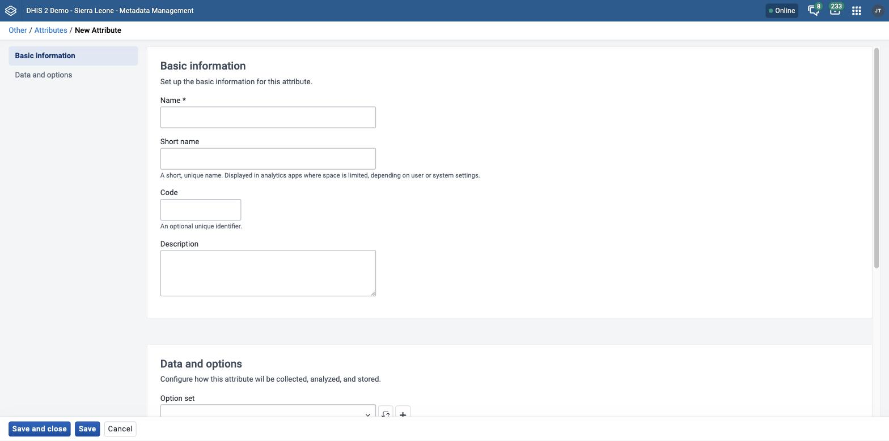
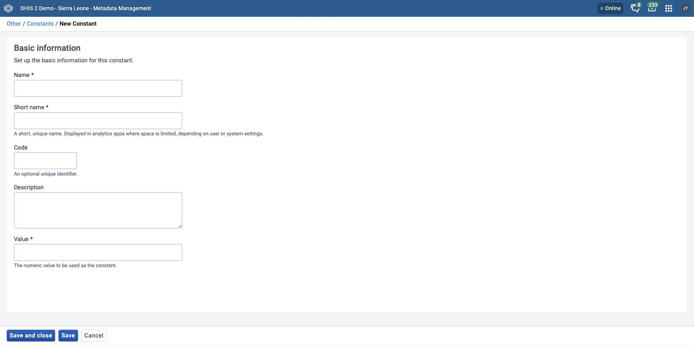
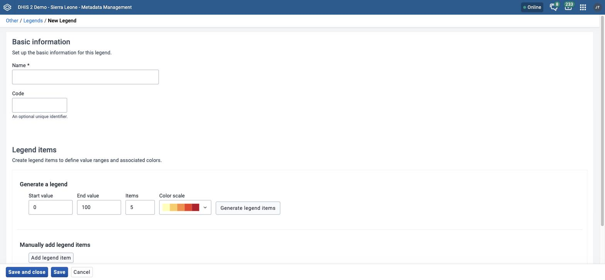
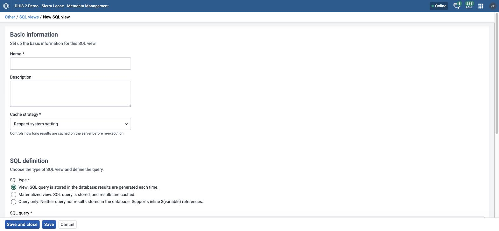
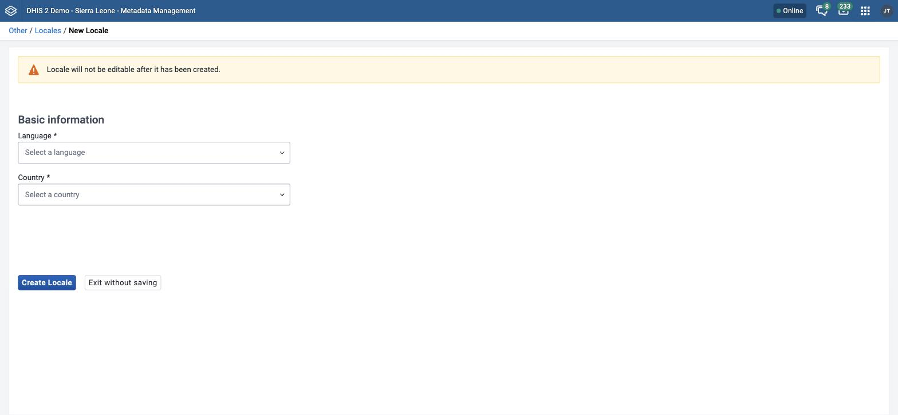

# Manage other configuration { #mm_manage_other_configuration }

This chapter explains how to manage attributes, constants, legends, external map layers, SQL views, analytics table hooks, locales, and group membership in the **Metadata Management** app. These topics have no shared theme. Each section is complete on its own, so go to the section that you need.

> **Note**
>
> The **Metadata Management** app replaces the functionality of the Maintenance app.
> If your instance does not have the **Metadata Management** app installed, use the Maintenance app instead. See [Configure metadata](#maintenance_app).

> **Background and reference**
>
> For background and concepts, see [Understanding option sets, attributes, constants, legends, and merging](#understanding_shared_metadata_concepts).

## Manage attributes { #mm_manage_attribute }

For background on attributes, see [About attributes](#mm_about_attribute).



In the **Metadata Management** app, you manage these attribute objects:

Table: Attribute objects in the Metadata Management app

| Object type | Available functions                                             |
| ----------- | --------------------------------------------------------------- |
| Attribute   | Create, edit, clone, share, delete, show details, and translate |

### Create or edit an attribute

To create an attribute, you need the `F_ATTRIBUTE_PUBLIC_ADD` or `F_ATTRIBUTE_PRIVATE_ADD` authority. To delete an attribute, you need the `F_ATTRIBUTE_DELETE` authority.

1. Open the **Metadata Management** app and click **Other** > **Attributes**.
2. To create an attribute, click **New**. To edit one, click the options menu of the attribute and choose **Edit**.
3. Under **Basic information**, fill in **Name**, **Short name**, **Code**, and **Description**. Only **Name** is required. Each attribute must have a unique name. See [Common metadata object fields](#mm_common_metadata_fields).
4. Under **Data and options**, choose an **Option set** to limit the values of the attribute to a predefined list. This step is optional. DHIS2 then sets the **Value type** from the option set.
5. If you did not choose an option set, choose a **Value type**.
6. (Optional) In **Display order**, enter a number to set the position of the attribute in lists and forms. Attributes without a number are shown afterwards.
7. Choose the options that you need, and choose the object types in **Applies to**:
    - **Mandatory: all objects must have a value for this attribute**: Every object of the chosen types must have a value for the attribute.
    - **Unique values only**: DHIS2 makes sure that no two objects of the same type have the same value.
8. Click **Save and close**. The attribute is available for the object types that you chose in **Applies to**.

If the value that you enter for an attribute in an object form does not match its value type, the app does not save the object. It shows a **Validation errors** notice with a message for the value type, for example **Please provide a round number without decimals** for an **Integer** attribute. The field of a number value type does not accept letters.

If you edit an attribute and change its **Value type**, the app asks you to confirm. If the attribute already has data, a new type can make existing values incompatible and affect analytics tables.

For **Show details**, **Sharing settings**, **Translate**, **Delete**, and **Clone**, see [Common actions](#mm_common_actions).

## Manage constants { #mm_manage_constant }

For background on constants, see [About constants](#mm_about_constant).



In the **Metadata Management** app, you manage these constant objects:

Table: Constant objects in the Metadata Management app

| Object type | Available functions                                             |
| ----------- | --------------------------------------------------------------- |
| Constant    | Create, edit, clone, share, delete, show details, and translate |

### Create or edit a constant { #mm_create_constant }

To create a constant, you need the `F_CONSTANT_ADD` authority. To delete a constant, you need the `F_CONSTANT_DELETE` authority.

1. Open the **Metadata Management** app and click **Other** > **Constants**.
2. To create a constant, click **New**. To edit one, click the options menu of the constant and choose **Edit**.
3. Fill in **Name**, **Short name**, **Code**, **Description**, and **Value**. **Name**, **Short name**, and **Value** are required. **Value** must be a number. Write a brief description that explains what the constant represents. See [Common metadata object fields](#mm_common_metadata_fields).
4. Click **Save and close**. The constant is available for use.

If DHIS2 cannot delete a constant, the app shows an error notice that starts with **Something went wrong deleting**, followed by the reason from DHIS2.

DHIS2 does not block the deletion of a constant that an indicator expression uses. The expression keeps the reference `C{constant ID}`, and the indicator form then shows **Invalid expression** for the numerator. Check where you use a constant before you delete it.

For **Show details**, **Sharing settings**, **Translate**, **Delete**, and **Clone**, see [Common actions](#mm_common_actions).

## Manage legends { #mm_manage_legend }

For background on legends, see [About legends](#mm_about_legend).

In the **Metadata Management** app, you manage these legend objects:

Table: Legend objects in the Metadata Management app

| Object type | Available functions                                             |
| ----------- | --------------------------------------------------------------- |
| Legend      | Create, edit, clone, share, delete, show details, and translate |

### Create or edit a legend { #mm_create_legend }

To create a legend, you need the `F_LEGEND_SET_PUBLIC_ADD` or `F_LEGEND_SET_PRIVATE_ADD` authority. To delete a legend, you need the `F_LEGEND_SET_DELETE` authority.

> **Note**
>
> A legend cannot have gaps. Legend items cannot overlap. The end value of a legend item must be greater than its start value. If a rule is broken, the app shows an error such as **Legend items must not have gaps.** or **Legend items must not overlap.**



1. Open the **Metadata Management** app and click **Other** > **Legends**.
2. To create a legend, click **New**. To edit one, click the options menu of the legend and choose **Edit**.
3. Fill in **Name** and **Code**. Only **Name** is required.
4. Create the legend items. In the **Generate a legend** panel:

    1. Enter a **Start value** and an **End value**. The defaults are 0 and 100.
    2. Enter the number of **Items**, from 3 to 9. The default is 5.
    3. Click the **Color scale** menu and choose a color scale.
    4. Click **Generate legend items**.

    The app divides the range into items of equal size. It names each item with its range, for example `0 - 20`, and gives each item a color from the color scale. The app lists the items in order of their start values.

5. (Optional) Add a legend item by hand. Click **Add legend item**. The app adds an item that starts where the last item ends and covers 10 units. In the item row, change **Name**, **Start value**, and **End value**.
6. (Optional) Change an item. To change its color, click the color swatch (**Change color**) and choose a color in the color picker. To remove the item, click the **Delete** button (trash icon) at the end of its row.
7. Click **Save and close**.

After you create legend items, the **Generate a legend** panel is replaced by the **Generate a new legend...** button. Click it to open the **Legend generator** dialog. The dialog warns that new legend items replace all legend items in the table. Enter the values, choose a color scale, and click **Create legend items**.

For an example of legend items, see [About legends](#mm_about_legend).

If DHIS2 cannot delete a legend, the app shows an error notice that starts with **Something went wrong deleting**, followed by the reason from DHIS2.

DHIS2 does not block the deletion of a legend that an indicator uses. The deletion removes the legend from the indicator.

### Assign a legend to an indicator or data element { #mm_assign_legend }

You can assign a legend to an indicator or a data element in the **Metadata Management** app, when you create the object or when you edit it. You can assign more than one legend. In the data element form, use the **Legend set** section. In the indicator form, use the **Legends** section. Both sections use a transfer list. See [Use a transfer list](#mm_transfer_list_component).

When you choose that indicator or data element in the **Maps** app, the system automatically chooses the assigned legend.

For **Show details**, **Sharing settings**, **Translate**, **Delete**, and **Clone**, see [Common actions](#mm_common_actions).

### See also { #mm_see_also_legend }

- [Using the GIS app](#using_gis)

## Manage external map layers { #mm_manage_external_maplayer }

> **Note**
>
> The sidebar of the **Metadata Management** app lists **External map layers** under **Other**. The app has no screen for external map layers. When you click **External map layers**, the app shows the notice **Section is not implemented yet** and the **Go to legacy app** button. The button opens the matching page of the Maintenance app. Configure external map layers there. See [Manage external map layers](#manage_external_maplayer).
>
> Managing external map layers is planned to move into the **Maps** app and will not be replicated in the **Metadata Management** app.

## Manage SQL views { #mm_manage_sql_view }

For background on SQL views, see [About SQL views](#mm_about_sql_views).

In the **Metadata Management** app, you manage these SQL view objects:

Table: SQL view objects in the Metadata Management app

| Object type | Available functions                                                                                                                   |
| ----------- | ------------------------------------------------------------------------------------------------------------------------------------- |
| SQL view    | Create, edit, clone, share, delete, show details, view results, create or update the view, and refresh data (materialized views only) |

### Create or edit a SQL view

To create a SQL view, you need the `F_SQLVIEW_PUBLIC_ADD` or `F_SQLVIEW_PRIVATE_ADD` authority. To delete a SQL view, you need the `F_SQLVIEW_DELETE` authority.



1. Open the **Metadata Management** app and click **Other** > **SQL views**.
2. To create a SQL view, click **New**. To edit one, click the options menu of the SQL view and choose **Edit**.
3. Fill in **Name** and **Description**. **Name** is required. DHIS2 uses the name of the SQL view to name the table that it creates when you create the view. The description explains what the SQL view does.
4. Choose a **Cache strategy**. This field is required. It controls how long DHIS2 caches results on the server before it runs the query again. The default is **Respect system setting**. The other choices are **No cache**, **Cache for 1 minute**, **Cache for 5 minutes**, **Cache for 10 minutes**, **Cache for 15 minutes**, **Cache for 30 minutes**, **Cache for one hour**, **Cache until 6am tomorrow**, and **Cache for two weeks**.
5. Choose an **SQL type**. You cannot change the type after you create the SQL view.
    - **View**: DHIS2 stores the SQL query in the database and generates the results each time.
    - **Materialized view**: DHIS2 stores the SQL query in the database and caches the results in the database.
    - **Query only**: DHIS2 stores neither the query nor the results in the database.
6. In **SQL query**, enter the SQL view definition. DHIS2 allows only SQL `SELECT` statements. Some sensitive tables, such as user information, are not accessible.
7. Click **Save and close**. If you created a **View** or a **Materialized view**, you must also create the view. See [Run and view a SQL view](#mm_run_sql_view).

The columns that the `SELECT` statement returns become table columns. They must be of a valid table column type. When you use functions, you might need to cast the result to a type. To do this, add `::{TYPE}` after the function.

For example, instead of `jsonb_each`, which returns a record type that cannot be a column type, use `jsonb_each_text` and cast the result to `text`, as in the following example:

```sql
select jsonb_each_text(eventdatavalues)::text from ...
```

For background on variables, see [Variables in SQL views](#mm_sql_view_variables). Under **SQL query**, the buttons **Current user id** and **Current username** insert the variables `${_current_user_id}` and `${_current_username}`. When you run the query, the app asks for a value for each other variable in the query.

For background on SQL views that call other SQL views, see [SQL views that call other SQL views](#mm_sql_views_call_other_views).

### Run and view a SQL view { #mm_run_sql_view }

1. Open the **Metadata Management** app and click **Other** > **SQL views**.
2. For a **View** or a **Materialized view**, click the options menu of the SQL view and choose **Create or update view**. The app shows the message **SQL view created or updated.** For a **Query only** SQL view, go to step 3.
3. Click the options menu of the SQL view and choose **View results**. The **SQL view results** panel opens.
4. (Optional) For a **Materialized view**, click **Refresh data** to update the cached results. The app shows the message **Materialized view data refreshed.**
5. (Optional) Click **Download** and choose a format: **Excel (.xlsx)**, **CSV (.csv)**, **PDF (.pdf)**, **HTML (.html)**, **XML (.xml)**, or **JSON (.json)**.

For a **Query only** SQL view, the options menu has **Run query** instead of **Create or update view**. If the query has variables, the **SQL view results** panel shows the notice **Variables required**. Click **Provide variables and run**, enter a value for each variable in the **Query variables** dialog, and click **Run query**.

If you choose **View results** before you create the view, the panel shows **No results available yet** and a button that creates the view.

For **Show details**, **Sharing settings**, **Delete**, and **Clone**, see [Common actions](#mm_common_actions). SQL views do not have **Translate**.

> **Tip**
>
> If you have a view which depends on another view, be careful about how the
> views are named. When analytics is run on the DHIS2 server, all views are
> dropped and then recreated: they are dropped in _reverse_ alphabetical order
> and recreated in _regular_ alphabetical order. So a view must come _after_
> the view it depends on alphabetically. For example, "ViewB" can safely depend
> on "ViewA". If you name them the other way round, analytics may fail because
> the dependency will not exist yet when the dependent view is recreated.

## Manage analytics table hooks { #mm_manage_analytics_table_hooks }

For background on analytics table hooks, see [About analytics table hooks](#mm_about_analytics_table_hooks).

See also [`/api/analyticsTableHooks` in the Developer documentation](#webapi_analytics_table_hooks).

In the **Metadata Management** app, you manage these analytics table hook objects:

Table: Analytics table hook objects in the Metadata Management app

| Object type          | Available functions                           |
| -------------------- | --------------------------------------------- |
| Analytics table hook | Create, edit, clone, delete, and show details |

### Create or edit an analytics table hook

To create an analytics table hook, you need the `F_ANALYTICSTABLEHOOK_ADD` authority. To delete one, you need the `F_ANALYTICSTABLEHOOK_DELETE` authority.

1. Open the **Metadata Management** app and click **Other** > **Analytics table hooks**.
2. To create an analytics table hook, click **New**. To edit one, click the options menu of the analytics table hook and choose **Edit**.
3. In **Name**, enter a name.
4. Choose a **Phase**: **Resource tables** or **Analytics tables**. The phase sets when DHIS2 runs the hook.
5. Choose the table. If you chose **Resource tables**, use **Which resource table**, for example **Organisation unit structure**. If you chose **Analytics tables**, use **Which analytics table**, for example **Data value**. The app shows only the menu that matches the phase.
6. In **SQL**, enter the SQL code that DHIS2 runs.
7. Click **Save and close**.

All fields are required. If a hook with the same phase, table, and SQL exists, the app shows the message **An analytics table hook with this table and SQL already exists.** If you change the phase, the app clears the table that you chose.

For **Show details**, **Delete**, and **Clone**, see [Common actions](#mm_common_actions). Analytics table hooks do not have **Sharing settings** or **Translate**.

## Manage locales { #mm_manage_locale_management }

For background on locales, see [About locales](#mm_about_locales).



In the **Metadata Management** app, you manage these locale objects:

Table: Locale objects in the Metadata Management app

| Object type | Available functions              |
| ----------- | -------------------------------- |
| Locale      | Create, delete, and show details |

### Create a locale

To create a locale, you need the `F_LOCALE_ADD` authority. To delete a locale, you need the `F_LOCALE_DELETE` authority.

> **Note**
>
> You cannot edit a locale after you create it.

1. Open the **Metadata Management** app and click **Other** > **Locales**.
2. Click **New**.
3. Choose a **Language**. To find a language, type in the menu.
4. Choose a **Country**. To find a country, type in the menu.
5. Click **Create Locale**. The custom locale is available as one of the translation locales in the system.

To leave the form without a new locale, click **Exit without saving**.

The locale list has a search box (**Search by name, code or ID**). The options menu of a locale has only **Show details** and **Delete**. **Show details** shows **Created**, **Last updated**, and **Id**. A locale does not have **Edit**, **Clone**, **Sharing settings**, or **Translate**.

When you delete a locale, the translations that you entered in that locale stay on the objects.

## Manage group membership { #mm_edit_multiple_object_groups }

The legacy Maintenance app had a separate **Metadata group editor** screen for adding objects to groups in bulk. The **Metadata Management** app does not have an equivalent screen, and one is not planned. Instead, you edit group membership from either side of the relationship.

- To put one object into several groups, open the edit form of the object and use the **Groups** section. The section has a transfer list with the **Available groups** and **Selected groups** lists. For example, the **Groups** section in [Create or edit a data element](#mm_create_data_element) puts one data element into as many data element groups as you need, without leaving the data element. The **Groups** section is available for data elements, indicators, and category options.
- To put several objects into one group, open the edit form of the group and assign the members there. For example, [Create or edit a data element group](#mm_create_data_element_group) assigns any number of data elements to a single group in one pass.

The other grouped object types in this chapter have no **Groups** section in the form of the member. Assign their members from the form of the group: indicator groups, category option groups, option groups, predictor groups, validation rule groups, and organisation unit groups. Group sets work in the same way. Open the form of the group set and assign groups to it.

Most of these forms use the standard [transfer list](#mm_transfer_list_component). The form of an organisation unit group uses an organisation unit tree in the **Organisation units** section instead.

To see or change which objects are in a group, open the list of groups from the sidebar, for example **Data elements** > **Data element groups**, and edit the group that you want.

When you save, DHIS2 saves the object first and then updates the group membership. If the group update fails, the app shows the message **Group assignment failed. Other values have been saved/updated**. Your other changes are saved. Correct the problem and save the form again.

> **Tip**
>
> When you assign members to a group, use the **Show only unassigned items**
> checkbox in the **Available** panel, where it is offered, to hide objects that already
> belong to another group of the same type. The checkbox is available in the forms of data element groups, indicator groups, predictor groups, and validation rule groups.
> See [Use a transfer list](#mm_transfer_list_component).
