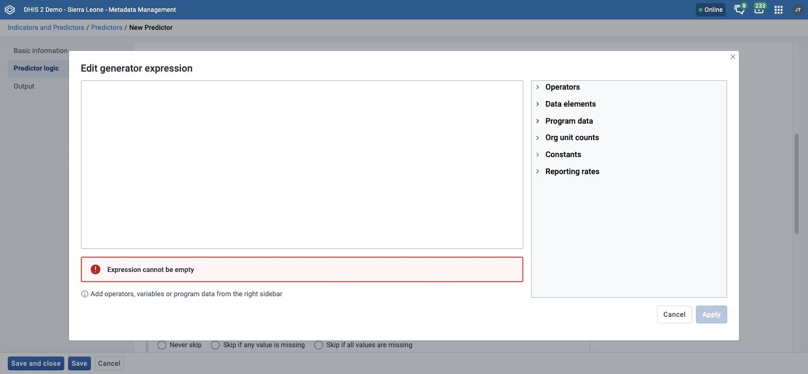
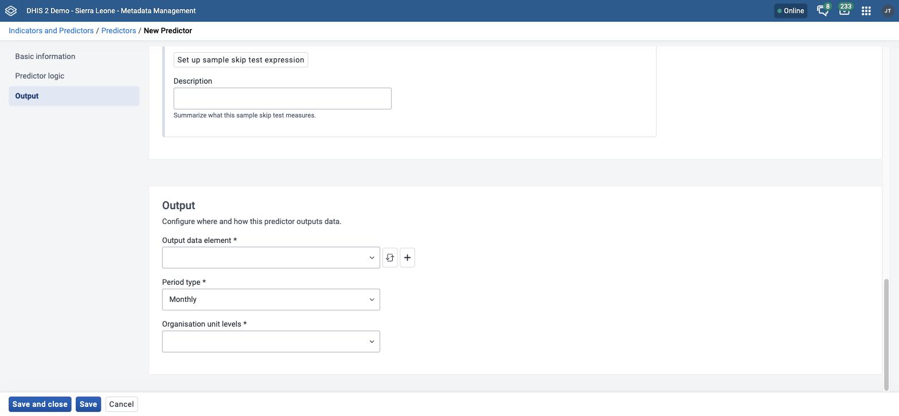

# Manage predictors { #mm_manage_predictor }

This chapter describes how to configure and run predictors and predictor groups in the **Metadata Management** app.

> **Note**
>
> If your instance does not have the **Metadata Management** app installed, use the Maintenance app instead. See [Configure metadata](#maintenance_app).

For background on how a predictor uses data and organisation unit levels, see [About predictors](#mm_about_predictors).
For background on how a predictor samples previous periods, see [Sampling previous periods](#mm_sampling_previous_periods).
For background on output disaggregations, see [Predictors and category option combinations (disaggregations)](#mm_predictor_category_option_combinations).
For background on attribute option combinations, see [Predictors and attribute option combinations](#mm_predictor_attribute_option_combinations).

> **Background and reference**
>
> For background and concepts, see [Understanding indicators, predictors, and expressions](#understanding_indicators_predictors_and_expressions). For the functions you can use, see [Reference: predictor generator expression functions and operators](#reference_predictor_generator_expressions).

## Create or edit a predictor { #mm_create_predictor }

You need the `F_PREDICTOR_ADD` authority to create a predictor.

1. Open the **Metadata Management** app and click **Indicators and Predictors** > **Predictors**.
2. To create a predictor, click **New**. To edit one, click the options menu of the predictor and choose **Edit**.
3. In the **Basic information** section, fill in **Name**, **Short name**, **Code**, and **Description**. **Code** and **Description** are optional. See [Common metadata object fields](#mm_common_metadata_fields).
4. In the **Predictor logic** section, set where the input data comes from and how many periods to sample. See [Sampling previous periods](#mm_sampling_previous_periods).

    1. In **Organisation units providing data**, choose **At selected level(s) only** or **At selected level(s) and all levels below**. For aggregate data, this field controls where the input values come from. If you choose **At selected level(s) only**, DHIS2 includes only the organisation units at the levels that you choose in the **Output** section. If you choose **At selected level(s) and all levels below**, DHIS2 also includes all organisation units below those levels. The default is **At selected level(s) only**.
    2. In **Sequential sample count**, enter the number of sequential periods that the calculation goes back in time to sample data. This field is required. The default is 0.
    3. In **Annual sample count**, enter the number of years that the calculation goes back in time to sample data. This field is required. The default is 0.
    4. (Optional) In **Sequential skip count**, enter the number of sequential periods immediately before the predicted period that DHIS2 skips before it samples the data.

5. In the **Generator** part of the **Predictor logic** section, set up the generator. The generator is the expression that DHIS2 uses to calculate the predicted value.

    1. Click **Set up generator expression**. If the predictor already has a generator, the button is **Edit generator expression**. The **Edit generator expression** dialog opens.

        

    2. Enter the generator expression. Type it, or use the panels at the right of the expression field to add items at the cursor:

        - **Data elements** for aggregate data.
        - **Program data** for program data elements, attributes, or program indicators.
        - **Org unit counts** for organisation unit counts.
        - **Constants** for constants.
        - **Reporting rates** for reporting rates.

        To use sampled data from past periods, enclose each item in an aggregate function. For the aggregate functions, the other functions that you can use, and examples of generator expressions, see [Generator expressions](#mm_predictor_generator_expressions).

    3. Click **Apply**. The app validates the expression. If the expression is valid, the **Valid expression** message shows a description of the expression. If it is not valid, the app shows the message **Invalid expression** and **Apply** is not available.
    4. In **Description**, enter a description of the generator. This field is required.
    5. Choose a **Missing value strategy**. This sets whether DHIS2 evaluates the generator expression at all when some of the data that it references is missing.

        | Option                         | Description                                                                                                                                                                                                              |
        | ------------------------------ | ------------------------------------------------------------------------------------------------------------------------------------------------------------------------------------------------------------------------ |
        | Skip if any value is missing   | DHIS2 does not evaluate the expression if any of the values that make it up are missing, so DHIS2 predicts no value.                                                                                                     |
        | Skip if all values are missing | DHIS2 does not evaluate the expression only if _every_ value that makes it up is missing. If at least one value is present, the expression runs and DHIS2 treats the missing values as zero. This is the default option. |
        | Never skip                     | DHIS2 always evaluates the expression, and treats every missing value as zero.                                                                                                                                           |

        For how the strategy affects missing values inside the expression, see [Missing values in generator expressions](#mm_predictor_missing_values).

6. (Optional) In the **Sample skip test** part of the **Predictor logic** section, set up the sample skip test. The sample skip test tells DHIS2 which previous periods, if any, to exclude from the sample.

    1. Click **Set up sample skip test expression**. If the predictor already has a sample skip test, the button is **Edit sample skip test expression**. The **Edit sample skip test expression** dialog opens.
    2. Enter the sample skip test expression. Build the expression from the same items as the generator expression, using the same panels and operators. You can also use the non-aggregating functions that [Generator expressions](#mm_predictor_generator_expressions) describes. The expression must evaluate to a boolean value of true or false. See the boolean expression notes in [Generator expressions](#mm_predictor_non_aggregating_functions).

        For examples of sample skip test expressions, see [Sample skip test expression examples](#mm_sample_skip_test_examples).

    3. Click **Apply**.
    4. (Optional) In **Description**, enter a description of the sample skip test.

    To remove the sample skip test, click **Clear expression**.

7. In the **Output** section, set where DHIS2 stores the predicted values.

    

    1. In **Output data element**, choose the data element. DHIS2 stores the values that this predictor generates as aggregate data for this data element and the predicted period. This field is required.

        DHIS2 rounds the value according to the value type of the data element. If the value type is an integer type, DHIS2 rounds the predicted value to the nearest integer. For all other value types, DHIS2 rounds the number to four significant digits. If there are more than four digits to the left of the decimal place, DHIS2 does not replace them with zeros.

    2. (Optional) In **Output category option combination**, choose the disaggregation to output to, or choose **Predict using input category option combination**. The field shows only if the output data element has a category combination other than "None". See [Predictors and category option combinations (disaggregations)](#mm_predictor_category_option_combinations).
    3. In **Period type**, choose a period type. The default is **Monthly**.
    4. In **Organisation unit levels**, choose one or more levels. DHIS2 assigns the output value to an organisation unit at one of these levels. For aggregate data, the input values depend on the **Organisation units providing data** field. For tracker-based data, the input values come from the organisation unit to which DHIS2 assigns the output, or from any organisation unit below it. See [Predictor organisation unit levels](#mm_predictor_organisation_unit_levels).

8. Click **Save**.

For **Show details**, **Translate**, **Delete**, and **Clone**, see [Common actions](#mm_common_actions).

For a predictor that runs once for each data element in a data element group, see [Predictions by data element group](#mm_predictions_by_data_element_group).

## Run a predictor or predictor group { #mm_run_predictor }

You can run a predictor, or a predictor group, for a range of dates. DHIS2 then generates the predicted values for the periods in that range.

1. Open the **Metadata Management** app and click **Indicators and Predictors** > **Predictors**. To run a predictor group, click **Indicators and Predictors** > **Predictor groups**.
2. Click the options menu of the predictor or predictor group and choose **Run now**. The **Run predictor** dialog opens.
3. In **Start date**, enter or choose the first date of the range.
4. In **End date**, enter or choose the last date of the range.
5. Click **Run now**. The button is not available until you set both dates. The app shows a message that the run started. The default message is **Predictor run started successfully**.

## Create or edit a predictor group { #mm_create_predictor_group }

You need the `F_PREDICTORGROUP_ADD` authority to create a predictor group.

1. Open the **Metadata Management** app and click **Indicators and Predictors** > **Predictor groups**.
2. To create a predictor group, click **New**. To edit one, click the options menu of the predictor group and choose **Edit**.
3. In the **Basic information** section, fill in **Name**, **Code**, and **Description**. **Name** is required and must be unique. **Code** and **Description** are optional. A **Code** must be unique. See [Common metadata object fields](#mm_common_metadata_fields).
4. In the **Predictors** section, move the predictors that you want to assign to the group to the **Selected** list. See [Use a transfer list](#mm_transfer_list_component).
5. Click **Save**.

For **Show details**, **Sharing settings**, **Translate**, **Delete**, and **Clone**, see [Common actions](#mm_common_actions). Predictor groups also support **Run now**. See [Run a predictor or predictor group](#mm_run_predictor).
