# Program disaggregations { #mmp_program_disaggregations }

This chapter explains how program disaggregation mappings connect program data to category options, and how to set them up in the **Metadata Management** app.

> **Note**
>
> The **Metadata Management** app replaces the functionality of the Maintenance app.
> If your instance does not have the **Metadata Management** app installed, use the Maintenance app instead. See [Configure metadata](#maintenance_app).

Program disaggregations are available in DHIS2 v42 and later, and only in the **Metadata Management** app. The Maintenance app does not support them. In the **Metadata Management** app, click **Programs** > **Program disaggregations**.

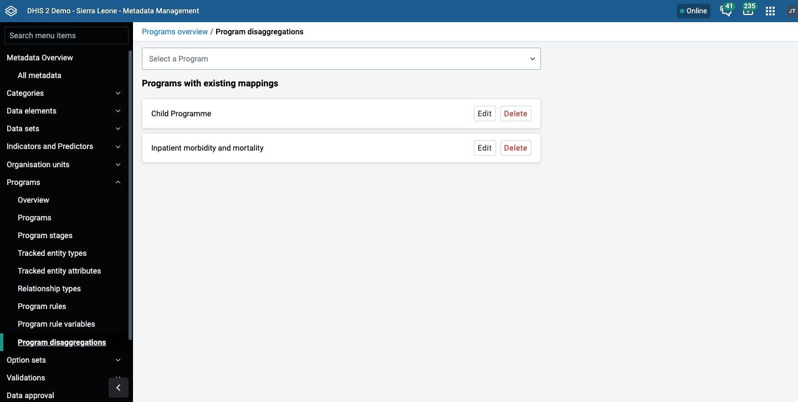

The page has these parts:

- **Select a Program**: a menu to start a mapping for a program. Programs that already have a mapping are not available in the menu.
- **Programs with existing mappings**: a list of every program that has a mapping. Each program has **Edit** and **Delete** actions.

To delete the mappings of a program, click **Delete** next to the program. The **Delete Mapping** dialog shows the number of mappings and the warning **This action cannot be undone.** Click **Delete** to confirm. This removes all mappings of the program.

For the concept of program disaggregation mappings, see [About program disaggregation mappings](#mmp_about_program_disaggregation_mappings).

> **Background and reference**
>
> For background and concepts, see [Understanding programs, tracker configuration, and program disaggregation](#understanding_programs_and_tracker).

## Program indicator card fields { #mmp_program_disaggregation_card_fields }

Each program indicator card has these fields:

- **Disaggregation category combination**: a category combination of data dimension type disaggregation. The menu does not show the default category combination.
- **Attribute category combination**: a category combination of data dimension type attribute.
- **Data element for aggregate data export**: the ID of a data element. See [Transfer program indicator data with the Aggregate data exchange app](#mmp_program_disaggregation_exchange).

If you leave a category combination at its default value, the card shows **Category option combination for aggregate data export** (disaggregation) or **Attribute option combination for aggregate data export** (attribute) instead of category mappings. Enter the ID of a category option combination or an attribute option combination.

## Set up new program disaggregation mappings { #mmp_program_disaggregation_mapping }

Before you start, create the category combination that you want to use. For this example, create a category combination that contains the categories **Gender** and **Under 5/5 and above of age**. See [Manage categories](#mm_manage_category).

You need DHIS2 v42 or later, and a program that has at least one program indicator.

1. Open the **Metadata Management** app, click **Programs** > **Program disaggregations**, and choose a program in **Select a Program**. For this example, choose the **Inpatient morbidity and mortality** program.

    The form for the program opens.

    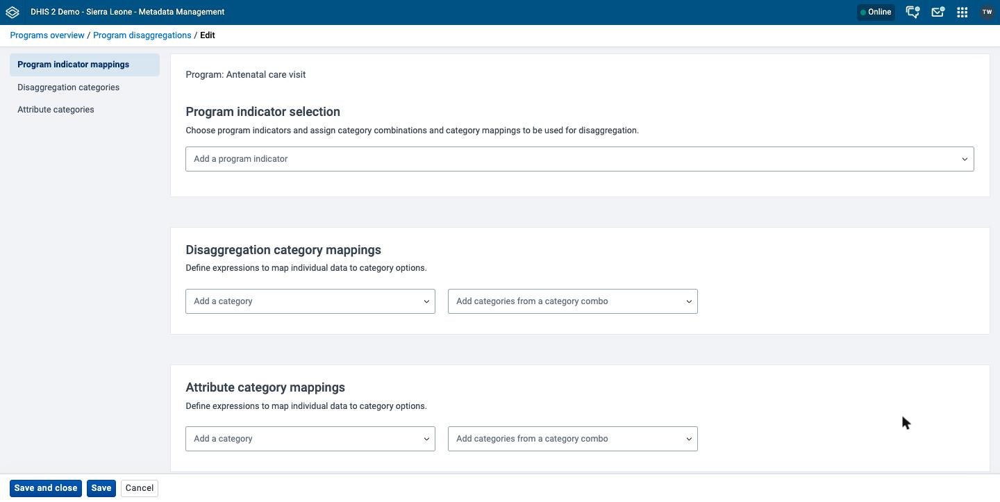

2. In **Add a program indicator**, choose a program indicator. For this example, choose **BMI**.

    The menu does not offer program indicators that you already added.

3. In **Disaggregation category combination**, choose **Gender and U5y**.

    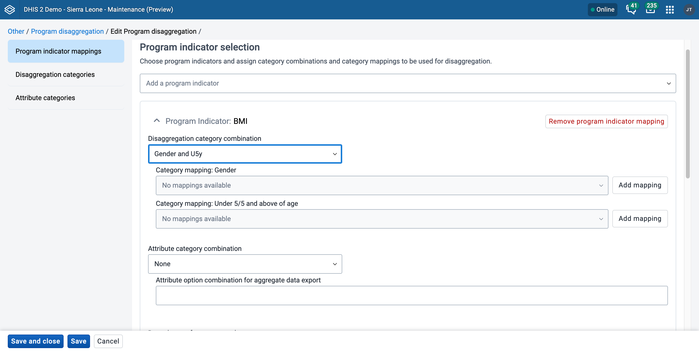

    The card shows a **Category mapping** menu for each category of the combination. The menus are empty and disabled until you add mappings for the categories.

4. In **Disaggregation category mappings**, find the suggestion row for each category of the combination. The row shows **Suggested based on Program Indicator selections**. Click **Add category** for **Gender** and for **Under 5/5 and above of age**.

    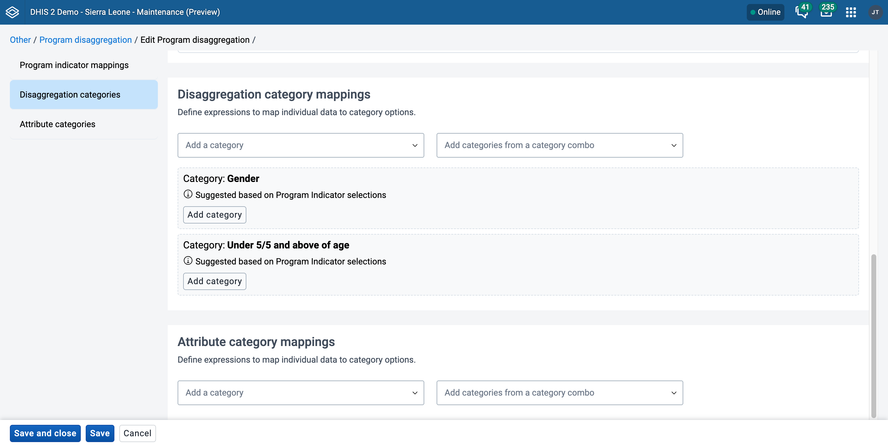

    You can also choose a category in **Add a category**, or choose all categories of a combination in **Add categories from a category combo**.

    A message shows how many categories the app added. DHIS2 creates one mapping for each category. The name of the mapping is "Standard" followed by the category name and "mapping".

### Create the category mappings { #mmp_program_disaggregation_expressions }

Each category option has an expression. The expression is true for the program data that belongs to the category option.

5. For each category option, click **Edit filter**. A category option without an expression shows **(No Value)**.

    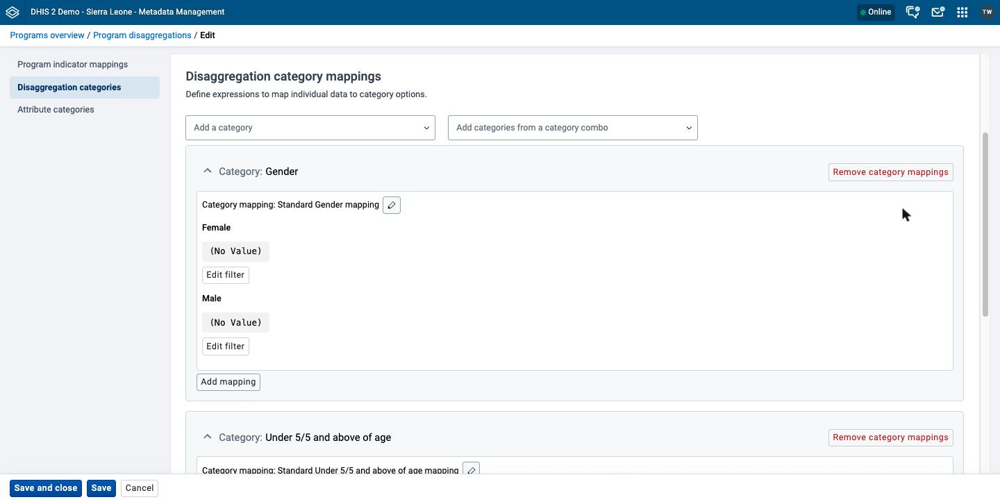

6. In the dialog, enter the expression in the text area. To add an item, use the sidebar on the right. Then check the message under the text area. If the message is **Expression not yet validated**, click **Validate**. Click **Apply**.

    The expression uses the same syntax as the **Filter** of a program indicator. See [Reference information: Functions, variables and operators to use in program indicator expressions and filters](#mmp_program_indicator_functions_variables_operators). The dialog validates the expression in the same way as the program indicator filter dialog.

    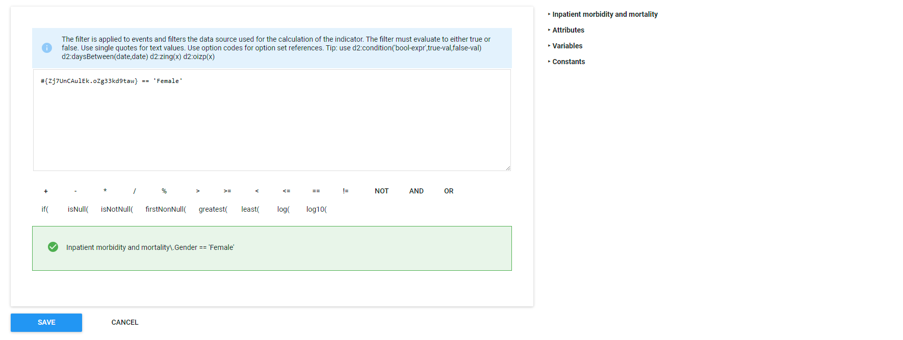{ .center width=60% }

    This example links the value of the **Gender** data element in the program to the category option. The option set of the data element is text, so the expression matches the text 'Female'. The age example shows a different way to define the relationship.

    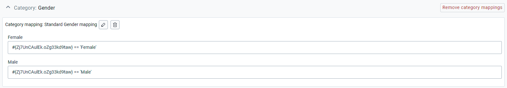

    The age data element is numeric. To map **Under 5 years** and **5 years and above**, use the operators `>`, `>=`, `<`, `<=`, `==` and `!=`.

    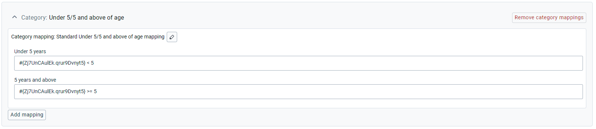

7. When all category options have an expression, click **Save and close**. To stay on the form, click **Save**.

If you also need to map an attribute category combination for the program indicator, repeat this process under **Attribute category mappings**. Choose an **Attribute category combination** instead. You can map an attribute category combination instead of, or in addition to, the disaggregation category combination.

If an expression is not valid, the **Category mapping** menu on the program indicator card shows the warning **There are some invalid expressions**.

### Change and remove mappings { #mmp_program_disaggregation_change }

Use these actions on the form:

- **Add mapping**: adds another mapping for a category. A category can have more than one mapping. On the program indicator card, choose the mapping to use in the **Category mapping** menu. If a category has only one mapping, the app chooses it for you.
- Pencil icon: opens the **Rename category mapping** dialog to rename a mapping. Click **Apply** to keep the new name.
- Trash icon: removes a mapping. The mapping stays on the form as **mapping will be removed on save**. Click **Restore mapping** to undo the removal before you save.
- **Remove category mappings**: removes all mappings of a category. Click **Restore mappings** to undo the removal before you save.
- **Remove program indicator mapping**: removes all mappings of a program indicator. Click **Restore mappings** to undo the removal before you save.

## View a disaggregated program indicator { #mmp_program_disaggregation_visualizer }

This procedure shows the effect of a mapping in the Data Visualizer app. It continues the example in the previous section.

1. Open the Data Visualizer app. Create a visualization of the five existing program indicators that have the disaggregations built in.

    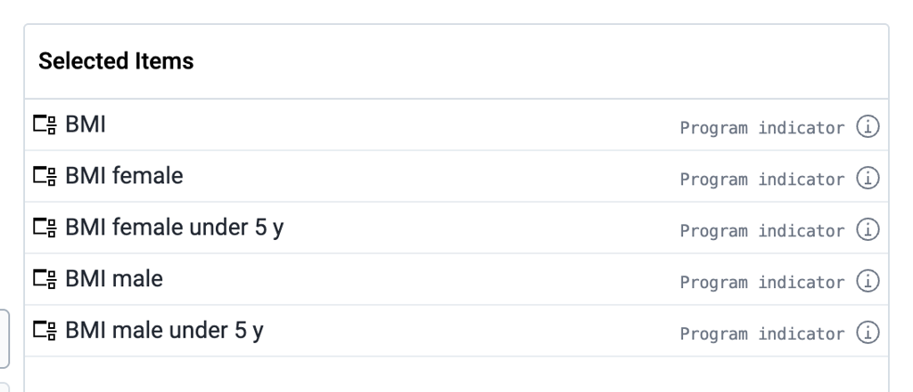{ .center width=60% }

    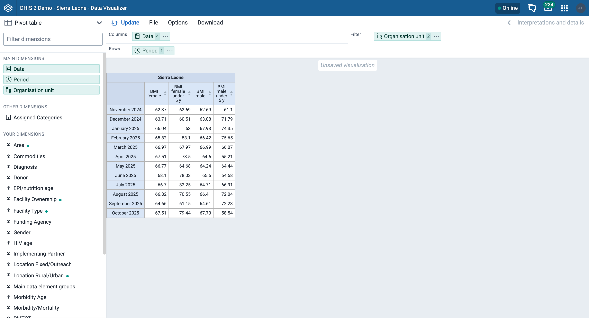

2. Remove the four program indicators that have a disaggregation in their name. Keep only the **BMI** program indicator.

    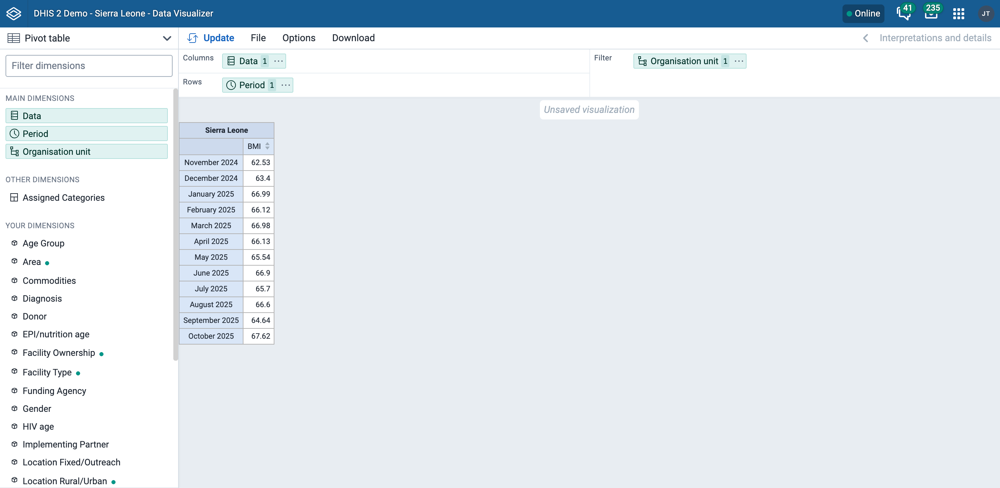

3. From **Your dimensions**, add **Gender** and **Under 5/5 and above of age** as dimensions for the program indicator. Click **Update**.

    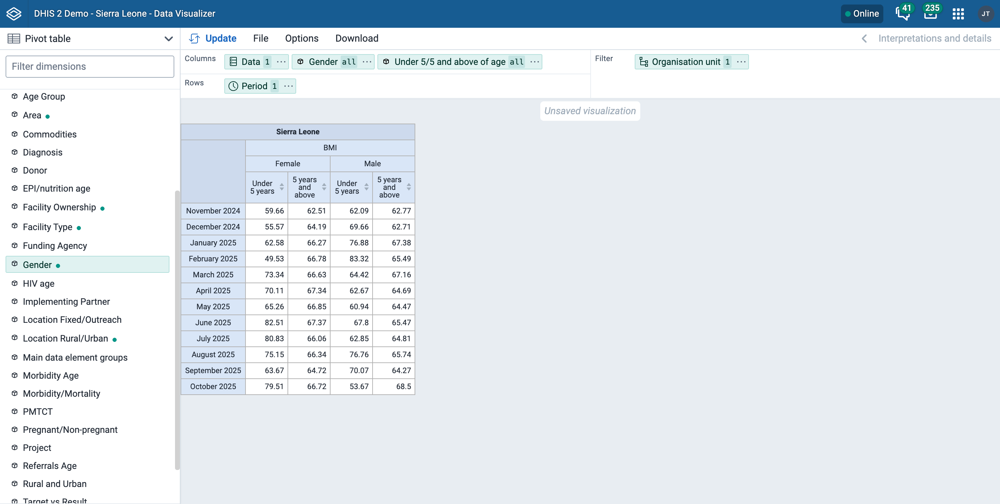

    You can now compare the data of the separate program indicators with the data of the single disaggregated program indicator.

## Transfer program indicator data with the Aggregate data exchange app { #mmp_program_disaggregation_exchange }

You can transfer program data through a disaggregated program indicator into a data element that has the same category combination.

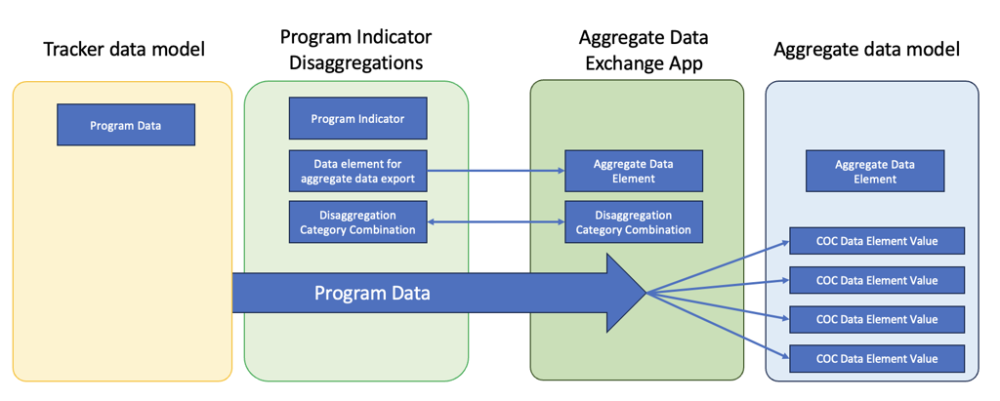

1. On the program indicator card, enter the ID of the data element in **Data element for aggregate data export**.
2. Click **Save and close**.
3. In the Aggregate data exchange app, set up an exchange that transfers the data.

    This saves the program data in the aggregate data model.

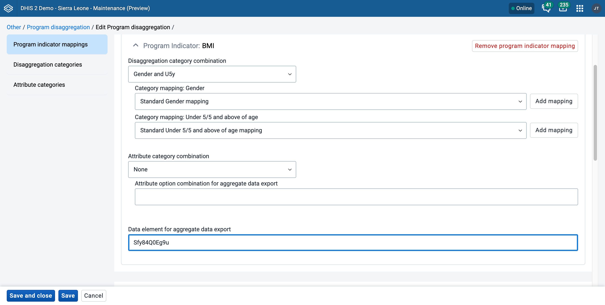
