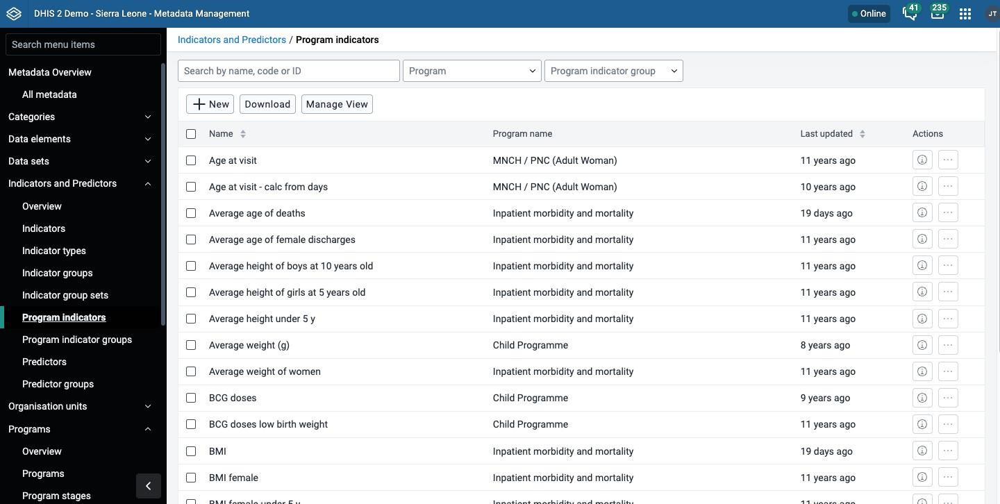
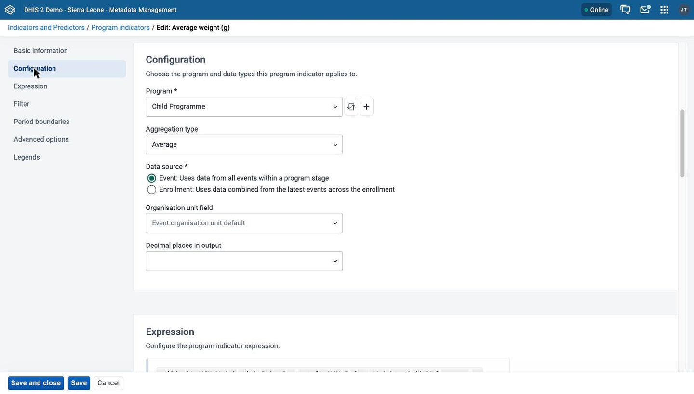
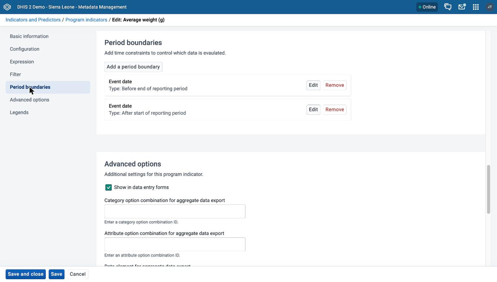

# Program indicators { #mmp_program_indicators }

This chapter explains how program indicators and program indicator groups work, how to create and edit them in the **Metadata Management** app, and which functions, variables, and operators you can use in program indicator expressions and filters.

> **Note**
>
> The **Metadata Management** app replaces the functionality of the Maintenance app.
> If your instance does not have the **Metadata Management** app installed, use the Maintenance app instead. In the Maintenance app, program indicators are under the **INDICATOR** top-level tab. See [Configure program indicators](#configure_program_indicator).

In the **Metadata Management** app, click **Indicators and Predictors** > **Program indicators** or **Program indicator groups**.

The program indicators list has a search box and the filters **Program** and **Program indicator group**. The default columns are **Name**, **Program name**, and **Last updated**. Use **Manage View** to add columns, for example the expression, the analytics type, or the category combinations of a program indicator disaggregation. The program indicator groups list has a filter for program indicators.

For the components of a program indicator, the order of evaluation, and period boundaries, see [About program indicators](#mmp_about_program_indicators).

> **Background and reference**
>
> For background and concepts, see [Understanding programs, tracker configuration, and program disaggregation](#understanding_programs_and_tracker). For the operators, functions, and variables you can use, see [Reference: program indicator expressions, functions, variables, and operators](#reference_program_indicator_expressions).

## Create or edit a program indicator { #mmp_create_program_indicator }

A program indicator belongs to exactly one program. Create the program first.

To create or delete program indicators you need these authorities: `F_PROGRAM_INDICATOR_PUBLIC_ADD` for public program indicators, `F_PROGRAM_INDICATOR_PRIVATE_ADD` for private program indicators, and `F_PROGRAM_INDICATOR_DELETE` to delete.

The form has these sections: **Basic information**, **Configuration**, **Expression**, **Filter**, **Period boundaries**, **Advanced options**, and **Legends**. The app shows **Attributes** only when your instance has custom attributes for program indicators.

1. Open the **Metadata Management** app and click **Indicators and Predictors** > **Program indicators**.
2. To create a program indicator, click **New**. To edit one, click the options menu of the program indicator and choose **Edit**.
3. Under **Basic information**, fill in **Name**, **Short name**, **Code**, and **Description**. **Name** and **Short name** are required. See [Common metadata object fields](#mm_common_metadata_fields). Under **Visual configuration**, you can choose a color and an icon.
4. Under **Configuration**, set the following fields:
    - **Program**: choose the program. This field is required.
    - **Aggregation type**: (Optional) choose an aggregation type.
    - **Data source**: choose **Event** or **Enrollment**. This field is required.
    - **Organisation unit field**: (Optional) choose the organisation unit that DHIS2 assigns to the values. The app shows this field only when it applies to the program and data source that you chose.
    - **Decimal places in output**: (Optional) choose a number from 0 to 5, or **\<No value\>**.

    

5. Under **Expression**, click **Set up expression**. If the program indicator already has an expression, the button is **Edit expression**. Then create the expression. See [Create an expression or a filter](#mmp_program_indicator_expression_dialog).
6. Under **Filter**, click **Set up filter**. If the program indicator already has a filter, the button is **Edit filter**. Then create the filter in the same way. To remove the filter, click **Clear filter**.
7. (Optional) Under **Period boundaries**, click **Add a period boundary**. Fill in the fields of the dialog and click **Add analytics period boundary**. To change a boundary, click **Edit** and then **Update analytics period boundary**. To delete a boundary, click **Remove**. See [About program indicators](#mmp_about_program_indicators).
8. (Optional) Under **Advanced options**, set these fields:
    - **Show in data entry forms**: choose this checkbox to show the program indicator in data entry forms. If you clear the checkbox, data capture apps never show the program indicator.
    - **Category option combination for aggregate data export**: enter the ID of a category option combination.
    - **Attribute option combination for aggregate data export**: enter the ID of an attribute option combination.
    - **Data element for aggregate data export**: enter the ID of a data element. This field is available in DHIS2 v42 and later.

    

9. (Optional) Under **Legends**, assign legend sets with the transfer list. See [Use a transfer list](#mm_transfer_list_component). Under **Attributes**, enter values for any custom attributes.
10. Click **Save and close**. To stay on the form, click **Save**.

The form does not require an expression. You can save a program indicator without one.

### Create an expression or a filter { #mmp_program_indicator_expression_dialog }

1. Click **Set up expression** or **Set up filter**. If the field already has a value, the button is **Edit expression** or **Edit filter**.
2. In the dialog, enter the expression in the text area. To add an item, click a type in the sidebar on the right: **Operators**, **Variables**, **Program data**, **Attributes**, or **Constants**. Then click an item in the list. The app inserts the item at the position of the cursor.
3. Check the message under the text area. **Valid expression** shows a description of the expression. **Invalid expression** means that you must correct the expression. If the message is **Expression not yet validated**, click **Validate**.
4. Click **Apply**.

The sidebar has these types:

Table: Sidebar of the program indicator expression editor

| Sidebar type     | What it inserts                                                                                                                                                                  |
| ---------------- | -------------------------------------------------------------------------------------------------------------------------------------------------------------------------------- |
| **Operators**    | The arithmetic operators `+`, `-`, `*`, `/`, `%`, parentheses, the comparison operators `>`, `>=`, `<`, `<=`, `==`, `!=`, the logical operators `!`, `&&`, `                     |     | `, and `days`, `if(`, `isNull(`, `isNotNull(`, `firstNonNull(`, `greatest(`, `least(`, `log(`, `log10(`. |
| **Variables**    | The `V{...}` variables. See the table of variables in this chapter.                                                                                                              |
| **Program data** | A data element of a program stage, inserted as `#{programStageUid.dataElementUid}`. Choose the program stage first. For an event program the app chooses the only program stage. |
| **Attributes**   | A tracked entity attribute of the program, inserted as `A{attributeUid}`.                                                                                                        |
| **Constants**    | A constant, inserted as `C{constantUid}`.                                                                                                                                        |

If you have not chosen a program in the **Configuration** section, the **Program data** and **Attributes** types show **Program has not been selected**. Choose the program first.

The **Variables** list does not include `enrollment_date`, `enrollment_status`, and `incident_date` for an event program. The variables `event_count`, `enrollment_count`, `org_unit_count`, and `tei_count` appear in the list only when the aggregation type is **Count**.

For examples per value type, and for the functions, variables, and operators, see [Reference information: expression and filter examples per value type](#mmp_reference_information_program_indicator) and [Reference information: functions, variables, and operators to use in program indicator expressions and filters](#mmp_program_indicator_functions_variables_operators).

## Create or edit a program indicator group { #mmp_create_program_indicator_group }

To create or delete program indicator groups you need these authorities: `F_PROGRAM_INDICATOR_GROUP_PUBLIC_ADD`, `F_PROGRAM_INDICATOR_GROUP_PRIVATE_ADD`, and `F_PROGRAM_INDICATOR_GROUP_DELETE`.

1. Open the **Metadata Management** app and click **Indicators and Predictors** > **Program indicator groups**.
2. To create a program indicator group, click **New**. To edit one, click the options menu of the program indicator group and choose **Edit**.
3. Fill in **Name** and **Code**. Only **Name** is required. See [Common metadata object fields](#mm_common_metadata_fields).
4. Under **Program indicators**, assign the program indicators to the group with the transfer list. See [Use a transfer list](#mm_transfer_list_component).
5. Click **Save**.
