# Manage program rules { #mmp_program_rules }

This chapter explains how program rules and program rule variables control the behavior of data entry forms, and how to create and manage them in the **Metadata Management** app. It also lists the operators, functions, and variables that you can use in program rule expressions, and gives worked examples.

> **Note**
>
> If your instance does not have the **Metadata Management** app installed, use the Maintenance app instead. See [Configure programs in the Maintenance app](#configure_programs_in_maintenance_app).

In the **Metadata Management** app, click **Programs** > **Program rules** to open the list of program rules. Click **Programs** > **Program rule variables** to open the list of program rule variables. For the other **Programs** pages, see [Configure programs (Metadata Management app)](#mmp_configure_programs).

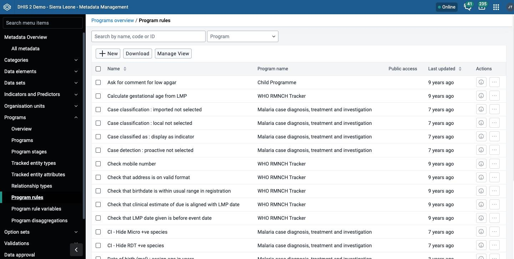

For the components of a program rule, see [About program rules](#mmp_about_program_rules).

> **Background and reference**
>
> For background and concepts, see [Understanding programs, tracker configuration, and program disaggregation](#understanding_programs_and_tracker). For the operators, functions, and variables you can use, see [Reference: program rule operators, functions, and variables](#reference_program_rule_expressions).

## Create or edit a program rule { #mmp_create_program_rule }

> **Note**
>
> A program rule belongs to exactly one program.

The program rule form has a vertical layout. A sidebar lists the sections of the form, and you scroll through them on one page. The Maintenance app uses a horizontal layout.

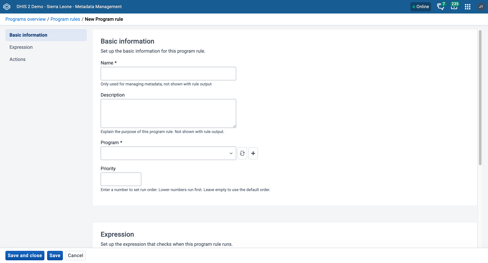

The form has these sections:

- **Basic information**: **Name**, **Description**, **Program**, **Program stage to trigger rule**, and **Priority**. **Name** and **Program** are required.
- **Expression**: the condition of the program rule. Click **Set up condition expression** to open the expression editor.
- **Actions**: the actions that the program rule triggers when its expression is true. You must save the program rule before you can add actions.

Before you start, create the program that the rule belongs to. If the expression uses data values or attribute values, create the [program rule variables](#mmp_create_program_rule_variable) first.

To create a program rule, you need the authority `F_PROGRAM_RULE_ADD` or `F_PROGRAM_RULE_MANAGEMENT`. To delete one, you need `F_PROGRAM_RULE_DELETE` or `F_PROGRAM_RULE_MANAGEMENT`.

1. Open the **Metadata Management** app and click **Programs** > **Program rules**.

2. To create a program rule, click **New**. To edit one, click the options menu of the program rule and choose **Edit**.

3. In **Basic information**, fill in the fields. End users do not see these fields. They are for the program administrator.

    - **Name**: required.

    - **Description**: the purpose of the program rule.

    - **Program**: required. You cannot change the program after you save the program rule.

    - **Program stage to trigger rule**: if you choose a program stage, the program rule runs only for that program stage. Otherwise, the program rule runs for every program stage in the program. The app shows this field only after you choose a program, and not for programs without registration.

    - **Priority**: a whole number of 1 or higher that sets the order in which DHIS2 runs the program rules. Lower numbers run first. If you leave the field empty, the program rule runs after the program rules that have a priority.

        For example, a program has 16 program rules with these priority settings:

        - Priority 1 for program rule A

        - Priority 2 for program rules B - K

        - No priority for program rules L - P

        The system runs the program rules in this order:

        1. Program rule A

        2. Program rules B - K (you cannot find out or configure the order in which the system runs these program rules)

        3. Program rules L - P

4. In **Expression**, click **Set up condition expression**. In the expression editor, enter the expression and click **Apply**. See [Use the expression editor](#mmp_program_rule_expression_editor).

5. Click **Save**. The app saves the program rule and opens it for editing. If you are editing a saved program rule, skip this step.

6. In **Actions**, click **Add action**. In the panel that opens, choose an **Action type**, fill in the fields for that action type, and click **Add action**. See [Program rule actions](#mmp_program_rule_actions).

    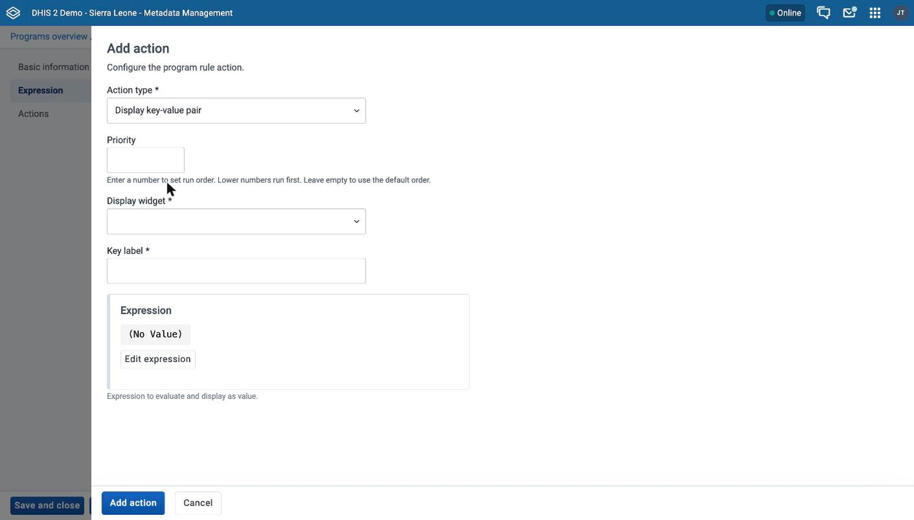

7. Click **Save and close**.

To add more actions, repeat step 6. The app saves each action when you click **Add action** in the panel, before you save the program rule.

To edit an action, click it in the list in **Actions**, change the fields, and click **Save action**. To delete an action, click the options menu of the action and choose **Delete**. DHIS2 deletes the action when you save the program rule. Before you save, click **Undo delete** to restore the action.

### Program rule actions { #mmp_program_rule_actions }

Depending on the action type, you must choose a data element, a tracked entity attribute, or a program stage, or enter free text or an expression. The lists of data elements and tracked entity attributes show only those of the program that you chose for the program rule. For fields that need an expression, click **Edit expression** in the panel. See [Use the expression editor](#mmp_program_rule_expression_editor).

The **Action type** list shows 17 action types. For programs without registration, the list does not show **Schedule event**.

Table: Program rule action types in the Metadata Management app

| Action type                | Fields                                                                                                                                                                                                                                                                                                         | Description                                                                                                                                                                                                                                                                                                                                                                                                                                                                                                                                                                                                                                                                                                                                                                                                                                                                                                                                                                                                                                                                                                                                                                      |
| -------------------------- | -------------------------------------------------------------------------------------------------------------------------------------------------------------------------------------------------------------------------------------------------------------------------------------------------------------- | -------------------------------------------------------------------------------------------------------------------------------------------------------------------------------------------------------------------------------------------------------------------------------------------------------------------------------------------------------------------------------------------------------------------------------------------------------------------------------------------------------------------------------------------------------------------------------------------------------------------------------------------------------------------------------------------------------------------------------------------------------------------------------------------------------------------------------------------------------------------------------------------------------------------------------------------------------------------------------------------------------------------------------------------------------------------------------------------------------------------------------------------------------------------------------- |
| **Assign value**           | **Data element to assign to**   **Tracked entity attribute to assign to**   **Program rule variable to assign to**   **Expression to evaluate and assign** (required)   You must choose at least one of the data element, the tracked entity attribute, and the program rule variable. | Use this action to help end users calculate and fill in fields in the data entry form. End users do not have to fill in values that the system can calculate, for example BMI.   When DHIS2 assigns a value to a field, the end user sees the value but cannot edit it.   To assign a value to a tracked entity attribute, the end user must open the tracked entity profile widget for the rule to trigger.   Example from the Immunization stock card in Zambia: the data element for the vaccine stock outgoing balance is calculated from the data element for the incoming stock balance, minus the data elements for consumption and wastage.   Advanced use: configure an **Assign value** action to do a part of a calculation, and assign the result to a program rule variable. This is the purpose of the **Calculated value** source type of program rule variables.   If several **Assign value** actions target the same field, only the one with the highest rule priority applies. DHIS2 ignores the others. If the assigned value is not a valid option of the option set of the field, DHIS2 silently replaces it with no value. |
| **Display key-value pair** | **Display widget** (required)   **Key label** (required)   **Expression to evaluate and display as value**                                                                                                                                                                                         | Use this action to show information that is not an error or a warning.   Example: calculate the number of weeks and days in a pregnancy and show it in the format that the clinician is used to. The calculation is based on previously recorded data.   **Display widget** has two options: **Feedback widget** and **Program indicator widget**.                                                                                                                                                                                                                                                                                                                                                                                                                                                                                                                                                                                                                                                                                                                                                                                                                   |
| **Display text**           | **Display widget** (required)   **Static text** (required)   **Expression to evaluate and display after static text**                                                                                                                                                                              | Use this action to show information that is not an error or a warning, for example feedback to the end user. You can also use this action to show important information, for example the patient's allergies.   **Display widget** has two options: **Feedback widget** and **Program indicator widget**.                                                                                                                                                                                                                                                                                                                                                                                                                                                                                                                                                                                                                                                                                                                                                                                                                                                                  |
| **Error on complete**      | **Data element to display error next to**   **Tracked entity attribute to display error next to**   **Static text** (required)   **Expression to evaluate and display after static text**                                                                                                    | Use this action for cross-checks in the form that must be met.   This action differs from **Show error** because the app does not show the error until the end user tries to complete the form.   If you do not choose a data element or a tracked entity attribute to show the error next to, write an error message that helps the end user fix the error.                                                                                                                                                                                                                                                                                                                                                                                                                                                                                                                                                                                                                                                                                                                                                                                                         |
| **Hide field**             | **Data element to hide**   **Tracked entity attribute to hide**   **Custom message for blanked field**   You must choose a data element or a tracked entity attribute.                                                                                                                       | Use this action to hide a field from the end user. This action never hides a required field, whether the field is required natively or made required by a **Set mandatory field** action.   **Custom message for blanked field** is a message that the end user sees if the program rule hides and blanks a field after the end user typed in or chose a value.   If a **Hide field** action hides a field that contains a value, DHIS2 always removes the value. If you do not define a message, the app shows a standard message to alert the end user.                                                                                                                                                                                                                                                                                                                                                                                                                                                                                                                                                                                                            |
| **Hide option**            | **Data element**   **Tracked entity attribute**   **Option to hide** (required)   The data element or tracked entity attribute that you choose must use an option set.                                                                                                                       | Use this action to hide one option of an option set in a data element or tracked entity attribute.   When you combine it with **Show option group**, **Hide option** takes precedence.                                                                                                                                                                                                                                                                                                                                                                                                                                                                                                                                                                                                                                                                                                                                                                                                                                                                                                                                                                                     |
| **Hide option group**      | **Data element**   **Tracked entity attribute**   **Option group to hide** (required)   The data element or tracked entity attribute that you choose must use an option set.                                                                                                                 | Use this action to hide all options in an option group, in a data element or tracked entity attribute.   When you combine it with **Show option group**, **Hide option group** takes precedence.                                                                                                                                                                                                                                                                                                                                                                                                                                                                                                                                                                                                                                                                                                                                                                                                                                                                                                                                                                           |
| **Hide program stage**     | **Program stage** (required)                                                                                                                                                                                                                                                                                   | Use this action when you do not want end users to add more events to a program stage. Existing events stay visible.                                                                                                                                                                                                                                                                                                                                                                                                                                                                                                                                                                                                                                                                                                                                                                                                                                                                                                                                                                                                                                                              |
| **Hide section**           | **Program stage section to hide** (required)                                                                                                                                                                                                                                                                   | Use this action to hide every field in a section of a program stage. The section itself disappears only when none of its fields remain visible. A section that contains a required field stays visible, and that field shows.                                                                                                                                                                                                                                                                                                                                                                                                                                                                                                                                                                                                                                                                                                                                                                                                                                                                                                                                                    |
| **Schedule event**         | **Program stage** (required)   **Program rule variable for scheduled date** (required)                                                                                                                                                                                                                   | Unlike most other actions, the client app does not evaluate this action live. The server applies it when the enrollment or event is saved.   Use this action to schedule a new event for the program stage, on the date that the expression returns. The expression must return a valid date. If it does not, DHIS2 does not schedule an event.   DHIS2 schedules the event once. If the rule condition becomes true again, DHIS2 does not create a duplicate event.   Use it for programs where existing data gives the date of the next visit or follow-up, for example to schedule a second vaccination dose a fixed number of days after the first.   Example expression that schedules an event 28 days after a recorded date:  `d2:addDays(#{dateOfFirstDose}, 28)`                                                                                                                                                                                                                                                                                                                                                                             |
| **Schedule message**       | **Message template** (required)   **Date to send message.** (required)                                                                                                                                                                                                                                   | The server runs this action, not the client app. Use this action to schedule a notification for the date that the expression returns. If the expression returns anything other than a date, DHIS2 discards the result and does not schedule the notification.   Sample expression: `d2:addDays( '2018-04-20', '2' )`   DHIS2 parses the message template and replaces the variables with actual values.   After you save this action, you cannot edit it.                                                                                                                                                                                                                                                                                                                                                                                                                                                                                                                                                                                                                                                                                                      |
| **Send message**           | **Message template** (required)                                                                                                                                                                                                                                                                                | The server runs this action, not the client app. Use this action to trigger a notification that is based on a message template. DHIS2 sends the notification as soon as the rule condition is true. DHIS2 parses the message template and replaces the variables with actual values.   After you save this action, you cannot edit it.                                                                                                                                                                                                                                                                                                                                                                                                                                                                                                                                                                                                                                                                                                                                                                                                                                     |
| **Set mandatory field**    | **Data element to display error next to**   **Tracked entity attribute to display error next to**   You must choose a data element or a tracked entity attribute.                                                                                                                                  | Use this action to make a data element or tracked entity attribute required, so that the end user must fill it in before the form can be saved.                                                                                                                                                                                                                                                                                                                                                                                                                                                                                                                                                                                                                                                                                                                                                                                                                                                                                                                                                                                                                                  |
| **Show error**             | **Data element to display error next to**   **Tracked entity attribute to display error next to**   **Static text** (required)   **Expression to evaluate and display after static text**                                                                                                    | Use this action for rules that end users must follow.   Whether the action blocks the end user depends on the **Validation strategy** of the program. Under **On complete**, it blocks only an attempt to complete the record. Under **On update and insert**, it blocks every save attempt.   Use this strict validation only when the expression is never true unless the end user made a mistake in data entry.   **Static text** is the message that the end user sees when the expression is true and the action triggers.   You can link the error to a data element or tracked entity attribute. This helps the end user fix the error. If several data elements or attributes are involved, choose the one that the end user is most likely to change.                                                                                                                                                                                                                                                                                                                                                                                           |
| **Show option group**      | **Data element**   **Tracked entity attribute**   **Option group to show** (required)   The data element or tracked entity attribute that you choose must use an option set.                                                                                                                 | Use this action to show only the options of an option group, in a data element or tracked entity attribute. Showing an option group hides all options that are not part of the group that you show.                                                                                                                                                                                                                                                                                                                                                                                                                                                                                                                                                                                                                                                                                                                                                                                                                                                                                                                                                                              |
| **Show warning**           | **Data element to display warning next to**   **Tracked entity attribute to display warning next to**   **Static text** (required)   **Expression to evaluate and display after static text**                                                                                                | Use this action to warn the end user about the entered data while the end user can still save and continue.   Warnings help end users avoid errors, and let them choose to save a value that is outside the preset expectations.   **Static text** is the message that the end user sees when the expression is true and the action triggers.   You can link the warning to a data element or tracked entity attribute. This helps the end user fix the problem. If several data elements or attributes are involved, choose the one that the end user is most likely to change.                                                                                                                                                                                                                                                                                                                                                                                                                                                                                                                                                                               |
| **Warning on complete**    | **Data element to display warning next to**   **Tracked entity attribute to display warning next to**   **Static text** (required)   **Expression to evaluate and display after static text**                                                                                                | Use this action to warn an end user who tries to complete inconsistent data, while the end user can still continue. The app shows the warning in a dialog when the end user completes the form.   **Static text** is the message that the end user sees when the expression is true and the action triggers.   You can link the warning to a data element or tracked entity attribute. This helps the end user fix the problem. If you do not choose a data element or a tracked entity attribute, write a message that helps the end user fix the problem.                                                                                                                                                                                                                                                                                                                                                                                                                                                                                                                                                                                                          |

The widget that you choose in **Display widget** for **Display text** and **Display key-value pair** disappears from the form whenever no active rule targets it.

#### v43 and later { #mmp_program_rule_actions_v43_and_later }

From v43, the **Add action** panel in the **Metadata Management** app has a **Priority** field.

From v43, the **Priority** field in the **Add action** panel sets the run order of the action within the same program rule. Lower numbers run first. Leave the field empty to use the default order.

From v43, the list of actions in **Actions** shows the priority of an action as **Priority: <number>**.

#### v42 and earlier { #mmp_program_rule_actions_v42_and_earlier }

In v42 and earlier, the **Add action** panel in the **Metadata Management** app does not have a **Priority** field.

### Use the expression editor { #mmp_program_rule_expression_editor }

The expression editor opens in a window. It opens when you click **Set up condition expression** in the **Expression** section of a program rule, or **Edit expression** in the panel of an action. In the **Expression** section, the button is **Edit condition expression** if the program rule already has an expression. In the panel of a new action, the button is **Edit expression** and the expression shows **(No Value)**.

The editor has a text area for the expression, and a sidebar with four groups. Choose a group to open it, and choose an item to insert it at the cursor position:

- **Operators**: the operators in [Operators](#mmp_program_rule_operators). The editor shows the logical operators as **NOT**, **AND**, and **OR**.
- **Variables**: the standard variables in [Standard variables](#mmp_program_rule_standard_variables).
- **Program rule variables**: the program rule variables of the program that you chose. The editor inserts a variable as `#{name}`. If you did not choose a program, the group shows a message.
- **Functions**: the functions in [Functions](#mmp_program_rule_functions).

To check the expression, click **Validate**. The editor then shows **Valid expression** with a description of the expression, or **Invalid expression**. Before validation, the editor shows **Expression not yet validated**. **Apply** is not available while the expression is invalid or empty, except where an empty expression clears the field. Click **Apply** to keep the expression, or **Cancel** to close the editor without changes. For the **Assign value** action, the expression cannot be empty.

For programs without registration, the **Variables** group does not show `V{enrollment_date}`, `V{enrollment_status}`, and `V{incident_date}`.

For the list of operators, functions, data matrix codes, and standard variables, see [Operators and functions in program rule expressions](#mmp_program_rules_operators_functions).

## Create or edit a program rule variable { #mmp_create_program_rule_variable }

Program rule variables are the values that you use in program rule expressions. Create the variables of a program before you create its program rules.

To create a program rule variable, you need the authority `F_PROGRAM_RULE_MANAGEMENT`.

1. Open the **Metadata Management** app and click **Programs** > **Program rule variables**.

2. To create a program rule variable, click **New**. To edit one, click the options menu of the program rule variable and choose **Edit**.

3. In **Basic information**, enter a **Name**. The name has these rules:

    - It can contain only letters, numbers, spaces, dashes, dots, and underscores.
    - It can have at most 230 characters.
    - It must be unique in the program.
    - It cannot contain the words `and`, `or`, or `not`.

4. In **Configuration**, choose a **Program**. You cannot change the program after you save the program rule variable.

5. Choose a **Source type**, and fill in the fields that the source type needs. The source type determines how DHIS2 populates the program rule variable with a value. See the table that follows these steps.

6. Optional: if the data element or tracked entity attribute is connected to an option set, choose **Show option set code instead of display name (when selection is linked to an option set).**

    This option has an effect only when the data element or tracked entity attribute is connected to an option set. If you do not choose it, DHIS2 populates the program rule variable with the name of the selected option. If you choose it, DHIS2 populates the program rule variable with the code of the selected option.

7. Click **Save and close**.

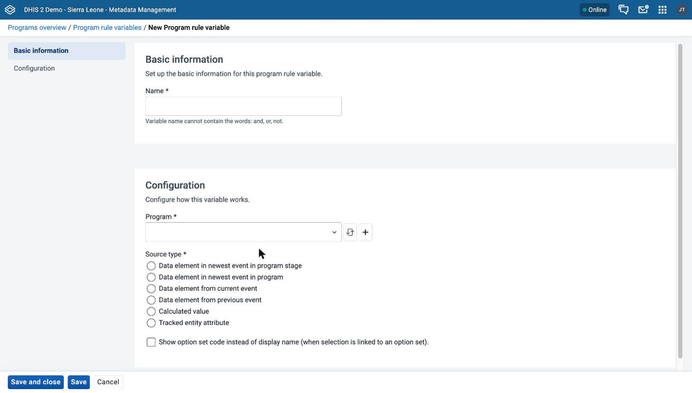

Table: Source types of program rule variables

| Source type                                       | Fields                                   | Description                                                                                                                                                                                                                                                                                                                                                                                                                                                                                                                                                                                                                                                                                                                                                                                                                                                             |
| ------------------------------------------------- | ---------------------------------------- | ----------------------------------------------------------------------------------------------------------------------------------------------------------------------------------------------------------------------------------------------------------------------------------------------------------------------------------------------------------------------------------------------------------------------------------------------------------------------------------------------------------------------------------------------------------------------------------------------------------------------------------------------------------------------------------------------------------------------------------------------------------------------------------------------------------------------------------------------------------------------- |
| **Data element in newest event in program stage** | **Program stage**, then **Data element** | This source type works the same way as **Data element in newest event in program**, except that it evaluates values from one program stage only.   It is useful in program rules where the same data element is used in several program stages, and a rule must evaluate the newest data value in one specific stage.   To find the newest event, DHIS2 uses the report date (event date). If several events have the same report date, DHIS2 chooses the event with the latest `createdAt` property.                                                                                                                                                                                                                                                                                                                                                       |
| **Data element in newest event in program**       | **Data element**                         | Use this source type when a program rule variable must hold the newest known value of a data element, regardless of which event the end user has open.   DHIS2 populates this source type slightly differently for tracker programs and event programs:   **Tracker programs**: DHIS2 populates the program rule variable with the newest data value collected for the data element in the enrollment.   **Event programs**: DHIS2 populates the program rule variable with the data of the current event.   **NB** Future dates are newer than current or past dates.   To find the newest event, DHIS2 uses the report date (event date). If several events have the same report date, DHIS2 chooses the event with the latest `createdAt` property.                                                                                    |
| **Data element from current event**               | **Data element**                         | A program rule variable with this source type contains the data value from the event that the end user has open.   This is the most common source type, especially for skip logic (hide actions) and for warning and error rules.                                                                                                                                                                                                                                                                                                                                                                                                                                                                                                                                                                                                                                 |
| **Data element from previous event**              | **Data element**                         | A program rule variable with this source type contains the value of the data element from a previous event. DHIS2 evaluates only older events, not the event that the end user has open.   Use this source type when a data element must be collected only once in an enrollment and hidden in later events.   Another use is a rule that validates input where the values are expected to progress from one event to the next. The rule can compare the previous value with the new value and show a warning if the value is not as expected.                                                                                                                                                                                                                                                                                                              |
| **Calculated value**                              | **Value type**                           | A program rule variable with this source type is not connected to form data. DHIS2 populates it as the result of the **Assign value** action of another program rule.   Use it for preliminary calculations. A program rule with an **Assign value** action assigns a value to the variable, and other program rules can use that value. This can make expressions simpler and easier to maintain.   DHIS2 does not store these variables. They stay in memory only while DHIS2 runs the set of program rules. A program rule that assigns a value to a calculated value normally also has a **Priority**, so that the preliminary calculation runs before the rule that uses the calculated value.   **Value type** is required. The default is **Text**. The list of value types comes from the server, and includes **Text with multiple values**. |
| **Tracked entity attribute**                      | **Tracked entity attribute**             | This source type populates the program rule variable with a tracked entity attribute of the current enrollment.   Use it to create program rules that evaluate data values entered during registration, or that compare data in events with data entered during registration.   Use this source type only in tracker programs (programs with registration).                                                                                                                                                                                                                                                                                                                                                                                                                                                                                                 |

The source types **Data element in newest event in program stage**, **Data element in newest event in program**, and **Data element from previous event** use only some events. DHIS2 picks only an event that has a report date and the status **Completed**, **Active**, or **Visited**. DHIS2 never picks a scheduled or skipped event, regardless of its date.

## Examples of program rules { #mmp_program_rule_examples }

> **Note**
>
> You can view all examples on the demo server, under **Programs** > **Program rules** and **Programs** > **Program rule variables**, for the **WHO RMNCH Tracker** program.

### Example: show the gestational age as weeks and days

This example shows how to configure a program rule that calculates the number of weeks and days in a pregnancy and shows the result in the format that the clinician is used to. The calculation is based on previously recorded data.

The first screenshot shows the **Basic information** section of the program rule.

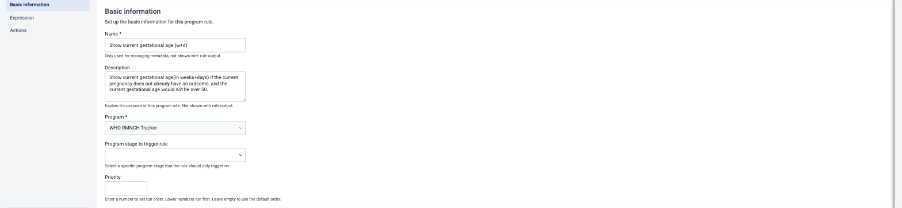

The next screenshot shows the **Expression** section.

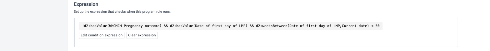

The full expression in **Expression to evaluate and display as value**:

    d2:concatenate(d2:weeksBetween(#{lmp}, V{current_date}), '+',
    d2:modulus(d2:daysBetween(#{lmp}, V{current_date}), 7))

The next screenshot shows the **Actions** section with a **Display key-value pair** action.

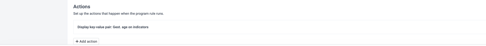

### Example: show feedback for a penicillin allergy

This example shows how to configure a program rule that shows text in the **Feedback widget** in the **Capture** app.

The first screenshot shows the program rule variable `penicillinAllergy`.

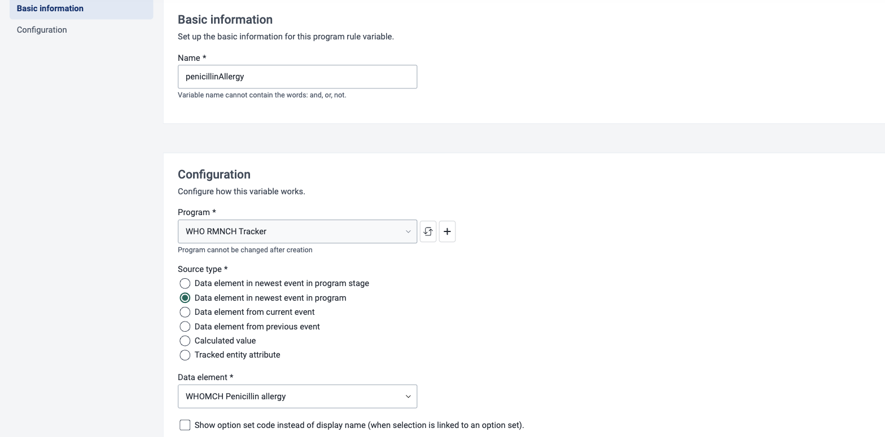

The next screenshots show the **Basic information**, **Expression**, and **Actions** sections of the program rule. The action is **Display text**.

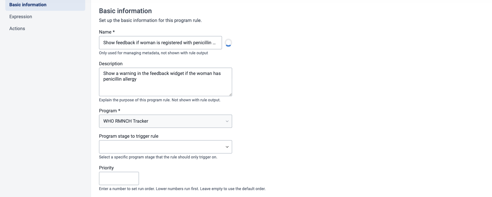

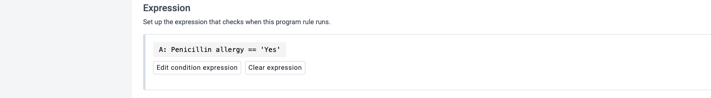

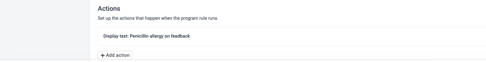

### Example: always show vital data in the feedback widget

This example shows how to configure a program rule that always shows certain data in the **Feedback widget** in the **Capture** app. Use this when you want to make sure that vital data, for example medicine allergies, is always visible.

The first screenshot shows the program rule variable `othermedicineallergy`.

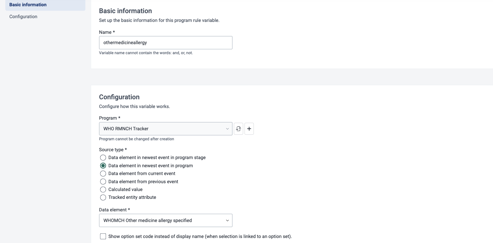

The next screenshots show the **Basic information**, **Expression**, and **Actions** sections of the program rule. The action is **Display text**.

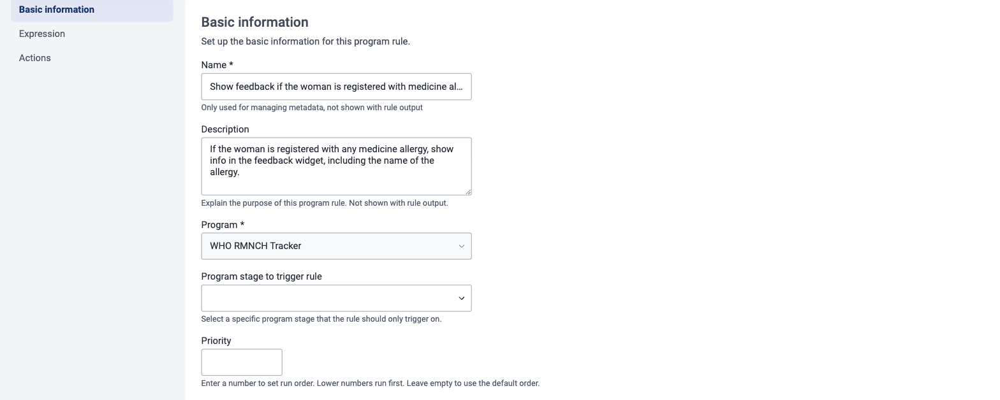

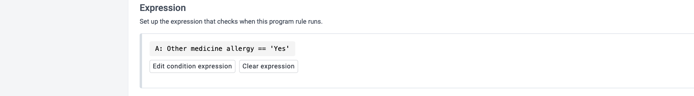

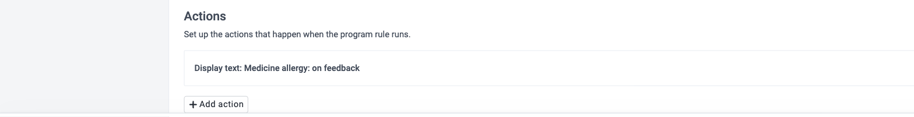

Both feedback messages together, as they appear in the Capture app:

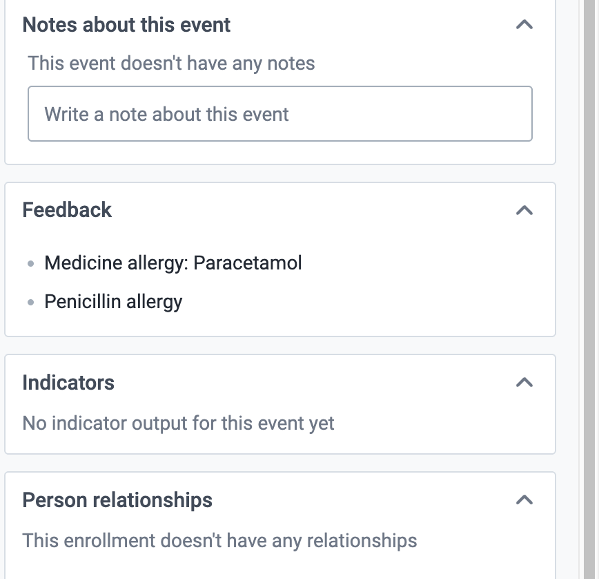{ .center width=30% }

### Example: calculate the gestational age at the visit

With a program rule that has an **Assign value** action, you can calculate the "Gestational age at visit" value and fill it in the data entry form. You configure the program rule to calculate "Gestational age at visit" from either "LMP date" or "Ultrasound estimated due date".

The first screenshot shows the **Basic information** section of the program rule.

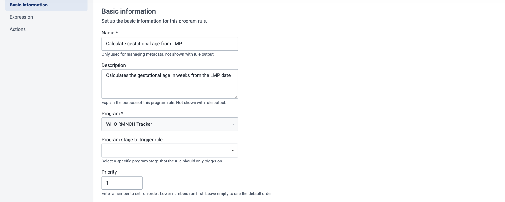

The next screenshots show the **Expression** and **Actions** sections.

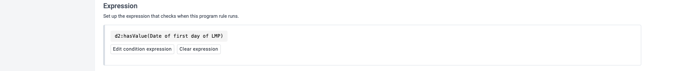

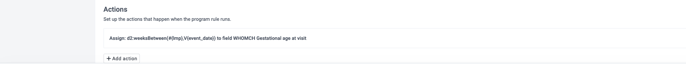

The calculated value filled into the data entry form:

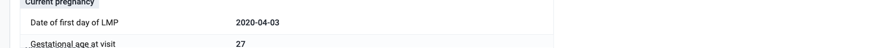
