# Configure programs in the Metadata Management app { #mmp_configure_programs }

This chapter explains how programs work in DHIS2, how the **Programs** section of the **Metadata Management** app differs from the Maintenance app, and how to create event programs and tracker programs.

> **Note**
>
> The **Metadata Management** app replaces the program-related functions of the Maintenance app.
> The app is available from the [DHIS2 App Hub](https://apps.dhis2.org/app/3c6d0723-904c-4c7a-bbd6-35f3c3aa356b) and works with DHIS2 v41 and later.
> If your instance does not have the **Metadata Management** app installed, use the Maintenance app instead. See [Configure programs in the Maintenance app](#configure_programs_in_maintenance_app).

The **Metadata Management** app groups the program-related metadata under the **Programs** section of its sidebar:

- Overview
- Programs
- Program stages
- Tracked entity types
- Tracked entity attributes
- Relationship types
- Program rules
- Program rule variables
- Program disaggregations (v42 and later)

Two related object types are not in the **Programs** section. They are under **Indicators and Predictors**, in both the old and the new app:

- Program indicators
- Program indicator groups

> **Note**
>
> The functions that you can use depend on the permissions of your user role.

> **Background and reference**
>
> For background and concepts, see [Understanding programs, tracker configuration, and program disaggregation](#understanding_programs_and_tracker).

## What changed from the Maintenance app { #mmp_what_changed }

The way you create and edit programs changed more than the way you work with most other object types. See [Configure metadata](#metadata_management_app). The program model is the same: event programs and tracker programs, program stages, tracked entity types, and program rules. The screens are different. The **Metadata Management** app does not copy the screens of the Maintenance app.

Table: Programs, Maintenance app compared with Metadata Management app

|                                                                                                                  | Maintenance app                                                                                                                                                                                                                                                  | Metadata Management app                                                                                                                                                                                                                                                                                                                                                                                                                                                                                       |
| ---------------------------------------------------------------------------------------------------------------- | ---------------------------------------------------------------------------------------------------------------------------------------------------------------------------------------------------------------------------------------------------------------- | ------------------------------------------------------------------------------------------------------------------------------------------------------------------------------------------------------------------------------------------------------------------------------------------------------------------------------------------------------------------------------------------------------------------------------------------------------------------------------------------------------------- |
| Editing pattern                                                                                                  | A numbered wizard. For tracker programs, the steps are **Program details**, **Enrollment details**, **Attributes**, **Program stages**, **Access**, and **Notifications**. Event programs use a shorter wizard. You move forward and backward through the steps. | One scrollable page with a section list on the left. Event programs have these sections: **Program Details**, **Program Settings**, **Data**, **Form**, **Notifications**, **Access and Sharing**, and **Customization**. Tracker programs have **Program Details**, **Enrollment: Settings**, **Enrollment: Data**, **Enrollment: Form**, **Program Stages**, **Notifications**, **Access and Sharing**, and **Customization**. Click a section to scroll the page to it. There is no forward and back flow. |
| Choosing the program type                                                                                        | Two creation actions on a floating button: **Event Program** and **Tracker Program**.                                                                                                                                                                            | One **New** button opens the **Choose program type** dialog with two options: **Single event** (**Collect standalone events with no person or entity attached.**) and **Tracker** (**Collect events for a person or other entity over time.**). The dialog states that you cannot change the program type later. The `programType` values `WITHOUT_REGISTRATION` and `WITH_REGISTRATION` are the same. Only the labels are new.                                                                               |
| Access level (Open, Audited, Protected, Closed)                                                                  | Part of the first wizard step, **Program details**, with the version, the tracked entity type, and the category combination.                                                                                                                                     | In the **Access and Sharing** section, with organisation unit access and role access. The **Access level** setting shows for tracker programs only.                                                                                                                                                                                                                                                                                                                                                           |
| Custom label overrides                                                                                           | Fields in the **Program details** and **Enrollment details** wizard steps.                                                                                                                                                                                       | A separate **Customization** section. Each program stage also has its own **Customization** section.                                                                                                                                                                                                                                                                                                                                                                                                          |
| Notifications                                                                                                    | Two lists, reached from wizard step 6, on two tabs: **Program stage notifications** and **Program notifications**.                                                                                                                                               | One **Notifications** section with an **Add a notification** button. In a tracker program, you choose **Program** or **Stage** as the **Notification type** in the notification editor.                                                                                                                                                                                                                                                                                                                       |
| Program stages                                                                                                   | A table that you can fill in only after you save the program. Wizard step 4 shows **Save** and **Cancel** until the program exists.                                                                                                                              | A **Program Stages** section that lists the stages. You also must save the program before you add stages. The **Add a program stage** button opens a stage editor with its own section list: **Basic information**, **Data entry options**, **Creation and scheduling**, **Data**, **Program stage form**, and **Customization**. Saving a stage does not save other changes to the program.                                                                                                                  |
| Program rules and program rule variables                                                                         | A three-step wizard (program rule details, expression, actions), reached from the **PROGRAM** top tab.                                                                                                                                                           | A page with three sections (**Basic information**, **Expression**, **Actions**), reached from **Programs** > **Program rules**. The fields are the same.                                                                                                                                                                                                                                                                                                                                                      |
| Program disaggregations                                                                                          | Not available in the Maintenance app. See [Setting up new program disaggregation mappings](#mmp_program_disaggregation_mapping) for the **Metadata Management** app.                                                                                             | A **Program disaggregations** page in the **Programs** section (v42 and later). It lists the programs that have a mapping, with **Edit** and **Delete** actions, and a **Select a Program** menu to add a mapping.                                                                                                                                                                                                                                                                                            |
| Program indicators, and the reference for program rule expressions and filters (functions, variables, operators) | Under **INDICATOR** in the Maintenance app.                                                                                                                                                                                                                      | Under **Indicators and Predictors**, in both apps. The expression language is the same. See [Program indicators](#mmp_program_indicators).                                                                                                                                                                                                                                                                                                                                                                    |

A program has the same settings, the same program stage model, and the same rule engine as before. What changed is where each setting is on the screen, and that you reach it on a scrolling page and not through a wizard.

For the program types and the metadata objects that a program uses, see [About programs](#mmp_about_program_maintenance_app).

## Configure event programs in the Metadata Management app { #mmp_configure_event_program_in_mma_app }

For the form types and notifications of an event program, see [About event programs](#mmp_about_event_program).

## Creating a single event program { #mmp_create_single_event_program }

### Workflow: Create a single event program { #mmp_workflow_single_event_program }

Save the program before you add notifications, set role access, or create a section form or a custom form. The **Section form** and **Custom form** tabs, the **Notifications** section, and the role access settings are available only after you save the program.

1. Open the **Metadata Management** app.
2. In the sidebar, click **Programs** > **Programs**.
3. Click **New**.
4. In the **Choose program type** dialog, choose **Single event**, and then click **Continue**.
5. Fill in **Program Details**.
6. Fill in **Program Settings**.
7. Under **Data**, choose the data elements of the program.
8. Click **Save**.
9. Under **Form**, choose a form type if you want something other than the default **Basic form**.
10. (Optional) Add notifications.
11. Under **Access and Sharing**, choose the organisation units and the user roles that can use the program.
12. (Optional) Under **Customization**, override labels.
13. Click **Save and close**.

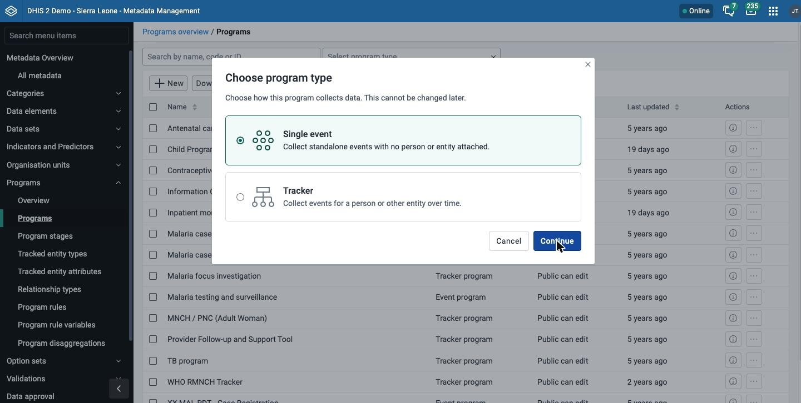

### Program Details { #mmp_single_event_program_details }

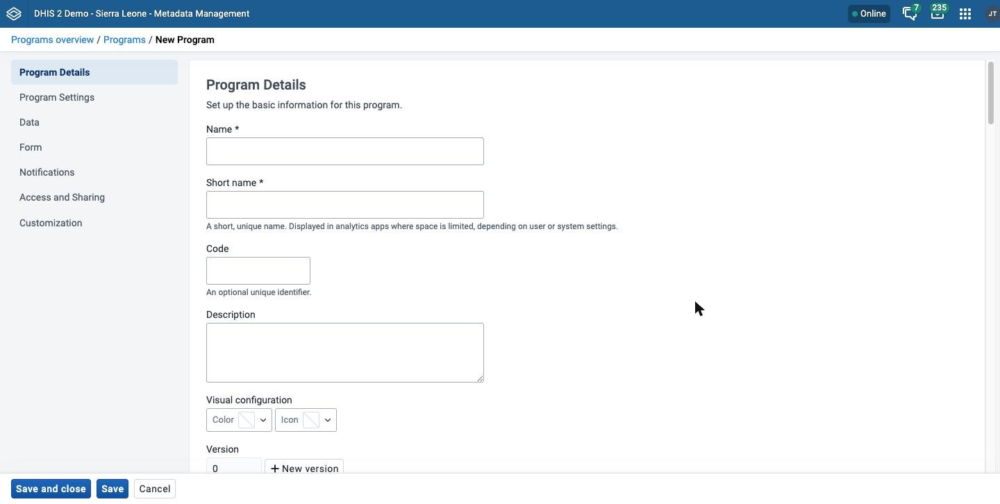

Fill in the basic information of the program:

- **Name** and **Short name** (required). See [Common metadata object fields](#mm_common_metadata_fields).
- **Code**, **Description**, and **Visual configuration** (color and icon). See [Common metadata object fields](#mm_common_metadata_fields).
- **Version**: A number that you can increase by hand. Click **New version** to increase it by one. DHIS2 also increases the number by one each time you save changes to the program. If you change the number and want the old one back, click **Reset version**. After you save, the field shows the date of the last update.
- **Location type**: The location of the event. Choose **Point**, **Polygon/Area**, or **Do not collect location data**. In the Maintenance app, this field was **Feature type**.
- **Event category combination**: A category combination that disaggregates the events of the program. The menu lists the category combinations with the data dimension type **Attribute**, and **None** (the default) is the first option. In the Maintenance app, this field was **Category combination**.
- **Record change history for event data values**: A checkbox. It is available in DHIS2 v43 and later.

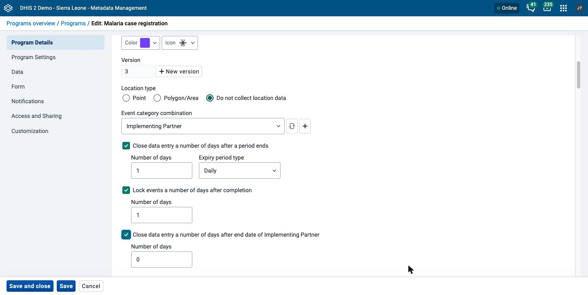

After the category combination, these checkboxes let you close data entry and lock events on a schedule:

- **Close data entry a number of days after a period ends**: Shows the **Number of days** field and the **Expiry period type** menu (for example **Daily** or **Monthly**). In the Maintenance app, these were **Expiry period type** and **Expiry days**.
- **Lock events a number of days after completion**: Shows the **Number of days** field. After that number of days, you can no longer edit a completed event. In the Maintenance app, this was **Completed events expiry days**.
- **Close data entry a number of days after end date of _[category combination name]_**: Shows only when the **Event category combination** is not **None**. The label uses the name of the category combination that you chose, for example **Close data entry a number of days after end date of Implementing Partner**. It shows the **Number of days** field. In the Maintenance app, this was **Open days after category option end date**.

After an event falls outside one of these windows, no one can edit it. Only a user with the **Edit expired data** authority can still change it.

### Program Settings { #mmp_single_event_program_settings }

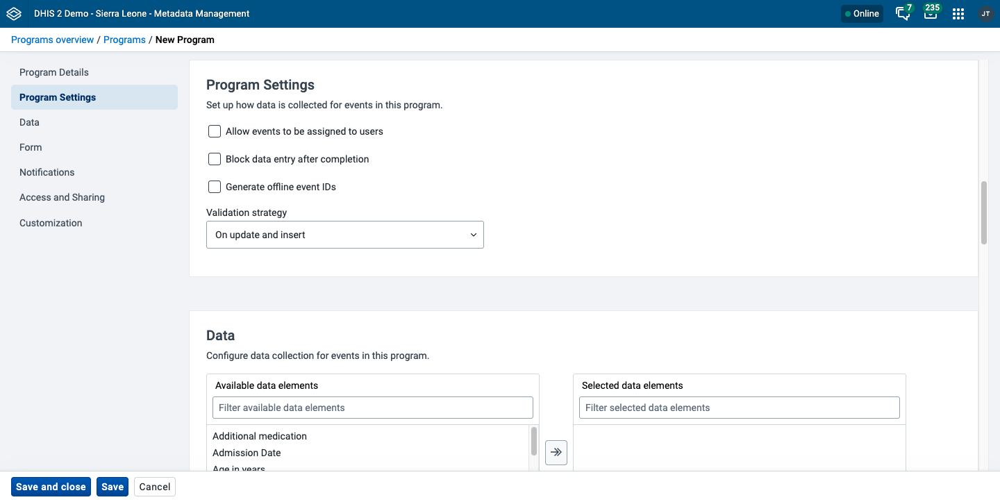

Configure how DHIS2 collects data for the events of this program:

- **Allow events to be assigned to users**: Lets a user assign an event to a specific user. This also adds an **Assigned to** column to the working lists of this program.
- **Block data entry after completion**: After an event is complete, users cannot edit its values.
- **Generate offline event IDs**: Generates event identifiers on the device when it is offline, and does not request them from the server.
- **Validation strategy**: Choose **On update and insert** or **On complete**. A new event program uses **On update and insert**.

### Data { #mmp_single_event_program_data }

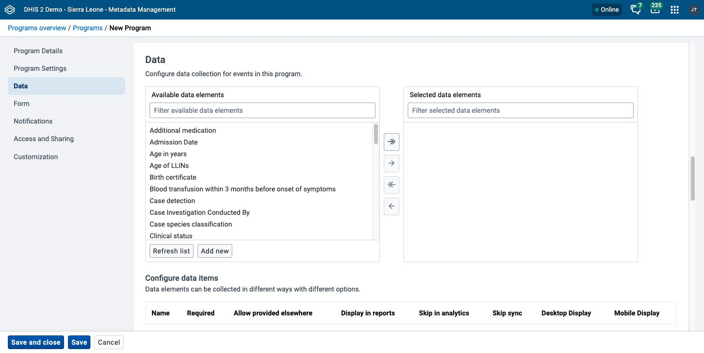

1. Under **Data**, use the transfer list to move data elements from **Available data elements** to **Selected data elements**. The list offers only data elements with the domain type tracker. See [Using a transfer list component](#mm_transfer_list_component).
2. (Optional) To create a data element without leaving the program editor, click **Add new** in the footer of the list of available data elements, next to **Refresh list**.
3. In the **Configure data items** table, set the options of each data element. See the following table.

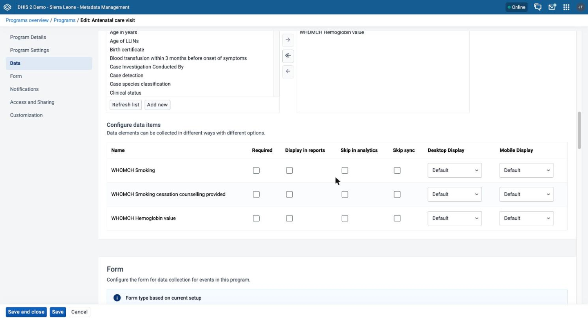

Table: Configure data items, column reference

| Column                 | Description                                                                                                                                                                                                            |
| ---------------------- | ---------------------------------------------------------------------------------------------------------------------------------------------------------------------------------------------------------------------- |
| **Name**               | The display name of the data element. You cannot edit it here. It identifies the row.                                                                                                                                  |
| **Required**           | With the validation strategy **On update and insert**, a required data element blocks every save. With **On complete**, it blocks only the completion of the event. You can still save the event with the value empty. |
| **Display in reports** | Controls whether the data element shows as a column in working lists and similar list views.                                                                                                                           |
| **Skip in analytics**  | Leaves the data element out of the analytics tables.                                                                                                                                                                   |
| **Skip sync**          | Leaves the data element values out of data synchronization to another DHIS2 instance.                                                                                                                                  |
| **Allow future dates** | Shows when the program has at least one data element with the value type **Date**. The checkbox is available only for **Date** data elements and lets users choose a date in the future.                               |
| **Desktop Display**    | How the field looks in the web Capture app.                                                                                                                                                                            |
| **Mobile Display**     | How the field looks in the Android Capture app.                                                                                                                                                                        |

The **Desktop Display** and **Mobile Display** options depend on the value type of the data element. For example:

- A **Yes/No** data element offers **Default**, **Vertical radiobuttons**, **Horizontal radiobuttons**, **Vertical checkboxes**, and **Horizontal checkboxes**.
- A **Number** data element offers **Default**, **Value**, **Slider**, and **Linear scale**.
- A data element with an option set offers **Default**, **Dropdown**, radio button and checkbox layouts, **Shared header radiobuttons**, and **Icons as buttons**.

Other value types, for example date, can offer only **Default**. The app reads the list of options for each value type from the server, so the options that you see can differ. If a client does not support an option, it uses its own default.

In the Maintenance app, these settings were **Compulsory**, **Allow provided elsewhere**, **Display in reports**, **Date in future**, **Skip synchronization**, **Mobile render type**, and **Desktop render type**. The **Metadata Management** app has no **Allow provided elsewhere** column.

### Form { #mmp_single_event_program_form }

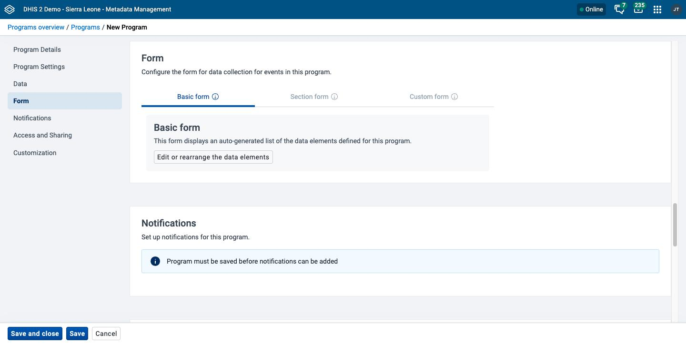

Choose how the data entry form of the events looks. The **Section form** and **Custom form** tabs are not available until you save the program. A tooltip says: **You need to save before this form type can be configured.** If you add data elements to a saved program, save the program again before you edit sections or the custom form.

- **Basic form**: An automatic list of the data elements of the program, in the order that you added them. To change the data elements, click **Edit or rearrange the data elements**.
- **Section form**: Groups data elements in named sections.
- **Custom form**: Lets you write the form layout in HTML.

These tabs replace the **Create data entry forms** step of the Maintenance app. The form types are the same.

After you save the program and add at least one data element, an info box at the top of the section shows the form type in effect for **Web** and for **Android**.

### Notifications { #mmp_single_event_program_notifications }

Save the program before you add notifications. Before then, the section shows the message **Program must be saved before notifications can be added**. Click **Add a notification** to open the notification editor. The editor has its own section list. An event program has one stage, so the editor does not show the **Notification type** choice.

- **Basic information**: **Name** (required) and **Code**.
- **Message content**: The templates of the message subject and the message body. Under **Insert a variable:**, click a variable to add it. The variables include the program name, the organisation unit, the due date, the days until and since the due date, the current date, the program stage name, and the data elements of the stage.
- **Notification timing**: **When to send notification**. The options are **Program stage completion** (when the event is completed), **Days scheduled (due date)** (a set number of days before or after the due date of the event), and **Program rule** (as a result of the **Send message** or **Schedule message** action of a program rule). For **Days scheduled (due date)**, choose **Before** or **After** and enter the number of days. The checkbox **Allow notification to be sent multiple times** is also available.
- **Recipient**: **Recipient type**. The types are **Tracked entity instance**, **Organisation unit contact**, **Users at organisation unit**, **User group**, **Data element**, and **Web hook**. Depending on the type, you also choose a user group, a data element, or a delivery channel (**Send as SMS** or **Send as Email**), or enter a web hook URL. There is no **Program attribute** type.

The footer of the editor says: **Saving a notification does not save other changes to the program.** Use **Save notification** or **Save notification and close** to save the notification.

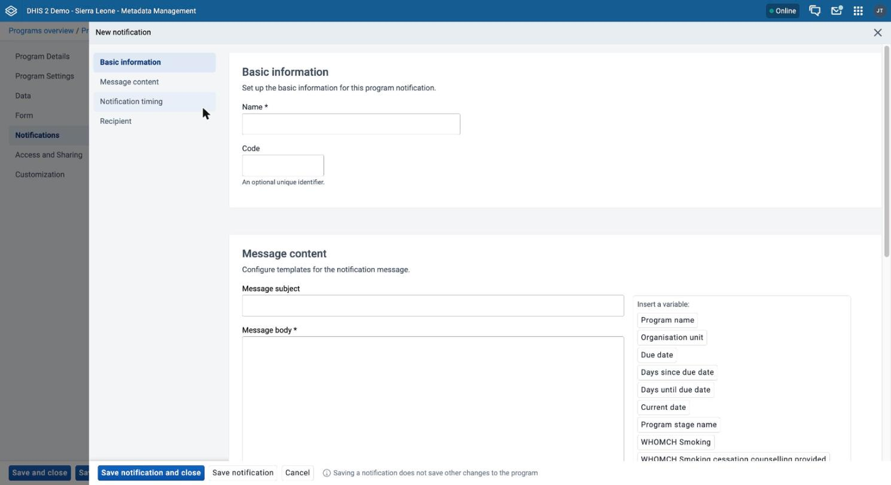

### Access and Sharing { #mmp_single_event_program_access }

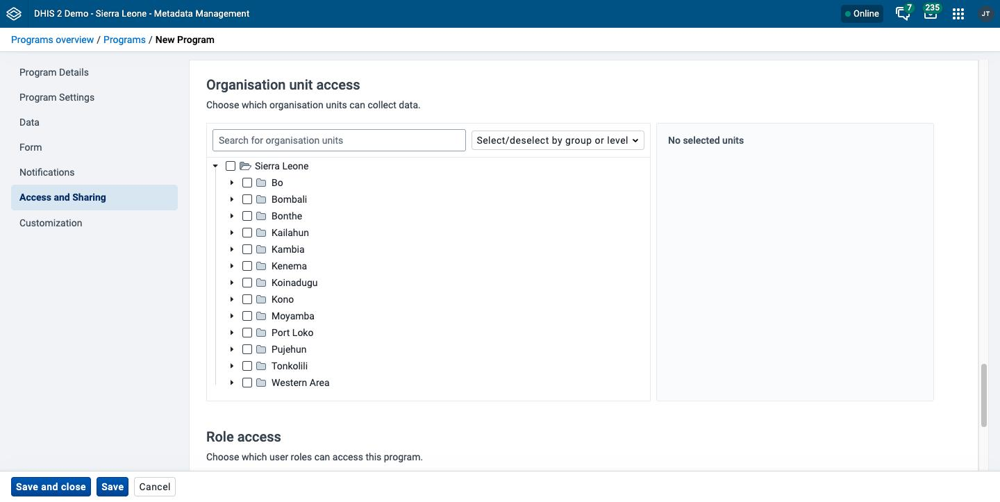

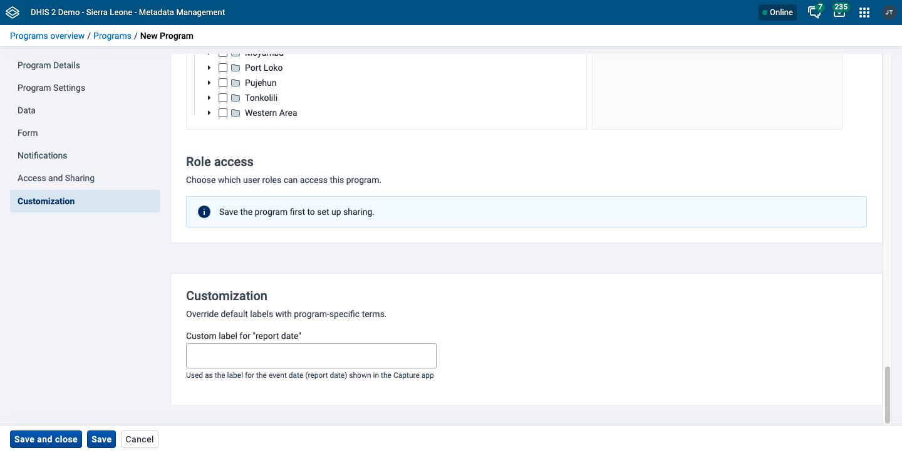

1. Under **Organisation unit access**, choose the organisation units that can collect data for this program. Use the tree, the search box, or **Select/deselect by group or level**.
2. Under **Role access**, click **Edit access** to open the sharing dialog, and choose the user roles that can use this program.

Role access is available only after you save the program. Before then, the section shows the message **Save the program first to set up sharing.** The sharing dialog is the same as the sharing dialog of the Maintenance app.

### Customization { #mmp_single_event_program_customization }

Override the default labels with terms that fit your program. An event program has these label fields:

- **Custom label for "report date"**: The label of the event date in the Capture app.
- **Custom label for "event" (singular)**
- **Custom label for "organisation unit"**
- **Custom label for "relationship" (singular)**
- **Custom label for "note" (singular)**

In DHIS2 2.43.2 and later, the section also shows the plural labels: **Custom label for "events" (plural)**, **Custom label for "relationships" (plural)**, and **Custom label for "notes" (plural)**.

## Creating a tracker program { #mmp_create_tracker_program }

### Workflow: Create a tracker program { #mmp_workflow_tracker_program }

Save the program before you add program stages, add notifications, or set role access. The **Program Stages** section, the **Notifications** section, the role access settings, and the **Section form** and **Custom form** tabs are available only after you save the program.

1. Open the **Metadata Management** app.
2. In the sidebar, click **Programs** > **Programs**.
3. Click **New**.
4. In the **Choose program type** dialog, choose **Tracker**, and then click **Continue**.
5. Fill in **Program Details**.
6. Fill in **Enrollment: Settings**. **Tracked entity type** is required.
7. Under **Enrollment: Data**, choose the tracked entity attributes.
8. Click **Save**.
9. Under **Enrollment: Form**, choose a form type for the enrollment if you want something other than the default **Basic form**.
10. Under **Program Stages**, add one or more program stages. See [Create or edit a program stage](#mmp_create_program_stage).
11. (Optional) Add notifications.
12. Under **Access and Sharing**, set the access level, the organisation unit access, and the role access.
13. (Optional) Under **Customization**, override labels.
14. Click **Save and close**.

### Program Details { #mmp_tracker_program_details }

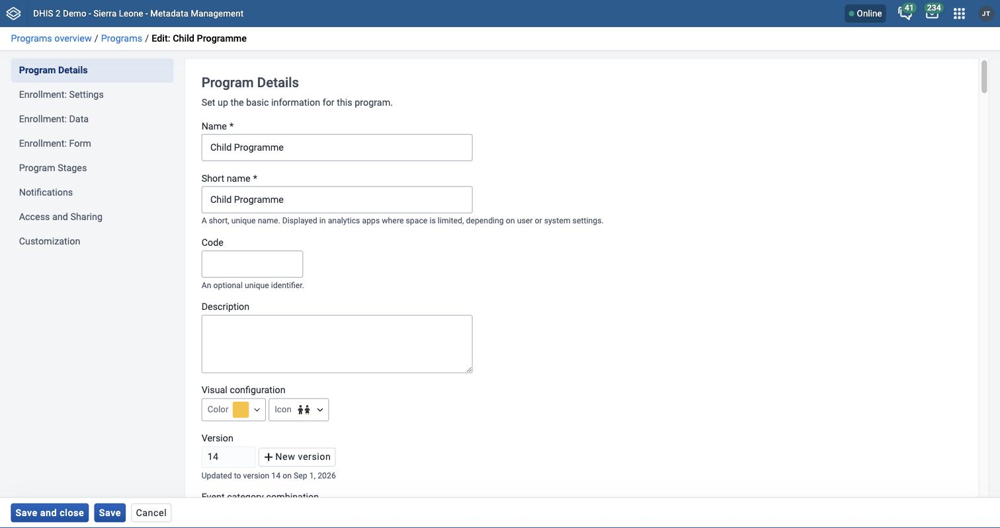

Fill in the basic information of the program:

- **Name** and **Short name** (required). See [Common metadata object fields](#mm_common_metadata_fields).
- **Code**, **Description**, and **Visual configuration** (color and icon). See [Common metadata object fields](#mm_common_metadata_fields).
- **Version**: A number that you can increase by hand. Click **New version** to increase it by one. DHIS2 also increases the number by one each time you save changes to the program. If you change the number and want the old one back, click **Reset version**. After you save, the field shows the date of the last update.
- **Event category combination**: A category combination that disaggregates the events of the program. The menu lists the category combinations with the data dimension type **Attribute**, and **None** (the default) is the first option. In the Maintenance app, this field was **Category combination**.
- **Record change history for event data values**: A checkbox. It is available in DHIS2 v43 and later.

A tracker program has no **Location type** field in this section. The **Tracked entity type** field and the **Location type** field for the enrollment are in **Enrollment: Settings**.

These checkboxes let you close data entry and lock events on a schedule:

- **Close data entry a number of days after a period ends**: Shows the **Number of days** field and the **Expiry period type** menu (for example **Daily** or **Monthly**). In the Maintenance app, these were **Expiry period type** and **Expiry days**.
- **Lock events a number of days after completion**: Shows the **Number of days** field. After that number of days, you can no longer edit a completed event. In the Maintenance app, this was **Completed events expiry days**.
- **Close data entry a number of days after end date of _[category combination name]_**: Shows only when the **Event category combination** is not **None**. The label uses the name of the category combination that you chose, for example **Close data entry a number of days after end date of Implementing Partner**. It shows the **Number of days** field. In the Maintenance app, this was **Open days after category option end date**.

After an event falls outside one of these windows, no one can edit it. Only a user with the **Edit expired data** authority can still change it.

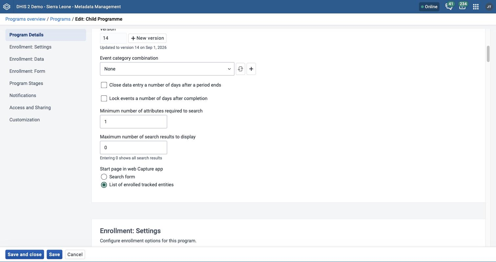

A tracker program also has these fields for the search of tracked entities:

- **Minimum number of attributes required to search**: The number of tracked entity attributes that a user must fill in before a search. In the Maintenance app, this field had the same name.
- **Maximum number of search results to display**: For a search outside the capture scope of the user, the server rejects the search with an error if it would match more tracked entities than this number. It does not return a partial list. The limit has no effect on searches inside the capture scope. Enter **0** to turn the limit off. In the Maintenance app, this was **Maximum number of tracked entity instances to return in search**.
- **Start page in web Capture app**: Choose **Search form** or **List of enrolled tracked entities**. In the Maintenance app, this was the checkbox **Display front page list**.

### Enrollment: Settings { #mmp_tracker_enrollment_settings }

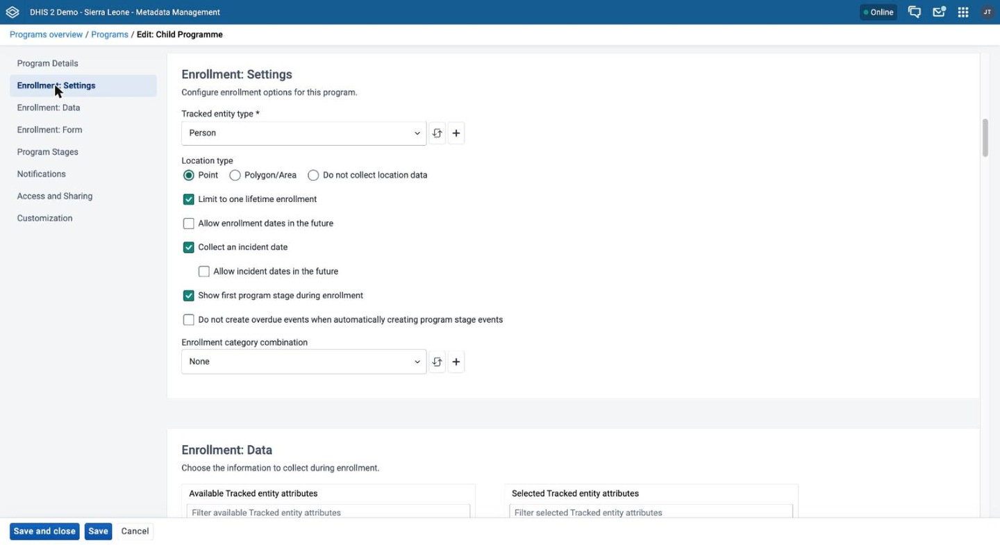

- **Tracked entity type** (required): The type of entity that the program enrolls, for example a person. To create a tracked entity type without leaving the program editor, click the **+** button.
- **Location type**: The location of the enrollment. Choose **Point**, **Polygon/Area**, or **Do not collect location data**. In the Maintenance app, this field was **Feature type**.
- **Limit to one lifetime enrollment**: A tracked entity can enroll in the program only once.
- **Allow enrollment dates in the future**.
- **Collect an incident date**: A date that is different from the enrollment date, for example the date when a condition started. When you choose this checkbox, the checkbox **Allow incident dates in the future** shows. If you clear **Collect an incident date**, DHIS2 also clears **Allow incident dates in the future**.
- **Show first program stage during enrollment**: Shows the data entry form of that program stage on the registration page, so you can capture its first event together with the enrollment.
- **Do not create overdue events when automatically creating program stage events**.
- **Enrollment category combination**: A category combination for the enrollment. It is available in DHIS2 v43 and later.

### Enrollment: Data { #mmp_tracker_enrollment_data }

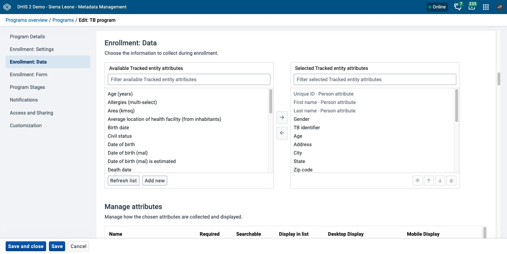

1. Use the transfer list to move tracked entity attributes from **Available tracked entity attributes** to **Selected tracked entity attributes**. These attributes are the information that DHIS2 collects at enrollment. See [Using a transfer list component](#mm_transfer_list_component).
2. In the **Manage attributes** table, the row of each attribute shows its **Name**. Set these options for each attribute: **Required**, **Searchable**, **Display in list**, **Desktop Display**, and **Mobile Display**. The table also has an **Allow future dates** column when the program has an attribute with the value type **Date**.

The attributes that belong to the tracked entity type of the program are already in the list of selected attributes. The list shows them in gray with the text _[tracked entity type name]_ attribute, and you cannot remove them. A tooltip in the **Manage attributes** table says: **This attribute is defined at the tracked entity type level**. If an attribute is required at the tracked entity type level, **Required** is already checked and disabled. If an attribute is unique, **Searchable** is already checked and disabled. If you choose a different tracked entity type, the list of attributes of the tracked entity type changes.

### Enrollment: Form { #mmp_tracker_enrollment_form }

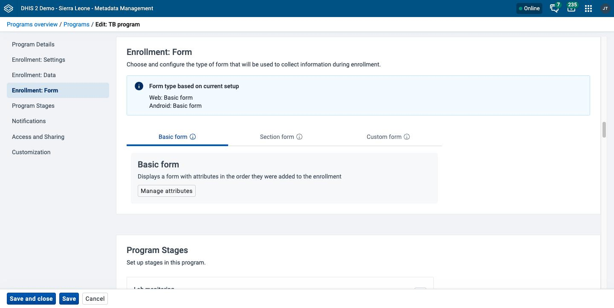

Choose how the enrollment form looks. The **Section form** and **Custom form** tabs are not available until you save the program. A tooltip says: **You need to save before this form type can be configured.** If you add attributes to a saved program, save the program again before you edit sections or the custom form.

- **Basic form**: An automatic list of the tracked entity attributes of the enrollment, in the order that you added them. To change the attributes, click **Manage attributes**.
- **Section form**: Groups attributes in named sections.
- **Custom form**: Lets you write the form layout in HTML.

After you save the program and assign at least one tracked entity attribute, an info box at the top of the section shows the form type in effect for the **Web** and for **Android**.

If an attribute is required but not in any section of a section form, the section shows a warning with the title **Mandatory tracked entity attributes are not included in this form.** and the list of attributes.

### Program Stages { #mmp_tracker_program_stages }

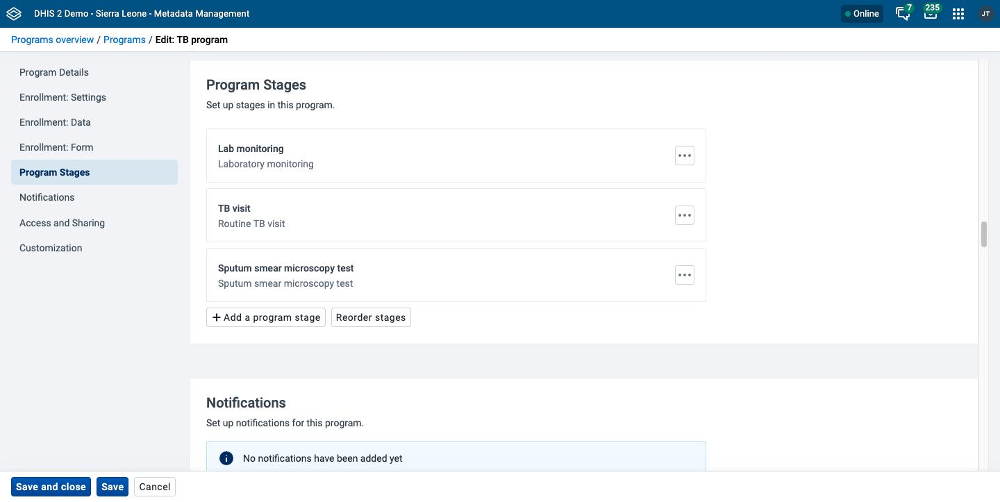

The **Program Stages** section lists the stages of the program. Before you save the program, the section shows the message **Program must be saved before stages can be added**. Each stage has an options menu with **Edit**, **Translate**, **Copy ID**, and **Delete**. If you delete a stage, the list shows the message **Stage {name} will be removed on save**, and you can click **Restore stage** before you save. Click **Add a program stage** to create a stage. Click **Reorder stages** to open a dialog. In the dialog, move the stages up or down one at a time, and then click **Save program stage ordering**. **Reorder stages** is not available when the program has fewer than two stages.

#### Create or edit a program stage { #mmp_create_program_stage }

A stage opens in its own editor, in a panel with the title **New stage** or **Edit stage**. The editor has its own section list, separate from the sections of the program.

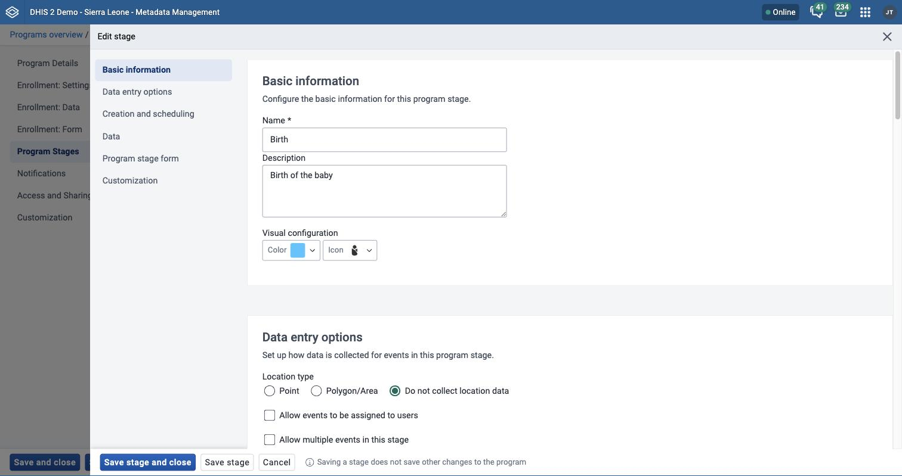

**Basic information**: **Name** (required), **Description**, and **Visual configuration** (color and icon).

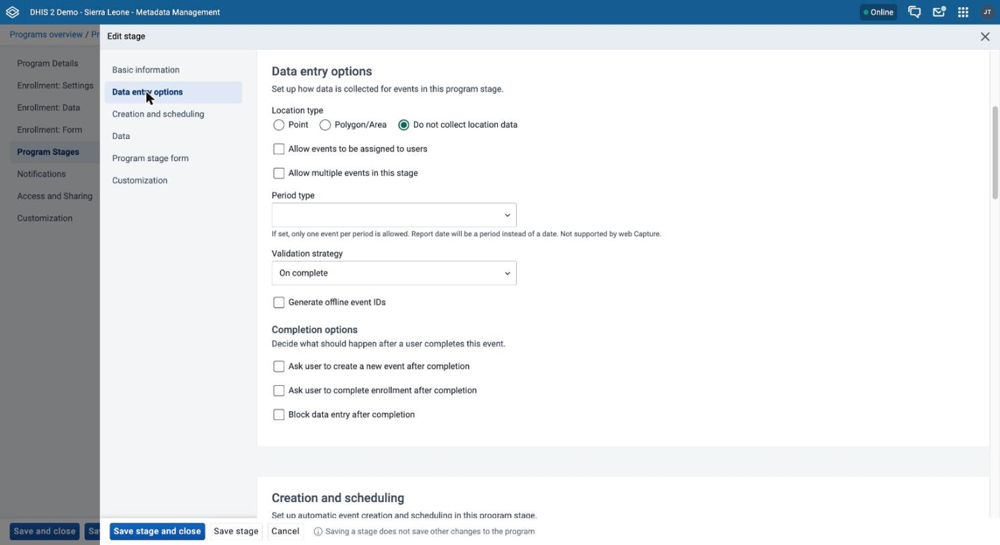

**Data entry options**:

- **Location type**: The location of the events of this stage. Choose **Point**, **Polygon/Area**, or **Do not collect location data**. In the Maintenance app, this field was **Feature type**.
- **Allow events to be assigned to users**: Adds an assigned user field to the events of this stage, so a specific user can be responsible for an event. This also adds an **Assigned to** column to the working lists of this stage.
- **Allow multiple events in this stage**: When you choose this checkbox, the fields **Standard interval days** (the number of days between repeated events) and **Default next scheduled date** also show. **Default next scheduled date** lets you choose a data element of the stage with the value type **Date**, or **None**. If it is set, its value sets the next scheduled date. If it is empty, DHIS2 uses **Standard interval days**.
- **Period type**: If you set it, the stage allows only one event for each period, and the report date is a period and not a date. The web Capture app does not support this option.
- **Validation strategy**: Choose **On complete** or **On update and insert**. A new stage uses **On complete**. This field is available in DHIS2 v42 and later.
- **Generate offline event IDs**.

Under **Completion options**, you decide what happens after a user completes an event. Each option is a checkbox:

- **Ask user to create a new event after completion**
- **Ask user to complete enrollment after completion**
- **Block data entry after completion**

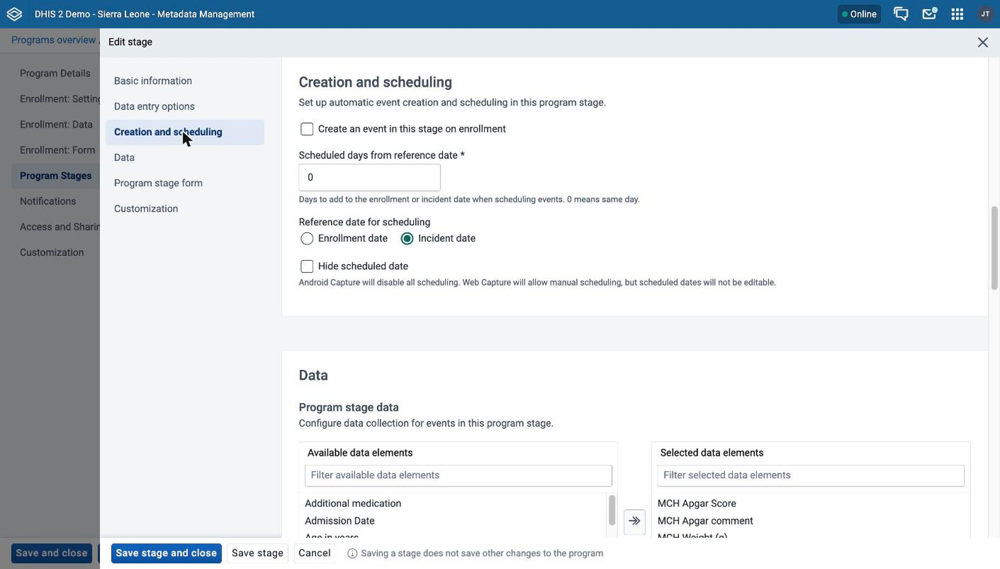

**Creation and scheduling**:

- **Create an event in this stage on enrollment**: When you choose this checkbox, **Open data entry form after enrollment** shows. When you choose that checkbox, **Date to use for created event report date** shows. **Open data entry form after enrollment** opens the form of this event right after enrollment. If more than one stage of the program has this checkbox chosen, only the first one in the stage order opens. Choose **Enrollment date**, **Incident date**, or **None (report date will be empty)**.
- **Scheduled days from reference date**: The days to add to the enrollment date or the incident date when DHIS2 schedules events. **0** means the same day. This fixed number of days is the last of three ways that DHIS2 suggests a scheduled date for a repeated event. DHIS2 first uses the **Default next scheduled date** data element of the previous event, if you set one. Then it adds **Standard interval days** to the date of the previous event. It uses this fixed number only if neither of those applies.
- **Reference date for scheduling**: Choose **Enrollment date** or **Incident date**.
- **Hide scheduled date**: The Android Capture app turns off all scheduling. The web Capture app still lets users schedule events by hand, but users cannot edit the scheduled dates. In the web Capture app, the schedule dialog shows the date as read-only text. The app also hides the scheduled date in the event editor, in the stage's event list, and in the scheduled-date filter of working lists.

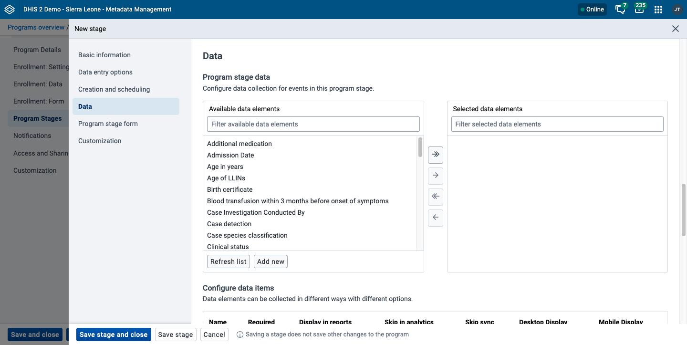

**Data**: Choose the data elements of the events of this stage.

1. Use the transfer list to move data elements from **Available data elements** to **Selected data elements**. The list offers only data elements with the domain type tracker. See [Using a transfer list component](#mm_transfer_list_component).
2. (Optional) To create a data element, click **Add new** in the footer of the list of available data elements. This opens the full data element creation page in a new tab.
3. In the **Configure data items** table, set the options of each data element. See the following table.

Table: Configure data items, column reference

| Column                 | Description                                                                                                                                                                                                            |
| ---------------------- | ---------------------------------------------------------------------------------------------------------------------------------------------------------------------------------------------------------------------- |
| **Name**               | The display name of the data element. You cannot edit it here. It identifies the row.                                                                                                                                  |
| **Required**           | With the validation strategy **On update and insert**, a required data element blocks every save. With **On complete**, it blocks only the completion of the event. You can still save the event with the value empty. |
| **Display in reports** | Controls whether the data element shows as a column in working lists and similar list views.                                                                                                                           |
| **Skip in analytics**  | Leaves the data element out of the analytics tables.                                                                                                                                                                   |
| **Skip sync**          | Leaves the data element values out of data synchronization to another DHIS2 instance.                                                                                                                                  |
| **Allow future dates** | Shows when the stage has at least one data element with the value type **Date**. The checkbox is available only for **Date** data elements and lets users choose a date in the future.                                 |
| **Desktop Display**    | How the field looks in the web Capture app.                                                                                                                                                                            |
| **Mobile Display**     | How the field looks in the Android Capture app.                                                                                                                                                                        |

The **Desktop Display** and **Mobile Display** options depend on the value type of the data element. For example, a **Yes/No** data element offers **Default**, radio button layouts, and checkbox layouts, and a **Number** data element offers **Default**, **Value**, **Slider**, and **Linear scale**. A data element with an option set offers **Default**, **Dropdown**, radio button and checkbox layouts, **Shared header radiobuttons**, and **Icons as buttons**. Other value types, for example date, can offer only **Default**. If a client does not support an option, it uses its own default.

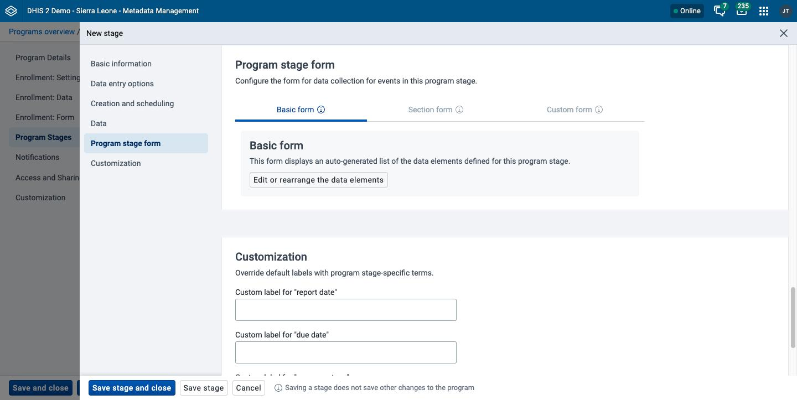

**Program stage form**: Choose how the event form of this stage looks. The options are **Basic form** (an automatic list of the data elements, in the order that you added them), **Section form** (data elements in named sections), and **Custom form** (a layout that you write in HTML). The **Section form** and **Custom form** tabs are not available until you save the program. On the **Basic form** tab, click **Edit or rearrange the data elements** to go to the **Data** section of this stage. After you save the program and assign at least one data element, an info box at the top of the section shows the form type in effect for **Web** and for **Android**. In a tracker program, you can reorder the sections of a section form with **Reorder sections**.

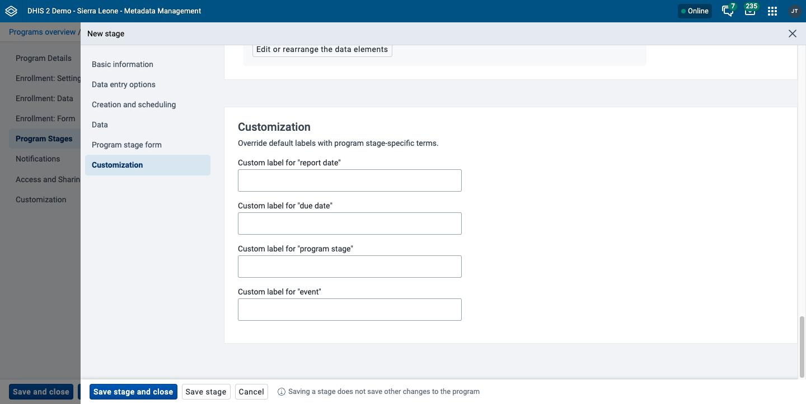

**Customization**: Custom labels for this stage: **Custom label for "report date"**, **Custom label for "due date"**, **Custom label for "program stage"**, and **Custom label for "event"**. In DHIS2 2.43.2 and later, the section also has **Custom label for "events" (plural)**.

The footer of the editor says: **Saving a stage does not save other changes to the program.** Click **Save stage** or **Save stage and close** to save the stage. These buttons do not save other pending changes on the program page. Save those changes with the **Save** or **Save and close** button of the program.

### Notifications { #mmp_notifications }

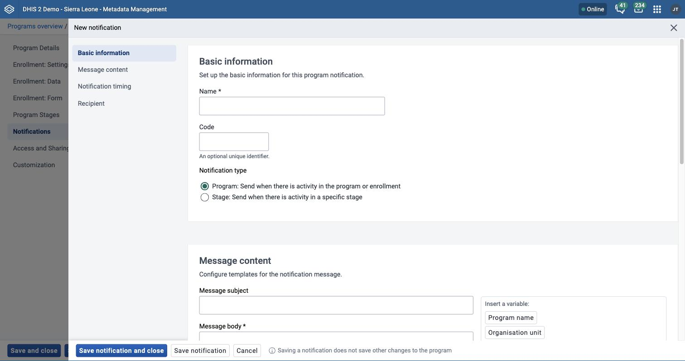

In the **Notifications** section, click **Add a notification** to open the notification editor. The editor has its own section list. Before you save the program, the section shows the message **Program must be saved before notifications can be added**.

- **Basic information**: **Name** (required), **Code**, and **Notification type**. This choice shows for tracker programs only. Choose **Program** (**Send when there is activity in the program or enrollment**) or **Stage** (**Send when there is activity in a specific stage**). If you choose **Stage**, also choose the **Program stage**. You cannot change these choices after you save the notification. This choice replaces the two tabs of the Maintenance app, **Program notifications** and **Program stage notifications**.
- **Message content**: The templates of the message subject and the message body. Under **Insert a variable:**, click a variable to add it. The variables include the program name, the organisation unit, the due date, the days until and since the due date, the current date, and the tracked entity attributes of the program. For a stage notification, they also include the program stage name and the data elements of the stage.
- **Notification timing**: **When to send notification**. The options for a program notification are **Program enrollment**, **Program completion**, **Program rule**, **Days scheduled (incident date)**, and **Days scheduled (enrollment date)**. The options for a stage notification are **Program stage completion**, **Days scheduled (due date)**, and **Program rule**. For the options that use days, choose **Before** or **After** and enter the number of days. For a stage notification, **Allow notification to be sent multiple times** is also available. Choose this checkbox if DHIS2 must send the notification again each time a repeated event triggers it.
- **Recipient**: **Recipient type**. Depending on the type, you also choose a user group, a program attribute, a data element, or a delivery channel (**Send as SMS** or **Send as Email**), or enter a web hook URL.

Table: Notification timing options

| Option                               | Notification type | When DHIS2 sends the notification                                                     |
| ------------------------------------ | ----------------- | ------------------------------------------------------------------------------------- |
| **Program enrollment**               | Program           | When the tracked entity enrolls in the program.                                       |
| **Program completion**               | Program           | When the enrollment is completed.                                                     |
| **Days scheduled (incident date)**   | Program           | A set number of days before or after the incident date.                               |
| **Days scheduled (enrollment date)** | Program           | A set number of days before or after the enrollment date.                             |
| **Program stage completion**         | Stage             | When the event is completed.                                                          |
| **Days scheduled (due date)**        | Stage             | A set number of days before or after the due date of the event.                       |
| **Program rule**                     | Program and stage | As a result of the **Send message** or **Schedule message** action of a program rule. |

Table: Recipient types

| Recipient type             | What DHIS2 does                                                                                                                                                                                                           |
| -------------------------- | ------------------------------------------------------------------------------------------------------------------------------------------------------------------------------------------------------------------------- |
| Tracked entity instance    | Sends an email or SMS to the tracked entity, if it has a phone number or an email attribute. Also choose the delivery channels.                                                                                           |
| Organisation unit contact  | Sends an email or SMS to the registered contact person of the organisation unit, if there is one. Also choose the delivery channels.                                                                                      |
| Users at organisation unit | Sends a message through the DHIS2 messaging system to every user assigned to the organisation unit.                                                                                                                       |
| User group                 | Sends a message through the DHIS2 messaging system to every member of the **User Group Recipient** that you choose. You can limit this to **Notify users in hierarchy only** or **Notify parent organisation unit only**. |
| Program attribute          | Sends the message to the phone number or email tracked entity attribute that you choose as **Program attribute recipient**.                                                                                               |
| Data element               | Sends the message to the phone number or email data element of the stage that you choose as **Data element recipient**. Only a stage notification offers this type.                                                       |
| Web hook                   | Posts an HTTP request to the URL that you enter in **Web hook message URL**.                                                                                                                                              |

The footer of the editor says: **Saving a notification does not save other changes to the program.** Use **Save notification** or **Save notification and close** to save the notification. If you delete a notification, the list shows a message that the notification will be removed on save, and you can click **Restore notification** before you save.

### Access and Sharing { #mmp_tracker_program_access }

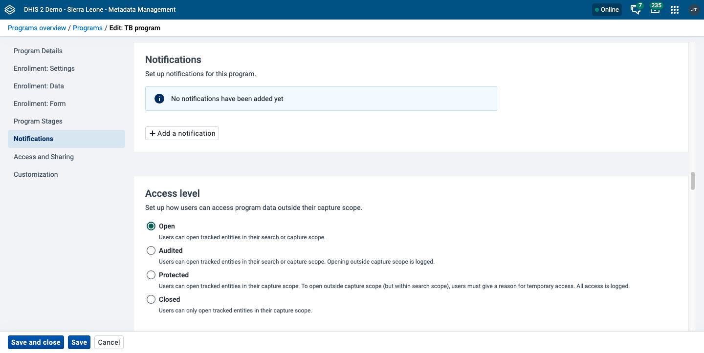

This section has three parts that were in different places in the Maintenance app:

- **Access level**: Sets how users can open program data outside their capture scope.
    - **Open**: Users can open tracked entities in their search scope or capture scope.
    - **Audited**: The same as **Open**, but DHIS2 logs the opening of a tracked entity outside the capture scope.
    - **Protected**: Users must give a reason for temporary access to open a tracked entity outside their capture scope but inside their search scope. DHIS2 logs all access.
    - **Closed**: Users can open only tracked entities in their capture scope.
    - The access level also decides what happens to the access of a user after the ownership of a tracked entity moves out of the capture scope of the user. With **Open** or **Audited**, the user never loses access. With **Protected**, the user loses access only if they had capture access, and not only search access, before the transfer. With **Closed**, the user loses access whenever the new owner location is outside their capture scope, even if they had only search access before.
- **Organisation unit access**: The organisation units that can collect data for this program. Use the tree, the search box, or **Select/deselect by group or level**.
- **Role access**: The user roles that can use the program and its program stages. Role access is available only after you save the program. Before then, the section shows the message **Save the program first to set up sharing.** The sharing dialog is the same as the sharing dialog of the Maintenance app. After you save the program, the panel shows one sharing box for the program and one for each program stage. The box of the program has **Edit access**, which opens the sharing dialog, and **Apply to all stages**, which copies the sharing of the program to every stage. The box of a stage has **Edit data access** and **Apply program access rules**, which copies the sharing of the program to that stage only.

In the Maintenance app, the access level was in the first wizard step, **Program details**. Event programs do not have the **Access level** setting.

### Customization { #mmp_tracker_program_customization }

Override the default labels with terms that fit your program. A tracker program has these label fields:

- **Custom label for "incident date"**
- **Custom label for "enrollment date"**
- **Custom label for "enrollment" (singular)**
- **Custom label for "event" (singular)**
- **Custom label for "program stage" (singular)**
- **Custom label for "follow-up"**
- **Custom label for "organisation unit"**
- **Custom label for "relationship" (singular)**
- **Custom label for "note" (singular)**
- **Custom label for "attribute" (singular)**

In DHIS2 2.43.2 and later, the section also has the plural labels: **Custom label for "enrollments" (plural)**, **Custom label for "events" (plural)**, **Custom label for "program stages" (plural)**, **Custom label for "relationships" (plural)**, **Custom label for "notes" (plural)**, and **Custom label for "attributes" (plural)**.

The Maintenance app had the custom label fields in the **Program details** and **Enrollment details** wizard steps. The labels **Custom label for "report date"** and **Custom label for "due date"** are not in the program-level section of a tracker program. You set them for each stage, in the **Customization** section of the stage editor. See [Create or edit a program stage](#mmp_create_program_stage).
