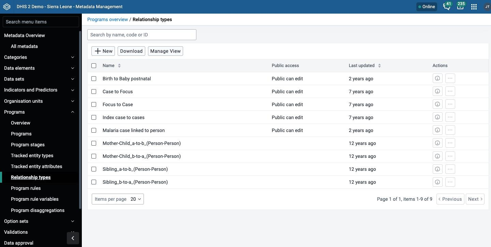
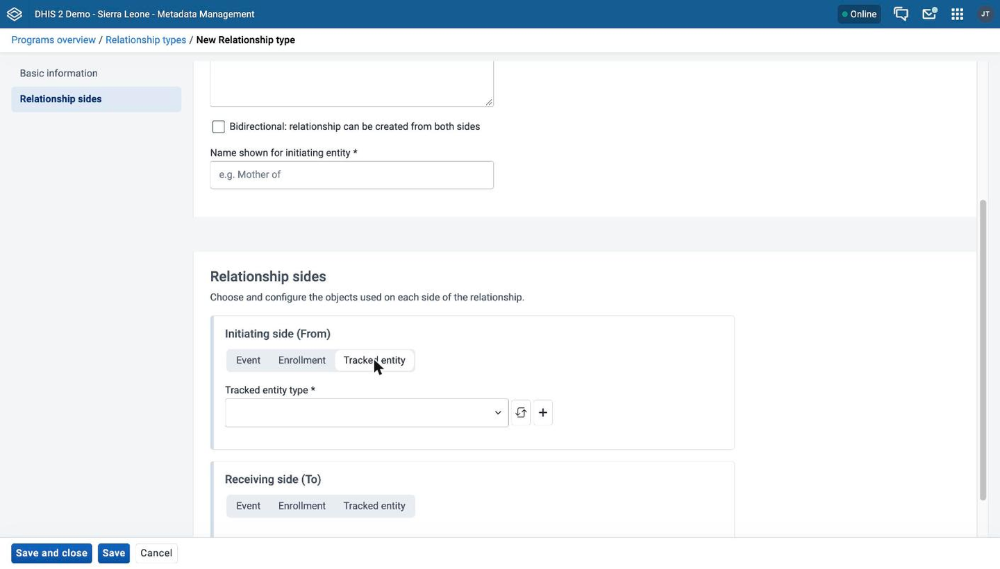
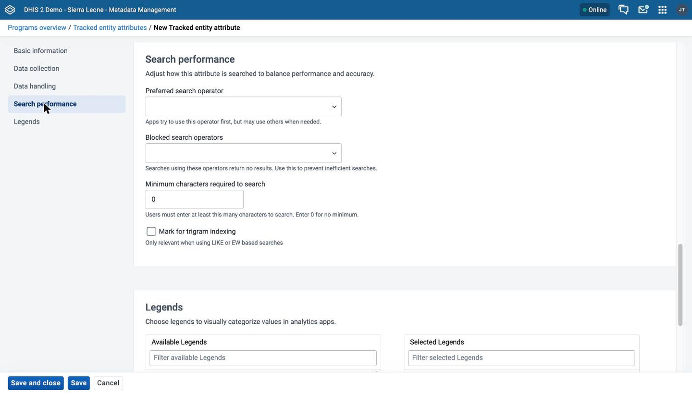
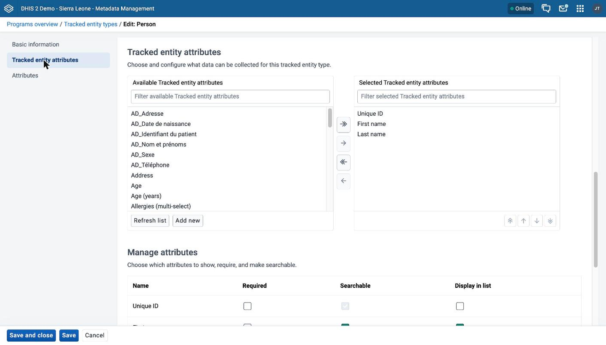

# Tracked entity types, tracked entity attributes, and relationship types { #mmp_tracked_entity_relationship }

This chapter explains what tracked entity types, tracked entity attributes, and relationship types configure, and how to create or edit each of them in the **Metadata Management** app. It also lists the fields that each form offers.

> **Note**
>
> The **Metadata Management** app replaces the functionality of the Maintenance app.
> If your instance does not have the **Metadata Management** app installed, use the Maintenance app instead. See [Configure programs in the Maintenance app](#configure_programs_in_maintenance_app).

The **Metadata Management** app has a screen for each of the three object types. Open them from the sidebar under **Programs**: **Tracked entity types**, **Tracked entity attributes**, and **Relationship types**.

These lists and forms follow the same conventions as every other object type in the app. See [Common metadata object fields](#mm_common_metadata_fields), [Common actions](#mm_common_actions), and [Use a transfer list](#mm_transfer_list_component) in [Configure metadata (Metadata Management app)](#metadata_management_app).

In the **Metadata Management** app, you manage these objects:

Table: Tracked entity objects in the Metadata Management app

| Object type              | Available functions                                             |
| ------------------------ | --------------------------------------------------------------- |
| Tracked entity type      | Create, edit, clone, share, delete, show details, and translate |
| Tracked entity attribute | Create, edit, clone, share, delete, show details, and translate |
| Relationship type        | Create, edit, clone, share, delete, show details, and translate |

For **Show details**, **Sharing settings**, **Translate**, **Delete**, and **Clone**, see [Common actions](#mm_common_actions).

For the meaning of relationship types and tracked entity types, see [About relationship types](#mmp_about_relationship_types) and [About tracked entity types](#mmp_about_tracked_entity_type).

> **Background and reference**
>
> For background and concepts, see [Understanding programs, tracker configuration, and program disaggregation](#understanding_programs_and_tracker).

## Create or edit a relationship type { #mmp_create_relationship_type }

1. Open the **Metadata Management** app and click **Programs** > **Relationship types**.

2. To create a relationship type, click **New**. To edit one, click the options menu of the relationship type and choose **Edit**.

3. Under **Basic information**, fill in **Name**, **Code**, and **Description**. Only **Name** is required. See [Common metadata object fields](#mm_common_metadata_fields).

4. (Optional) Choose **Bidirectional: relationship can be created from both sides**.

5. In **Name shown for initiating entity**, enter the name of the relationship as the initiating entity shows it. This field is required. For example, in a mother and child relationship, enter `Mother of`. If you chose **Bidirectional**, the app also shows **Name shown for receiving entity**. Enter the name that the receiving entity shows, for example `Child of`. This field is required when the relationship is bidirectional.

6. Under **Relationship sides**, set up the **Initiating side (From)** and the **Receiving side (To)**. For each side, choose a constraint, then set the fields that the constraint shows. See [Relationship sides](#mmp_relationship_sides).

7. Click **Save and close**.

The name of the initiating entity is the name of the relationship at the "left" side of the relationship in the Data Entry app. The name of the receiving entity is the name at the "right" side.

### Relationship sides { #mmp_relationship_sides }

Each side has a button group with the constraints **Event**, **Enrollment**, and **Tracked entity**. A constraint limits what kind of entity can be on that side. When you change the constraint, the app clears the other choices for that side.

The following table shows the fields for each constraint.

Table: Fields of a relationship side

| Constraint         | Fields                                                                                                                                                                     | Attributes or data elements that you can show                          |
| ------------------ | -------------------------------------------------------------------------------------------------------------------------------------------------------------------------- | ---------------------------------------------------------------------- |
| **Tracked entity** | **Tracked entity type** (required). **Program** (optional) after you choose a tracked entity type. The list shows only tracker programs that use that tracked entity type. | Attributes of the tracked entity type and of the program, in one list. |
| **Enrollment**     | **Program** (required). The list shows only tracker programs.                                                                                                              | Attributes of the program.                                             |
| **Event**          | **Program** (required). **Program stage** (required) for a tracker program. For an event program, the app chooses the only stage for you.                                  | Data elements of the program stage.                                    |

After you choose the entity, the side shows a transfer list. Use it to choose what the relationship shows when you view it:

- For **Tracked entity** and **Enrollment**, the label is **Choose which tracked entity attributes are shown when viewing the relationship**. The lists are **Available tracked entity attributes** and **Selected tracked entity attributes**.
- For **Event**, the label is **Choose which data elements are shown when viewing the relationship**. The lists are **Available data elements** and **Selected data elements**.

See [Use a transfer list](#mm_transfer_list_component). In the transfer list, you can change the order of the selected items.

## Create or edit a tracked entity attribute { #mmp_create_tracked_entity_attribute }

The form of a tracked entity attribute has sections in a sidebar: **Basic information**, **Data collection**, **Data handling**, **Search performance**, and **Legends**.

In DHIS2 v42 and earlier, the app does not show **Search performance**. In the **Data handling** section, the app does not show **Do not expose this attribute in analytics**.

1. Open the **Metadata Management** app and click **Programs** > **Tracked entity attributes**.

2. To create an attribute, click **New**. To edit one, click the options menu of the attribute and choose **Edit**.

3. Under **Basic information**, fill in **Name**, **Form name**, **Short name**, **Code**, and **Description**. **Name** and **Short name** are required. **Form name** is an alternative name that data entry forms show. See [Common metadata object fields](#mm_common_metadata_fields).

4. Under **Data collection**, set how the app collects the attribute:

    1. (Optional) Choose an **Option set** to limit data entry to a predefined list of options. The app then sets the **Value type** to match the option set and disables the **Value type** menu.

    2. If you did not choose an option set, choose a **Value type**. This is the type of data that the attribute records. See [Value types](#mmp_tea_value_types).

    3. (Optional) Choose **Unique values only** to require a different value for each tracked entity instance. You cannot choose this option for the value type **Username**. The app then shows **Across entire system** and **Per organisation unit**. Choose where the value must be unique: in the whole system, or only within one organisation unit.

    4. (Optional) If you chose **Across entire system**, you can choose **Automatically generate values**. The app then shows **Pattern for automatically generated values**. Enter a pattern in DHIS2 TextPattern syntax.

    5. (Optional) In **Field mask**, enter a template that hints at the correct format of the attribute. See [Field mask](#mmp_tea_field_mask).

5. Under **Data handling**, set how DHIS2 displays, inherits, and synchronizes values:

    1. (Optional) Choose **Inherit values from tracked entities linked by a relationship**. When you register a new tracked entity, DHIS2 fills this attribute with the value of a related tracked entity.

    2. (Optional) Choose **Show in lists and search results when no program is selected**.

    3. (Optional) Choose **Skip synchronization for this attribute and its values**.

    4. (Optional) Choose **Do not expose this attribute in analytics**. DHIS2 then excludes the attribute from all analytics processing, including analytics tables and analytics apps.

    5. Choose an **Aggregation type**. This is the default way that analytics aggregates the attribute. The menu is disabled for value types that analytics cannot aggregate, such as **Text**, **Date**, and **Organisation unit**.

6. Under **Search performance**, set how searches work for the attribute:

    1. (Optional) Choose a **Preferred search operator**: **EQ | Equals**, **SW | Starts with**, **EW | Ends with**, or **LIKE | Contains**. Apps try to use this operator first, but can use others when needed. The apps honor this preference only for a non-unique attribute of type **Text**, **Long text**, **Phone number**, or **Email**. Apps always search a unique attribute, or an attribute that has an option set, with **EQ | Equals**. Apps ignore this preference for an attribute of a numeric, date, time, percentage, Yes/No, organisation unit, age, or username type. They always use a fixed operator for the type: Range for numeric, date, time, and percentage types, and Equals for all other types.

    2. (Optional) In **Blocked search operators**, choose one or more of **SW | Starts with**, **EW | Ends with**, and **LIKE | Contains**. Searches that use a blocked operator return no results. Use this to prevent inefficient searches. You cannot block the preferred operator.

    3. (Optional) In **Minimum characters required to search**, enter the number of characters that a user must enter before a search runs. Enter 0 for no minimum. The default is 0.

    4. (Optional) Choose **Mark for trigram indexing**. This is relevant only when searches use **LIKE** or **EW**. You cannot choose it when both **EW** and **LIKE** are blocked. After you choose it, the app shows whether the attribute is already trigram indexed in the database.

    

7. Under **Legends**, (optional) choose one or more legend sets in the transfer list.

8. Click **Save and close**.

### Value types { #mmp_tea_value_types }

The **Value type** menu lists the value types that your DHIS2 server offers. The following table describes the value types that the old documentation covered.

Table: Value types

| Value type               | Description                                                                                                                                                                              |
| ------------------------ | ---------------------------------------------------------------------------------------------------------------------------------------------------------------------------------------- |
| Age                      | Dates that DHIS2 shows as a calendar widget, or that you enter as a number of years, months, or days. DHIS2 calculates the date from the current date and saves the date in the backend. |
| Coordinate               | A point coordinate, specified as longitude and latitude in decimal degrees. Write the coordinate in the format `-19.23 , 56.42`, with a comma between the longitude and the latitude.    |
| Date                     | Dates that data entry shows as a calendar widget.                                                                                                                                        |
| Date and time            | A combination of the **Date** and **Time** value types.                                                                                                                                  |
| Email                    | A valid email address.                                                                                                                                                                   |
| File                     | A file resource that stores external files, for example documents and photos.                                                                                                            |
| Image                    | A file resource that stores photos. Unlike **File**, **Image** can show the uploaded image directly in forms.                                                                            |
| Integer                  | Any whole number, positive or negative, including zero.                                                                                                                                  |
| Letter                   | A single letter.                                                                                                                                                                         |
| Long text                | Textual value. Forms show it as a text area with no length limit.                                                                                                                        |
| Negative integer         | Any whole number less than zero. Zero is not included.                                                                                                                                   |
| Number                   | Any real number with a single decimal point. Thousands separators and scientific notation are not supported.                                                                             |
| Percentage               | Whole numbers from 0 to 100, including 0 and 100.                                                                                                                                        |
| Phone number             | A phone number.                                                                                                                                                                          |
| Positive integer         | Any whole number greater than zero. Zero is not included.                                                                                                                                |
| Positive or Zero integer | Any positive whole number, including zero.                                                                                                                                               |
| Organisation unit        | Organisation units that DHIS2 shows as a hierarchy tree widget. If the user has search organisation units, DHIS2 shows these instead of the assigned organisation units.                 |
| Unit interval            | Any real number greater than or equal to 0 and less than or equal to 1.                                                                                                                  |
| Text                     | Textual value. The maximum number of characters for each value is 50,000.                                                                                                                |
| Time                     | Time stored in the format HH:mm. HH is a number from 0 to 23. mm is a number from 00 to 59.                                                                                              |
| Username                 | A DHIS2 user. Data entry shows a dialog with a list of users and a search field. The user needs the "View User" authority to use this value type.                                        |
| Yes/No                   | Boolean values. Data entry shows them as menus.                                                                                                                                          |
| Yes only                 | True values. Data entry shows them as checkboxes.                                                                                                                                        |

### Field mask { #mmp_tea_field_mask }

The field mask is a pattern that limits the format of the attribute value. It is implemented only in the DHIS2 Android Capture app, which shows the error **It is not a correct format.** when a value does not match the pattern. The Capture web app does not use it.

The following special characters each match exactly one character of the given type:

Table: Field mask characters

| Character | Match                      |
| --------- | -------------------------- |
| `\d`      | digit                      |
| `\x`      | lowercase letter           |
| `\X`      | capital letter             |
| `\w`      | any alphanumeric character |

For example, the pattern `\d\d\d-\d\d\d-\d\d\d` shows a hyphen after every third digit.

## Create or edit a tracked entity type { #mmp_create_tracked_entity_type }

The form of a tracked entity type has these sections in a sidebar: **Basic information** and **Tracked entity attributes**. The sidebar also has an **Attributes** section, but only when your instance has attributes that apply to tracked entity types. See [Manage attributes](#mm_manage_attribute).

1. Open the **Metadata Management** app and click **Programs** > **Tracked entity types**.

2. To create a tracked entity type, click **New**. To edit one, click the options menu of the tracked entity type and choose **Edit**.

3. Under **Basic information**, fill in the following fields:

    1. **Name** and **Short name**. Both are required. See [Common metadata object fields](#mm_common_metadata_fields).

    2. (Optional) **Name (Plural)**. The app shows this field from DHIS2 2.43.2.

    3. (Optional) **Color and icon**. Under **Visual configuration**, choose a color and an icon that the data capture apps use to identify this tracked entity type.

    4. (Optional) **Description**.

    5. **Location type**: **Point**, **Polygon/Area**, or **Do not collect location data**.

    6. (Optional) **Record change history for attribute values**. The app shows this option from DHIS2 v43.

    7. (Optional) **Record access to tracked entities**.

    8. (Optional) **Minimum number of attributes required to search**. This sets how many attributes a user must fill in to search for this tracked entity type in a global search. The default is 1. See [Configure search](#mmp_configure_search).

    9. (Optional) **Maximum number of tracked entity instances to return when searching**. Enter 0 to show all search results. The default is 0.

4. Under **Tracked entity attributes**, choose the attributes in the transfer list. See [Use a transfer list](#mm_transfer_list_component). The **Manage attributes** table then lists each chosen attribute. For each attribute, choose **Required**, **Searchable**, and **Display in list** as you need.

    

5. Click **Save and close**.
