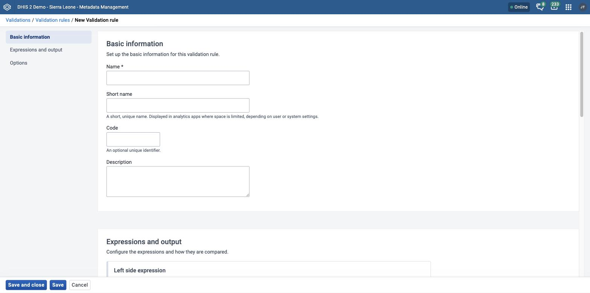

# Manage validation rules { #mm_manage_validation_rule }

This chapter describes how to configure validation rules, validation rule groups, and validation notifications in the **Metadata Management** app.

> **Note**
>
> The **Metadata Management** app replaces the functionality of the Maintenance app.
> If your instance does not have the **Metadata Management** app installed, use the Maintenance app instead. See [Configure metadata](#maintenance_app).

For background on validation rules and their expressions, see [About validation rules](#mm_about_validation_rule).
For background on sliding windows, see [About sliding windows](#mm_sliding_windows).
For background on validation rule groups, see [About validation rule groups](#mm_about_validation_rule_groups).
For background on validation notifications, see [About validation notifications](#mm_validation_notifications).
For background on the functions that you can use in a validation rule, see [About validation rule functions](#mm_about_validation_rule_functions).

> **Background and reference**
>
> For background and concepts, see [Understanding validation rules](#understanding_validation_rules).

## Create or edit a validation rule { #mm_create_validation_rule }

Before you start, create the data elements, constants, and other objects that you want to use in the expressions.

1. Open the **Metadata Management** app and click **Validations** > **Validation rules**.
2. To create a validation rule, click **New**. To edit one, click the options menu of the validation rule and choose **Edit**.
3. Fill in **Name**, **Short name**, **Code**, and **Description**. Only **Name** is required. The name must be unique among the validation rules. See [Common metadata object fields](#mm_common_metadata_fields).
4. In **Left side expression**, create the left side of the expression:

    1. Click **Set up numerator expression**. When the rule already has a left side, click **Edit numerator expression**. The expression editor opens.
    2. Enter the expression, or click an item in the list on the right to insert it at the cursor. The list has these groups: **Operators**, **Data elements**, **Program data**, **Org unit counts**, **Constants**, and **Reporting rates**. Use **Filter list** to search a group.
    3. Click **Apply**. If the expression is not valid, the editor shows **Invalid expression** and **Apply** is not available.
    4. (Optional) In **Description**, enter a description of the left side.
    5. Choose a **Missing value strategy**. The strategy sets how DHIS2 evaluates the validation rule when data is missing.

        Table: Missing value strategies

        | Option                         | Description                                                                                                                                                               |
        | ------------------------------ | ------------------------------------------------------------------------------------------------------------------------------------------------------------------------- |
        | Never skip                     | DHIS2 never skips the validation rule when data is missing. It treats all missing operands as zero. This is the default option for a new validation rule.                 |
        | Skip if any value is missing   | DHIS2 skips the validation rule if any value in the expression is missing. Always choose this option when you use the **Exclusive pair** or **Compulsory pair** operator. |
        | Skip if all values are missing | DHIS2 skips the validation rule only if all of the operands in the expression are missing.                                                                                |

    6. (Optional) Choose **Sliding window: validation checks against relative period** to compare data relative to the period that you are comparing. See [About sliding windows](#mm_sliding_windows).

5. Choose a **Comparison operator**: **Compulsory pair**, **Equal to**, **Exclusive pair**, **Greater than**, **Greater than or equal to**, **Less than**, **Less than or equal to**, or **Not equal to**. The default is **Not equal to**.

    The **Compulsory pair** operator lets you require that data values are entered in a form for both the left and right sides of the expression, or for neither side. This means that if one field in a form is filled in, one or more other fields must also be filled in.

    The **Exclusive pair** operator lets you assert that if any value exists on the left side, there are no values on the right side, and the reverse. This means that the data elements on either side of the rule must be mutually exclusive for a given period, organisation unit, and attribute option combination.

6. In **Right side expression**, create the right side of the expression:

    1. Click **Set up denominator expression**. When the rule already has a right side, click **Edit denominator expression**. The expression editor opens.
    2. Enter the expression, or click an item in the list on the right to insert it at the cursor. The list has the same groups as for the left side.
    3. Click **Apply**.
    4. (Optional) In **Description**, enter a description of the right side.
    5. Choose a **Missing value strategy**. The strategy sets how DHIS2 evaluates the validation rule when data is missing.

        Table: Missing value strategies

        | Option                         | Description                                                                                                                                                               |
        | ------------------------------ | ------------------------------------------------------------------------------------------------------------------------------------------------------------------------- |
        | Never skip                     | DHIS2 never skips the validation rule when data is missing. It treats all missing operands as zero. This is the default option for a new validation rule.                 |
        | Skip if any value is missing   | DHIS2 skips the validation rule if any value in the expression is missing. Always choose this option when you use the **Exclusive pair** or **Compulsory pair** operator. |
        | Skip if all values are missing | DHIS2 skips the validation rule only if all of the operands in the expression are missing.                                                                                |

    6. (Optional) Choose **Sliding window: validation checks against relative period** to compare data relative to the period that you are comparing. See [About sliding windows](#mm_sliding_windows).

7. (Optional) In **Instruction to show**, enter an instruction. DHIS2 shows this text when data is validated in the **Data Entry** app and in the Android apps. It is recommended to always provide an instruction that makes clear what action a user must take when the rule is triggered.

8. Choose a **Period type**. The default is **Monthly**.
9. Choose an **Importance**: **High**, **Medium**, or **Low**. The default is **Medium**. The importance changes how the validation rule output looks during data entry.
10. (Optional) In **Organisation unit levels to run validation for**, choose the organisation unit levels where DHIS2 evaluates the rule. If you leave this field empty, DHIS2 evaluates the rule at all levels.
11. (Optional) Choose **Skip this rule during form validation in Data Entry App** to stop the rule from being triggered during data entry.
12. Click **Save**.

## Create or edit a validation rule group { #mm_create_validation_rule_group }

Before you start, create the validation rules that you want to put in the group.

1. Open the **Metadata Management** app and click **Validations** > **Validation rule groups**.
2. To create a validation rule group, click **New**. To edit one, click the options menu of the group and choose **Edit**.
3. Fill in **Name**, **Code**, and **Description**. See [Common metadata object fields](#mm_common_metadata_fields).
4. Assign the validation rules to the group. See [Use a transfer list](#mm_transfer_list_component).
5. Click **Save**.

## Create or edit a validation notification { #mm_create_validation_notification }

Before you start, create the validation rules that trigger the notification and the user groups that receive it.

1. Open the **Metadata Management** app and click **Validations** > **Validation notifications**.
2. To create a validation notification, click **New**. To edit one, click the options menu of the validation notification and choose **Edit**.
3. Fill in **Name** and **Code**. See [Common metadata object fields](#mm_common_metadata_fields).
4. Assign the validation rules that trigger the notification. See [Use a transfer list](#mm_transfer_list_component).
5. Create the message template:

    1. In **Message subject**, enter the subject. The subject can have up to 100 characters.
    2. In **Message body**, enter the message. The message can have up to 1000 characters.
    3. To add a variable to a field, click in the field. Then click the variable under **Insert a variable:**. The variables are **Rule name**, **Rule description**, **Operator**, **Importance**, **Left side description**, **Right side description**, **Left side value**, **Right side value**, **Organisation unit name**, **Period**, and **Current date**.

6. In **User group recipients**, choose the user groups that receive the notification.
7. Under **Send notification as**, choose **Collective summary** to send message summaries, or **Single notification** to send individual messages.

8. (Optional) Choose **Notify users in hierarchy only**.

    If you choose this option, DHIS2 filters the recipient users. DHIS2 derives the recipient users from the recipient user groups. The filter is based on the organisation unit of each recipient user. Only users that are linked to an ancestor of the organisation unit where the violation took place receive validation notifications. DHIS2 ignores all other users, and they do not receive validation notifications.

9. Click **Save**.
